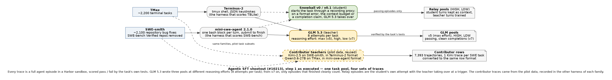
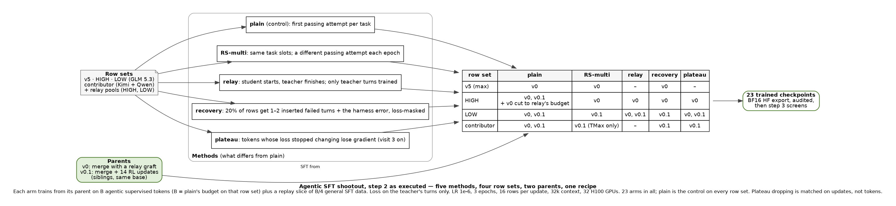
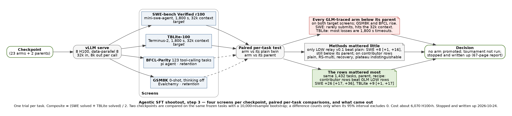

# Agentic SFT shootout on Snowball

This archive holds the final write-up of the experiment, which ran from
2026-10-16 to 2026-10-24. This branch stores only the paper and this notebook.

## Source

The code used for the experiment was written as eight Marin draft PRs. Each PR
head is preserved unchanged on its own branch here; the only added commit on
each removes the inherited `.github/workflows`. Reusable parts are promoted to
Marin in separate, smaller PRs; the rest stays only here.

| Marin PR | contents | archive branch | commit |
|---|---|---|---|
| marin-community/marin#10251 | GLM 5.3 Harbor trace generation driver, relay proxy, trace rebuild, HF publishing | `codex/10213-sft-shootout-pr10251` | [`bf7b59c150`](https://github.com/marin-community/marin-logbooks/tree/bf7b59c150e2973aaa2dfbcec945cbeea2e0d2bc) |
| marin-community/marin#10252 | Snowball v0 LR-sweep data builders | `codex/10213-sft-shootout-pr10252` | [`58daa1cd69`](https://github.com/marin-community/marin-logbooks/tree/58daa1cd699f18f963a563fcdc7a625d9e9a45cb) |
| marin-community/marin#10253 | arm row builder (stacked on #10252) | `codex/10213-sft-shootout-pr10253` | [`d833433929`](https://github.com/marin-community/marin-logbooks/tree/d8334339298bc22c69af2a54cd0259ca7fccaf98) |
| marin-community/marin#10255 | plateau dropping as a train_lm option | `codex/10213-sft-shootout-pr10255` | [`27977c8e49`](https://github.com/marin-community/marin-logbooks/tree/27977c8e498fdc6f598fed78e6ccf3246b6d0fab) |
| marin-community/marin#10258 | task pool builder | `codex/10213-sft-shootout-pr10258` | [`c7484c218b`](https://github.com/marin-community/marin-logbooks/tree/c7484c218b1553bc68cad595df226f908518efe2) |
| marin-community/marin#10324 | fixed-budget agentic LR sweep trainer | `codex/10213-sft-shootout-pr10324` | [`76f095e203`](https://github.com/marin-community/marin-logbooks/tree/76f095e203e7066b0af31a0611fc76bc25b2b0cf) |
| marin-community/marin#10325 | sweep screens and artifact-only recovery | `codex/10213-sft-shootout-pr10325` | [`f9704026d0`](https://github.com/marin-community/marin-logbooks/tree/f9704026d0c2d9772316dc6f40f8dc0b26f472b2) |
| marin-community/marin#10327 | epoch-exact multi-parent arm trainer | `codex/10213-sft-shootout-pr10327` | [`d17e5a7118`](https://github.com/marin-community/marin-logbooks/tree/d17e5a7118fc1db277f5aeb1abefceb5fac8e3a2) |

## Question and decision criteria

- Goal: find which SFT method, if any, improves Snowball v0 and v0.1 on
  SWE-bench Verified and TBLite over plain SFT at equal supervised tokens,
  without losing GSM8K or BFCL-Parity.
- Alternatives: plain SFT, rejection-sampled SFT (RS-multi), relay, recovery
  and plateau dropping.
- Evidence: paired per-task bootstrap intervals on SWE-bench Verified random-100
  and TBLite-100.

## Diagrams

Three Graphviz drawings of the experiment as executed, in `diagrams/`
(`.dot` source and `.png` render). Regenerate with
`dot -Tpng -Gdpi=110 diagrams/<name>.dot -o diagrams/<name>.png`.

Step 1, data: one task pool, four sets of traces.

Step 2, arms: five methods, four row sets, two parents, one recipe (23 arms).

Step 3, screens: four screens per checkpoint, paired per-task comparisons, and
the result.

## Final decision

- Result: no method beat plain SFT by enough to matter. Every arm trained on
  GLM 5.3 traces scored below its parent. On the same 1,432 tasks, the
  contributor traces (Kimi-2.5, Qwen3.6-27B) beat the GLM LOW traces by
  SWE-bench +26 [+17, +36] and TBLite +9 [+1, +17].
- Decision: stop and write up. The cross-format test that would separate the
  teacher from the harness format (about 125 H100-h) was not run.
- Paper: [agentic-sft-shootout.pdf](agentic-sft-shootout.pdf) (67 pages).
- Marin contribution PRs (drafts): marin-community/marin#10255 (plateau
  dropping in `train_lm`), #10887 (recording relay proxy, relay rules, trace
  rebuild, capability-token scrubbing), #10888 (harness-faithful recovery rows).
  The other draft PRs were closed; their code is on the archive branches above.
- Results by round: comments on marin-community/marin#10213.
- Remaining uncertainty: single runs on 100 tasks per screen; teacher and
  harness format are not separated.
- Hypotheses for the GLM-trace loss, ordered by evidence (teacher traces,
  SFT without RL, MoE expert-capacity token drops, eval protocol, parent
  headroom, harness format, training dose): the summary comment on
  marin-community/marin#10213, updated 2026-11-04.
