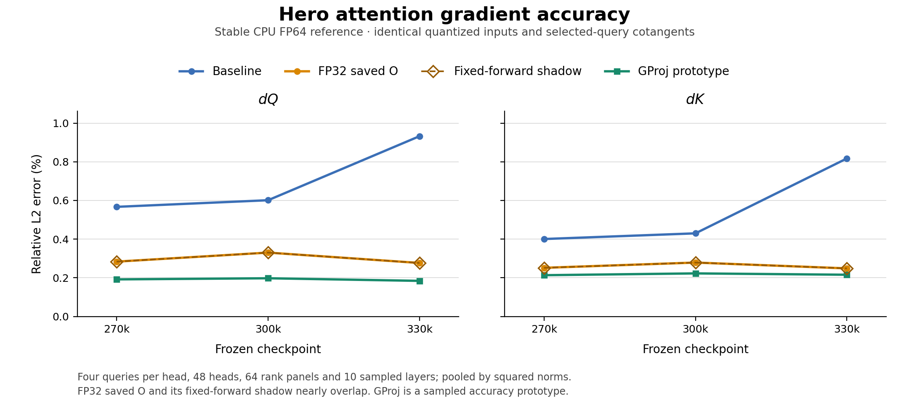
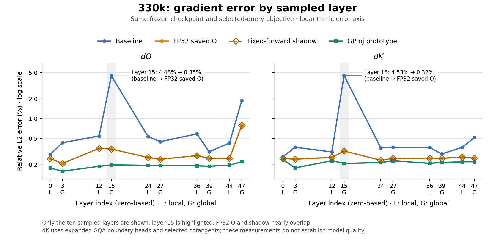

# Hero attention mitigation comparison

Genuine FP32 saved attention output reduces measured fused Q/K gradient error at all three Hero checkpoints. At step 330000, pooled relative L2 error falls from 0.9323%/0.8173% to 0.2767%/0.2487%. Upcasting the already rounded BF16 output retains baseline error. The forward-preserving shadow gives almost identical gradient accuracy at a higher measured attention cost. Training quality has not been tested.

## Method and acceptance

The frozen comparison restores checkpoints 270000, 300000 and 330000 and uses the same fixed training-mixture batch of 256 sequences × 16384 positions at data step 330000. Layers `[0,3,12,15,24,27,36,39,44,47]` cover five local and five global attention layers. Each layer has 64 rank panels, 48 query heads, twelve expanded boundary KV heads, four selected query positions and full keys. Each rank selects local sequence `rank modulo local batch size` from its four-sequence shard. The sequence is split into four equal query-position strata; a seed fixed by layer and rank selects one eligible multi-key query per stratum, reused across checkpoints. Global attention has six logical KV heads duplicated to twelve at the fused boundary; local attention has twelve. K errors are measured on these boundary tensors before combining logical duplicates. The sparse selected-query objective defines both dQ and dK; dK sums these selected cotangents and is not a full training-step parameter gradient. The real downstream dO comes from the frozen model regularized loss, including CE and final-logit z-loss coefficient 1e-4.

Actual fused GPU Q/K gradients are compared with stable CPU FP64 attention derivatives using identical quantized Q/K/V and identical dO. Relative error is `sqrt(sum(error_squared_norm) / sum(reference_squared_norm))`; absolute error is `sqrt(sum(error_squared_norm))`. Panel percentages are not averaged. The published [summary](mitigation-comparison-summary.json.gz), [absolute and relative errors](mitigation-gradient-errors.csv), [scientific configuration](mitigation-comparison-config.json), and [validator](validate_mitigation_comparison.py) preserve the calculation. Detailed panels, resolved requests, executable bytes and operational provenance remain private; no operands or token arrays are published.

Iris coordinator and worker both succeeded. All 1920 rank panels, six variants, 368640 multi-key query/head observations and 1152 dense timing records passed validation. All eleven mandatory original capture, baseline replay, decoder BF16 bit-parity, native operand coverage/mask/finiteness and contraction-bound gates are zero. All numerical values are finite. The ordinary distributed compilation consistency guard remained enabled and passed.

Earlier independent native compilation produced differing GPU instructions despite matching recorded launcher specifications; the compiler root cause remains unresolved. This completed diagnostic uses one genuine compiled executable per agreed compilation request, distributed and verified across processes. Validation checked 34 scope provenances, 12480 request proofs and 153 producer object files totaling 14256600 bytes. Twenty-one cached scopes legitimately requested no new native compilation. This establishes consistency of the executable used here; it does not prove equivalence of the earlier binaries.

## Checkpoint gradient errors

Each cell is pooled relative dQ / dK L2 error in percent. Full precision and absolute norms are in the linked CSV/JSON.

| Method | 270k | 300k | 330k |
| --- | ---: | ---: | ---: |
| Production baseline | 0.5670 / 0.4006 | 0.6012 / 0.4299 | 0.9323 / 0.8173 |
| FP32 saved O | 0.2836 / 0.2516 | 0.3303 / 0.2788 | 0.2767 / 0.2487 |
| Fixed-forward shadow | 0.2836 / 0.2516 | 0.3303 / 0.2788 | 0.2767 / 0.2487 |
| Upcast rounded O control | 0.5670 / 0.4006 | 0.6012 / 0.4299 | 0.9323 / 0.8173 |
| Native instrumented control | 0.5670 / 0.4006 | 0.6012 / 0.4299 | 0.9323 / 0.8173 |
| Sampled GProj prototype | 0.1918 / 0.2135 | 0.1976 / 0.2228 | 0.1841 / 0.2158 |

FP32 saved O retains the genuine pre-BF16 attention output and evaluates the backward normalization term `D = sum(O_fp32 * dO_fp32)`. It does not merely cast rounded BF16 O or change dO storage. Q/K/V, dO and returned gradients are BF16; auxiliary O, LSE and native accumulation are FP32. The baseline forward uses two query stages; the candidate uses one, with the same 128×128 tiles and four KV slots. The production baseline remains unchanged. The fixed-forward shadow returns baseline public O and uses baseline backward LSE; a second forward supplies only the genuine FP32 O used in D. Its other inputs, masks and backward arithmetic are unchanged. The native instrumented control exports actual BF16 probability P and score-gradient G operands plus decoded FP32 Q/K accumulators, while retaining the baseline arithmetic. The sampled GProj prototype measures `lambda = sum(G) / sum(P)` after BF16 casts. Before final gradient scaling/casting it subtracts `lambda * (P @ K)` from the Q accumulator and `P.T @ BF16(lambda * Q)` from the K accumulator, summing grouped query-head contributions. This native-plus-XLA path corrects the row-sum component of consumed score gradients. It has no efficient dense implementation or measured dense production cost.

## Concentrated layer and row outlier

At 330k, global layer 15 contributes 64.59% of baseline Q squared error and 76.07% of K squared error. Its pooled Q/K error is 4.4781%/4.5292%; FP32 saved O reduces this to 0.3465%/0.3233%, and the sampled projection to 0.1991%/0.2098%. The shadow closely matches FP32 saved O. Local/global and every selected-layer aggregate are in the summary.

The previously identified layer-15, query-head-41 observation, labeled outlier A here, is matched by its complete private sequence/query identity in the new baseline. Exact data coordinates remain private; the public summary retains its scalar reference norm and numerical evidence. Its Q vector has 45.8507% relative error and contributes 63.651% of checkpoint Q squared error. Its maximum attention probability is 0.969517, margin 3.45964 and entropy 0.297879 nats, with 994 valid keys. Thus the dominant outlier occurs well below the approximately 16.64 FP32 margin threshold.

The repaired variants omit outlier A from its own rank panel’s audited top-eight absolute-Q-error vectors across selected queries and heads. Each complete list is ordered by absolute vector error; its smallest retained error is therefore an upper bound for any omitted vector. This supplies an upper bound, not its exact repaired error: FP32 saved O and shadow have absolute error at most 4.67144e-11, or relative error at most 0.366867%; projection has at most 3.13986e-11, or 0.246586%. The same-run reference Q norm is 1.27333e-8. The rounded-O and instrumented controls retain the baseline row error. Historical and new reference norms differ, so matching the old row identity does not establish identical historical gradient tensors. All repair comparisons above are within the new run.

The earlier narrow-head diagnostic reported about 3.11%/2.50% pooled Q/K error at 330k. The present all-head baseline has a different denominator and a changed reference gradient norm for the matched historical row. Its lower baseline percentage must not be credited to mitigation.

## Saturation, distributions and forward behavior

| Checkpoint | Multi-key rows | Margin > 24 ln(2) | Mean entropy, nats | Maximum margin |
| --- | ---: | ---: | ---: | ---: |
| 270000 | 122880 | 0 | 3.879437 | 13.778038 |
| 300000 | 122880 | 0 | 3.871731 | 15.289693 |
| 330000 | 122880 | 1 | 3.915562 | 17.452990 |

Margin is the largest minus second-largest allowed scaled Q·K score, computed in FP64; entropy, pmax and tail mass use the same stable FP64 masked probability distribution. The 24 ln(2) threshold is a two-key FP32 rounding-risk marker. With multiple keys, total tail mass also matters, so crossing it does not prove rounding saturation. There are no masked, single-key or fallback observations. Only 1/368640 sampled query/head rows (0.0002713%) exceeds 24 ln(2). This is below 0.1% on this sampled attention-margin metric. It is not a production token prevalence estimate, a count of collapsed gradients, or directly comparable with output-CE collapse. Observations share sequences, heads and checkpoints and are correlated. No variant loses an entire Q or K vector with nonzero FP64 reference: each checkpoint has 122880 nonzero reference Q vectors and 51183828 nonzero reference K vectors. Some individual components become zero. Margin histograms, entropy/tail sums and stored-output score-gradient imbalance controls are retained in the summary. Stored-output reconstructions support attribution but do not directly observe the internal fused score gradients or establish a model-quality effect.

The strict original captured-tail and baseline replay parity gates pass. The optimized FP32-saved-O forward changes some public BF16 components: 40051709, 42216155 and 42571713 out of 64424509440 per checkpoint, respectively (0.06217%, 0.06553%, 0.06608%). Maximum LSE differences are 1.6880e-4, 1.6975e-4 and 1.7071e-4. These are full-sequence output-component rates, not token collapse rates. The shadow returns baseline public O/LSE by construction. All variants use the same frozen dO for the gradient comparison; this experiment does not propagate each changed forward through a new training trajectory.

## Dense attention cost

At 330k, dense forward-plus-backward attention cases use layers 0 (local) and 15 (global), lengths 256/2048/16384, 64 ranks, two warmups and eight timed iterations per case. Ratios below are medians of within-rank paired ratios; milliseconds are medians of rank times. They describe these attention cases, not end-to-end training throughput. Full timings and slowest-rank times are in [the timing CSV](mitigation-dense-timings.csv).

| Layer / length | Baseline ms | FP32 O ms / paired ratio | Shadow ms / paired ratio |
| --- | ---: | ---: | ---: |
| 0 / 256 | 0.505 | 0.477 / 0.950× | 0.544 / 1.090× |
| 0 / 2048 | 1.528 | 1.584 / 1.038× | 1.963 / 1.279× |
| 0 / 16384 | 11.269 | 12.254 / 1.085× | 15.582 / 1.379× |
| 15 / 256 | 0.481 | 0.456 / 0.952× | 0.525 / 1.100× |
| 15 / 2048 | 1.501 | 1.561 / 1.044× | 1.929 / 1.285× |
| 15 / 16384 | 21.856 | 23.197 / 1.078× | 29.019 / 1.336× |

At 16k, FP32 saved O costs about 8% in these attention cases. The forward-preserving shadow costs about 34–38%. Sparse projection timing cannot establish dense projection performance; no such extrapolation is made.

## Decision and remaining work

Preserve genuine FP32 auxiliary O as the leading numerical mitigation. Upcasting rounded O provides no measured repair. Keep the shadow as a forward-preserving accuracy control, with its measured extra-forward cost. Projection gives lower sampled error but remains an accuracy prototype. The frozen diagnostic is complete; live Hero training is unchanged.

A production contribution should provide an efficient FP32 auxiliary-output path while explicitly choosing its public-forward parity requirement. Maintainers must then decide whether to authorize a separately bounded paired training continuation to measure loss, stability and model quality, plus full-step memory and throughput. No training continuation or production change is launched by this report. That next phase belongs to a separately scoped implementation/training task; this investigation ends with the validated frozen comparison.

## Reproduce the reporting and validation

The source snapshot used for the completed comparison is [a125b7d](https://github.com/marin-community/marin-logbooks/commit/a125b7d91c09028f907603f9fa499ae9bc709cf0). The scientific configuration contains the checkpoint, sampling, arithmetic and compiler-consensus policies. Exact restore locations and the resolved launch record are access-controlled.

Run `uv run --no-sync python logbooks/12-hero-attention-softmax/plot_mitigation_comparison.py` from this research tree to regenerate the figures from the sanitized summary. `validate_mitigation_comparison.py --help` documents local inputs for independent arithmetic and executable-proof validation of privately downloaded panels. It checks stored counts/norms, events and provenance; raw operands are unavailable, so it cannot recompute FP64 derivatives from scratch. Job terminal success is checked separately. Its full output includes private provenance and must remain private.
