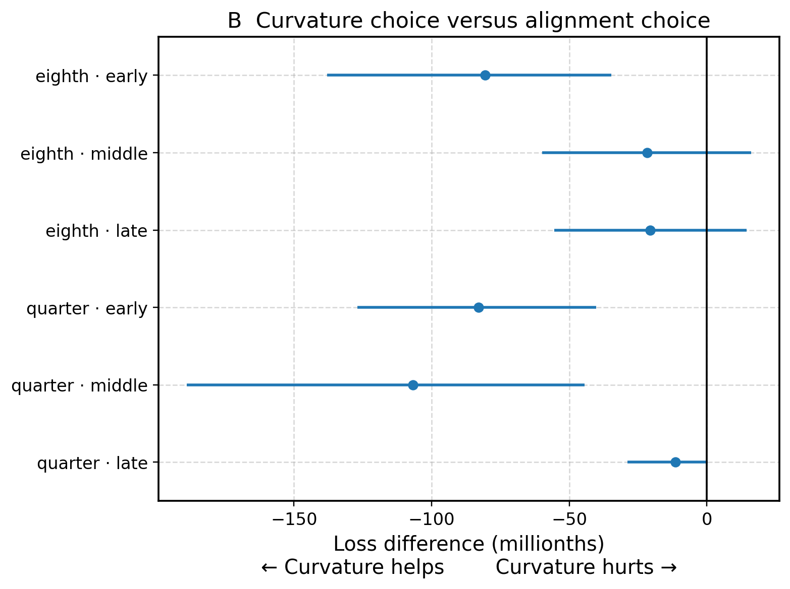
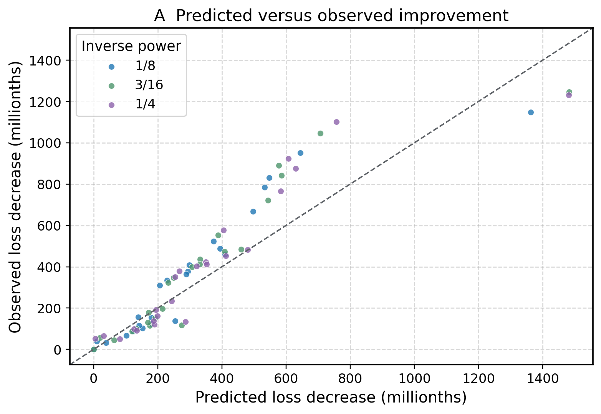
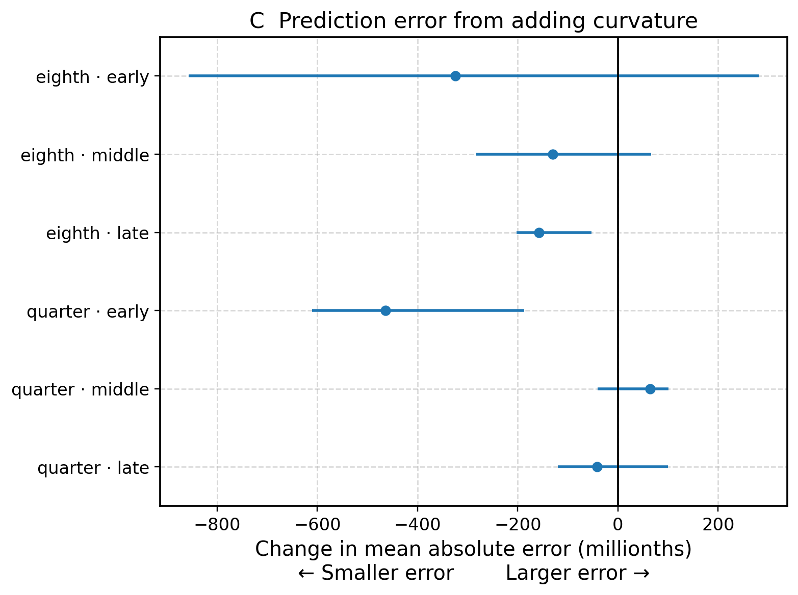
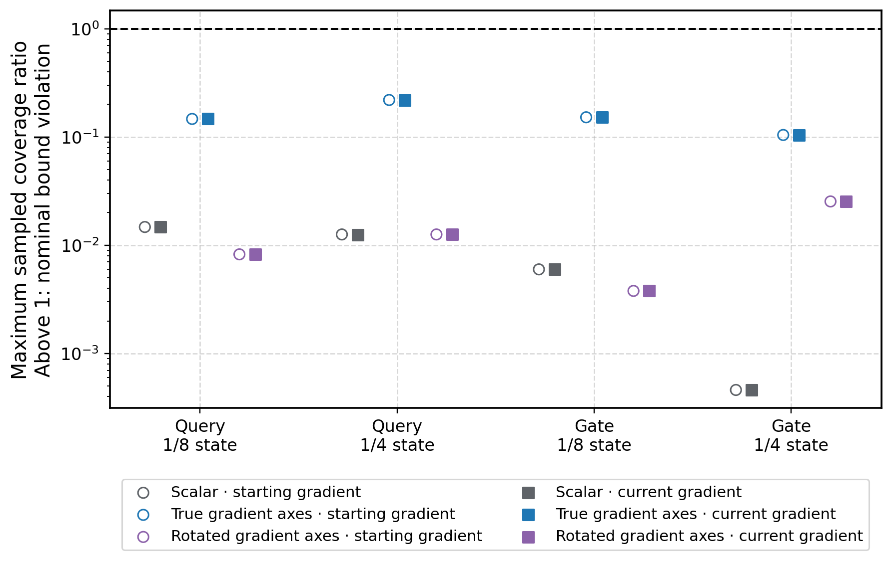
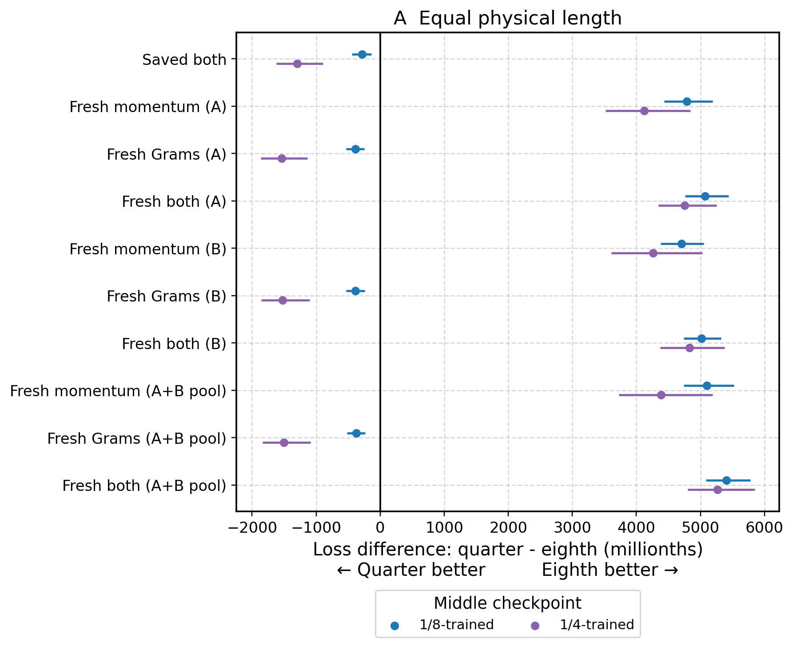
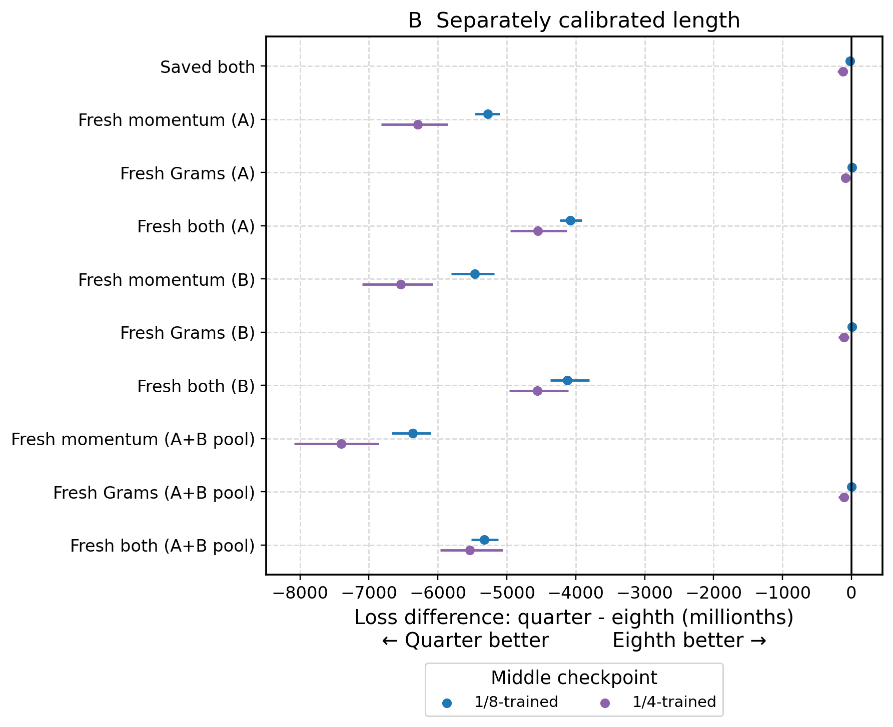

# Can curvature help choose an optimizer update?

**Checkpoint report complete · 14 November 2026. Matched training replay and independent-seed replication remain untested.**

This report follows the experiment request dated 13 November 2026. It extends the earlier gradient-and-curvature study with new text panels and new tests. Results from the earlier study are not counted as results of these new tests.

## What did the checkpoint experiments show?

**All four checkpoint experiments are complete. Their conclusions are local to the measured checkpoints and text panels.**

- **Choosing the power:** curvature-based selection beat alignment-based selection in three of six comparisons after step-length calibration. It did not establish an advantage over fixed power 1/4.
- **Bounding curvature:** the true gradient axes gave a modestly tighter attention envelope and a substantially tighter feed-forward-layer envelope after a post-hoc comparison equalized their remaining slack. All sampled path checks passed. These are local curvature bounds, not improvements in model loss.
- **Replacing optimizer history:** fresh momentum reversed the power ranking at equal length in both checkpoints. Separately calibrated lengths favored 1/4 in those conditions, but every quarter-power choice reached the maximum tested length.
- **Muon feedback:** all three checkpoints passed numerical checks. Every original-grid choice was zero. A separately registered smaller grid selected nonzero steps, but feedback methods still had less favorable mean loss changes than plain Muon.

## 1. Why do these experiments matter?

**An optimizer can appear better for several different reasons. These tests try to separate those reasons.**

A language model has adjustable numbers called **parameters**. Its **loss** measures prediction error; lower is better. An optimizer proposes how to change the parameters.

A proposed change has both a **direction** and a **length**. Changing either can change the loss. The optimizer also remembers previous gradients, so its history can change its next proposal.

The earlier study found that step length can reverse the local ranking of powers 1/8 and 1/4. That motivates a harder question: can we predict a useful power before measuring its outcome on separate text?

The **gradient** describes the initial change in loss. **Curvature** describes how that change itself changes as we move. The Hessian is the mathematical operator that measures local curvature.

Good initial alignment means that a direction looks promising at the starting point. Curvature may tell us whether that promise persists for a finite step.

## 2. What is a checkpoint experiment?

**We propose changes from a saved model state and measure their immediate effects. We are not yet comparing complete new training runs.**

A **checkpoint** stores model parameters and optimizer state, including accumulated gradient statistics and counters. A **native update** is the optimizer’s complete proposed displacement before this experiment normalizes or rescales it. Each candidate starts from the same saved state and receives the same new update text.

For a fair comparison, candidate powers incorporate the new gradient once into their accumulated statistics. Those resulting statistics must match across the powers.

The model parameters used to construct the candidates remain fixed. Evaluating a proposed move does not start an ongoing training trajectory.

These experiments can identify a useful local mechanism. They cannot, by themselves, establish which optimizer wins after a full training run or across independent training seeds.

## 3. Why are there three separate text sets?

**The text that chooses an action must be separate from the text that judges it.**

1. **Update text** constructs the proposed optimizer direction.
2. **Calibration text** measures alignment and curvature and chooses a step length.
3. **Evaluation text** measures how the already chosen action performs.

The calibration panel contains 64 sequences. The evaluation panel contains 128 sequences. Each sequence contains 4,096 tokens. Candidate methods share the same panels so their differences are paired comparisons.

All choices are saved before any evaluation-panel loss is read. This prevents choosing a method because it happened to look good on the text used to report its outcome.

This is the loss-comparison workflow for Experiments 1, 3 and 4. For Experiment 2, the locked objects are envelope coefficients, and new directions test them.

Whole-sequence hashes reject identical sequences across the panels and exclude the earlier study's recorded sequences. This does not prove that no documents or token spans overlap. It also does not establish that the text was absent from pretraining.

Cross entropy penalizes poor next-token predictions. Z-loss penalizes very large aggregate prediction scores. The reference loss adds z-loss with coefficient 0.0000001 to cross entropy. Weight decay is excluded from that measured loss. The production update still retains its original decay and nonmatrix parameter updates.

## 4. Experiment 1: can curvature improve the choice of power?

**The test compares choices made using alignment alone with choices made using alignment plus curvature.**

The experiment used six 447-million-parameter checkpoints: early, middle and late states from a trajectory trained with power 1/8 and a trajectory trained with power 1/4. Each checkpoint receives eight fresh update batches, also called update draws. Each batch produces three candidate powers: 1/8, 3/16 and 1/4. Each update batch contains eight sequences, matching these 447M training configurations. That gives 144 candidate directions.

The left and right Gram matrices accumulate products of earlier gradients. The power exponent controls their inverse powers. Each update applies these inverse powers on both sides of momentum, applies the production five-step Muon transformation, then applies the same inverse powers again. Changing the exponent can alter both direction and size.

Each complete candidate update is normalized by one scalar. This keeps its orientation while making its length one. A physical step length then specifies the Euclidean norm of the full parameter displacement.

We write a move as “new parameters = old parameters − s × d.” Thus positive alignment with d predicts an initial loss decrease. For a unit direction d and length s, the quadratic model predicts:

**predicted decrease = s × alignment − ½ × s² × directional curvature.**

Here, alignment is the inner product of the reference gradient and d. Directional curvature is the inner product of d and the Hessian-vector product Hd. Hd describes how the gradient initially changes when parameters move along d. Curvature can be negative.

The model chooses its best action within a common bounded range, including the option to take no step. Every comparator receives the same opportunity to calibrate its length. The tested choices include fixed 1/8, fixed 1/4, the best initial alignment and the best quadratic prediction.

A useful result would be a lower paired evaluation loss for the curvature-based choice than for the alignment-based choice. Good agreement between predicted and measured loss changes is a separate question; a predictor can be accurate without changing the preferred action.

## Power result: gains over alignment, no demonstrated gain over fixed 1/4

**Curvature selection improves on alignment selection in three of six checkpoint comparisons. It does not establish an advantage over always choosing power 1/4.**

All six checkpoints completed: 144 candidate directions in total. They come from two training trajectories, using powers 1/8 and 1/4. The early, middle and late stages of one trajectory are correlated. This is not a six-seed replication.

For each candidate power, the curvature rule maximizes its quadratic prediction over the bounded length interval. It then selects the power with the largest predicted improvement. The selected power receives a separately grid-calibrated length. All powers use the same calibration text; “separately” refers to their length choices.

Every fixed-power comparator receives the same per-draw grid calibration as the selected powers. The common grid is {0, 0.1, 0.3, 0.6, 1, 2, 4} × r, followed by midpoint refinement around the best interior grid point. The quadratic model optimizes over [0, 4r]. Here r is the checkpoint’s median native eighth-power norm.

The alignment rule chooses the power with the largest inner product ⟨g,d⟩, using the calibration gradient g and unit-normalized complete update d.

The table compares held-out losses after each selected power calibrates its own length. Negative differences favor curvature selection. Values are **millionths of loss**.

| Training power · checkpoint | Curvature minus alignment | Conditional 95% interval |
| --- | ---: | ---: |
| 1/8 · early | -80.59 | [-137.97, -34.66] |
| 1/8 · middle | -21.77 | [-59.85, +16.07] |
| 1/8 · late | -20.59 | [-55.48, +14.52] |
| 1/4 · early | -82.99 | [-127.06, -40.14] |
| 1/4 · middle | -106.87 | [-188.93, -44.43] |
| 1/4 · late | -11.42 | [-28.75, +0.34] |

The intervals lie entirely below zero at the two early checkpoints and the quarter-trained middle checkpoint. The other three intervals include zero. Each interval resamples eight update draws and 16 evaluation-text groups while retaining pairing. Checkpoint, calibration panel and locked selection rules stay fixed. The intervals do not adjust for multiple comparisons.

**The fixed-quarter comparison limits the adaptive-selection claim.** Curvature chose 1/4 for every draw at five checkpoints, so it exactly matched the fixed-quarter comparator there.

At the quarter-trained late checkpoint, curvature chose 1/8 on five draws and 1/4 on three. Its mean held-out loss was 13.38 millionths higher than fixed quarter, with interval [−9.14, +37.85]. This comparison is uncertain and provides no evidence of a benefit from adapting the power. Across all six checkpoints, direct minimization of calibration loss chose the same powers as the curvature rule.

Curvature also beat fixed 1/8 with intervals below zero at the same three checkpoints. The other three fixed-eighth comparisons were uncertain. All fixed-power and native-length comparisons are included in the linked analysis.

At equal physical length r, the same locked choices gave more negative curvature-minus-alignment mean differences. Values remain in millionths of loss.

| Training power · checkpoint | Curvature minus alignment | Conditional 95% interval |
| --- | ---: | ---: |
| 1/8 · early | -387.94 | [-623.79, -176.09] |
| 1/8 · middle | -223.62 | [-337.69, -115.83] |
| 1/8 · late | -96.85 | [-164.24, -27.72] |
| 1/4 · early | -602.31 | [-826.68, -404.04] |
| 1/4 · middle | -880.54 | [-1312.40, -443.65] |
| 1/4 · late | -97.46 | [-247.40, +4.74] |

Five intervals were below zero; the quarter-trained late interval included zero. Here r is the median native eighth-power norm at each checkpoint. The difference becomes smaller when every power chooses its own useful length. The length rule therefore matters when interpreting the selection benefit.

Each dot represents one checkpoint, one update draw and one candidate power. The diagonal marks equal predicted and observed improvement. A dot above it means the measured held-out improvement exceeded the calibration-based quadratic prediction. This comparison combines quadratic-model error and differences between calibration and evaluation text. It does not isolate either source.

As an additional numerical check, differentiating with respect to the exponent tests how the update responds to a small change in power. The discrete candidate comparisons above use their measured directions directly.

All 48 derivatives of the normalized complete update with respect to the power exponent, evaluated at 3/16, passed two-scale finite differences in the differentiable FP32 map. FP32 means 32-bit floating-point arithmetic; this derivative check uses the highest matrix-multiplication precision. It does not establish a derivative of the native low-precision computation. The loss comparisons above evaluate the native candidate directions. Reference Hessian-vector and symmetry checks also passed.

On the first draw of each checkpoint, direct differentiation of endpoint loss with respect to the power exponent agreed with the endpoint-gradient chain rule. The calibrated nonzero step length was held fixed. The largest relative discrepancy was 0.0713%.

Five candidates chose zero calibrated length: two at the eighth-trained early checkpoint and three at the quarter-trained middle checkpoint. The remaining 139 chose interior lengths; none chose the maximum radius. Zero won these candidates' measured calibration comparisons.

Earlier pilot attempts ran out of accelerator memory. The corrected implementation reduces temporary Hessian-vector buffer lifetimes. The eighth-trained middle and quarter-trained early jobs each needed one scheduler retry. Each retry restored the training checkpoint and restarted probe measurements. Partial attempts remain in the archive. Isolated native-update timing is unavailable in the eighth-trained middle pilot; the other five runs record it separately.

[Validated six-checkpoint analysis](../geometry-power-analysis.json) · [Numerical checks for all six checkpoints](../geometry-power-all-numerical-validation.json)

## Prediction accuracy at the same calibrated steps

**Adding curvature lowered the measured average prediction error at five checkpoints. Two conditional intervals supported a reduction; the other four were uncertain.**

This supplementary analysis was performed after the checkpoint measurements finished. It uses the already locked directions and grid-calibrated lengths. It does not change power choices or step lengths.

Both g and H are measured on the calibration text panel. The linear model predicts loss change using only the initial slope: −s⟨g,d⟩. The quadratic model adds ½s²⟨d,Hd⟩. Both predict the same move on the separate evaluation panel.

For each candidate, take the absolute difference between its prediction and the measured mean loss change on the 128 evaluation sequences. Average these errors over the 24 candidates at that checkpoint. Smaller values mean more accurate predictions. Values below are **millionths of loss**.

| Training power · checkpoint | Linear model error | Quadratic model error |
| --- | ---: | ---: |
| 1/8 · early | 511.28 | 186.36 |
| 1/8 · middle | 202.44 | 72.63 |
| 1/8 · late | 204.60 | 47.23 |
| 1/4 · early | 523.09 | 58.65 |
| 1/4 · middle | 33.85 | 98.63 |
| 1/4 · late | 74.26 | 32.94 |

The quadratic mean error was higher at the quarter-trained middle checkpoint. This is the same checkpoint where curvature-based power selection improved on alignment-based selection. Predicting the size of an improvement and selecting a lower-loss action are distinct tests.

Negative values favor the quadratic model. The conditional 95% intervals resample update draws and evaluation-text groups, keeping all three powers together within each draw. Each resampled text panel is averaged before taking absolute errors. Predictions and calibration remain fixed.

Only the eighth-trained late and quarter-trained early intervals were wholly below zero. These intervals are conditional and unadjusted for multiple comparisons. Differences between calibration and evaluation text contribute to prediction error, alongside the approximation error of the local model.

[Prediction-error values and conditional intervals](../geometry-power-analysis.json)

## 5. Experiment 2: does matrix orientation improve a curvature bound?

**The test asks whether the directions inside a gradient matrix contain useful information beyond its overall size.**

A proposed **envelope** limits the magnitude of curvature. A scalar envelope treats every direction equally. A matrix envelope can allow different amounts of curvature along different directions.

The experiment uses both middle checkpoints and two parameter blocks: the first attention-query matrix and the first multilayer-perceptron (MLP) gate matrix. Other model parameters remain fixed when measuring each block Hessian.

Each block has eight calibration directions and eight test directions. They include random directions and directions derived from the gradient's singular vectors. Optimizer directions are reserved for testing.

Three fitted controls are compared: a scalar envelope, an envelope using the gradient's actual matrix axes, and one using randomly rotated axes with the same singular values. Coefficients are shared across the two checkpoints for each block type.

Here G is the unclipped gradient of the reference loss with respect to the chosen matrix block. For a matrix direction E, the oriented envelope applies **L₀E + cᴸGGᵀE + cᴿEGᵀG**. The products GGᵀ and GᵀG describe the gradient's row and column axes. The fitted weights satisfy L₀ > 0 and cᴸ, cᴿ ≥ 0. The rotated control rotates G's axes while preserving G's singular values; it then fits its own nonnegative coefficients.

Writing the envelope operator as B, its allowed curvature along E is ⟨E,B(E)⟩. The tested bound is |⟨E,H(E)⟩| ≤ ⟨E,B(E)⟩. The inner product here sums products of corresponding matrix entries.

Calibration responses choose the coefficients. Those coefficients are then frozen. Test responses assess coverage and tightness.

The coverage score checks every linear combination of the eight test directions. It reports the largest magnitude of local curvature relative to the envelope allowed in that combination. A value above one, beyond numerical uncertainty, means at least one combination violates the fitted bound.

The calculation uses the full Hessian matrix restricted to those eight directions, including its off-diagonal entries. Looking only at eight separate directional curvatures would miss some violating combinations.

Coverage and tightness are different. A large envelope may cover everything but give little useful information. Tightness compares how much curvature the envelope allows, using average envelope size across the tested directions; smaller is tighter at comparable coverage.

A useful result would be a tighter envelope from the actual matrix axes at comparable coverage. Better calibration fit alone is insufficient. A promising fit also receives midpoint and endpoint checks along fixed block-update paths.

**Scope:** these are sampled block subspaces and local paths. Passing them would not prove a uniform bound on the full model Hessian.

## Matrix-envelope result: orientation helps, with different effect sizes

**All three frozen controls covered the tested subspaces. Matching their remaining slack shows a small attention advantage and a larger MLP advantage for the true gradient axes.**

The test has 12 combinations: two middle checkpoints × two matrix blocks × three controls. Each score checks the full span of eight reserved test directions. All scores were below one; no nominal violation was observed. The actual-gradient envelope's scores ranged from 0.104 to 0.218.

The dashed line marks one. Above it, a bound is violated in at least one linear combination of test directions. The vertical scale is logarithmic. Very small values can mean that a bound is overly large, so coverage alone does not identify the most useful bound.

Before any test-based rescaling, the true-gradient envelope's mean size was about 6.37% of the scalar control for attention and 0.783% for MLP. These are ratios of average trace per test direction, averaged equally over the two checkpoints.

Those large differences partly reflect different amounts of unused slack. To compare that slack explicitly, a **post-hoc diagnostic** multiplies each block/control's envelope by its largest observed test score across the two checkpoints. This makes its worst score exactly one. It can shrink a conservative bound as well as enlarge a violated one.

A ratio below one means a smaller envelope than the scalar control after this matching. The true-gradient ratios were 0.942 for attention and 0.199 for MLP: about 6% and 80% smaller. The rotated-axis ratios were 1.086 and 9.754. Each checkpoint/block uses one prespecified random rotation. These results do not measure variation across many rotations.

**This rescaling uses test results.** It is a description of relative shape and slack, not another independently tested bound. The path experiments retain the original frozen coefficients. No claim of uniform full-network coverage follows from these sampled block tests.

[Complete test analysis](../geometry-envelope-test-analysis.json) · [Frozen coefficient plan](../geometry-envelope-plan.json)

## Path result: the original bounds cover the sampled moves

**Both checkpoint path tests completed. No fitted control violated its bound at the sampled points.**

Each of the two checkpoints contributes an attention-query block and an MLP-gate block. For each block, the experiment tests the starting parameters, then the midpoint and endpoint of both power-1/8 and power-1/4 block moves. Both moves have the same physical length: the native eighth-power block norm from the prespecified first update draw. Only that block moves; other parameters stay fixed.

This gives five points per block, or 20 block/parameter points overall.

The four fixed anchors are an orthonormal basis built from the two optimizer directions and the fifth and sixth singular-vector matrix directions of the starting gradient. They were fixed before measuring path responses.

Starting responses are reused from the test screen; 64 additional Hessian-vector products measure the nonzero points. Finite differences check two of the four anchors at each new point. Every check passed two consecutive perturbation scales below 2%, and the largest symmetry discrepancy was about 0.00000046.

All path gradients, Hessians and loss remainders use the same 64-sequence calibration text panel. The separate test screen holds out directions, not text.

The coefficients remain exactly those fitted before the test screens. One version of each envelope uses the gradient at the starting checkpoint throughout the path. The other recomputes the gradient at each sampled point, using the same coefficients.

Each marker is the largest coverage ratio among the five sampled points in that checkpoint/block pair. Open circles use the starting gradient; filled squares use the current gradient. Colors distinguish the scalar, true-axis and rotated-axis controls. The dashed line marks the violation threshold of one. Both versions retain the original fitted coefficients, without the post-hoc rescaling used in the earlier tightness diagnostic. The current-gradient version recomputes the envelope matrix; its coefficients remain fixed.

The largest ratio was about **0.220**, from the true-axis attention envelope at the quarter-trained middle checkpoint. Updating the gradient reference did not change the coverage conclusion in these tests. Smaller ratios can reflect excess envelope size; they do not by themselves make a control more informative.

The saved loss remainder subtracts the initial linear prediction from the measured reference-panel loss change. Remainders ranged from about −0.11 to +0.63 millionths. Some are on the scale of FP32 loss rounding, so their signs should not be treated as reliable optimizer rankings. These are block moves on reference text, not the full-model held-out comparison used in Experiments 1 and 4.

Coverage was checked only at these points and within the four-anchor subspaces. The experiment does not establish coverage between points or across the full model.

[Validated path analysis](../geometry-envelope-path-analysis.json)

## 6. Experiment 3: which part of optimizer history matters?

**The test separates remembered gradient directions from remembered Gram matrices.**

Momentum averages earlier gradients. Gram matrices average matrix products of those gradients. They are different forms of memory.

At each middle checkpoint, the experiment compared four combinations:

- Saved momentum + saved Gram matrices.
- Fresh momentum + saved Gram matrices.
- Saved momentum + fresh Gram matrices.
- Fresh momentum + fresh Gram matrices.

All other optimizer state stays fixed. The same new update batch is incorporated once in every condition.

Two independent histories, each containing 512 batches of eight sequences at fixed model weights, test how much the result depends on the sampled history. The batch size matches the saved-state training configuration; this test does not change it. The fresh raw momentum and Gram buffers start at zero. Their original averaging factors are 0.95 and 0.99. After 512 batches, the remaining weight on initialization is negligible for momentum and about 0.58% for the Grams.

We also average the two raw histories before normalizing the Gram matrices by their traces (sums of diagonal entries), or adding the small diagonal stabilizer called a ridge. This checks sensitivity to the sampled history without changing the gradient batch size.

Both middle checkpoints completed all 160 candidates: ten history conditions × eight update draws × two powers. The all-saved condition is shared. Each of the three history sources (A, B and their raw pool) supplies the other three combinations. The two checkpoints therefore contribute 320 candidates.

The comparison uses the same update, calibration and evaluation panels as Experiment 1. Every history sequence is distinct from those panels by complete-sequence hash. All 32 all-saved candidates exactly reproduce Experiment 1's calibration and held-out measurements. This checks the common baseline; it does not make these repetitions independent evidence.

Reference Hessian-vector checks passed the unchanged 2% threshold at two final perturbation scales. Symmetry discrepancies were below 7 × 10⁻¹⁰. One eighth-trained attempt was preempted. Its replacement restored the training checkpoint and rebuilt both histories with identical record and raw-array hashes, then restarted the probe measurements.

[History data and restart audit](../geometry-history-data-validation.json) · [Baseline and numerical checks](../geometry-history-baseline-validation.json)

## History result: fresh momentum reverses the equal-length ranking

**At the same physical length, replacing momentum makes 1/8 outperform 1/4 at both checkpoints. Replacing only Gram statistics preserves the original ranking.**

Equal length means the same scalar r for every condition and power at a checkpoint. It is the median native eighth-power norm with saved history: about 1.309 at the eighth-trained checkpoint and 1.317 at the quarter-trained checkpoint.

The table shows quarter-power loss minus eighth-power loss, in **millionths of loss**. Negative favors 1/4; positive favors 1/8. Fresh entries use the raw pool of histories A and B. The figure also shows each separate history.

| History used | 1/8-trained checkpoint | 1/4-trained checkpoint |
| --- | ---: | ---: |
| Saved momentum and Grams | -282.57 | -1,291.92 |
| Fresh momentum, saved Grams | +5,103.52 | +4,388.04 |
| Saved momentum, fresh Grams | -373.16 | -1,501.26 |
| Fresh momentum and Grams | +5,406.77 | +5,268.34 |

Each point is an average over eight update draws. Lines are paired conditional 95% intervals. The large momentum-related reversals appear in A, B and their pool, with all corresponding intervals wholly above zero. For example, the pooled fresh-momentum, saved-Gram intervals are [+4,742.21, +5,522.16] and [+3,724.62, +5,188.66] millionths at the eighth-trained and quarter-trained checkpoints.

These are rankings between the two powers within a history condition. A change in that gap alone does not say whether either power improved relative to its own saved-history update.

## History result: length calibration changes that conclusion

**When each power calibrates its own length, fresh-momentum conditions favor 1/4 at both checkpoints. Every fresh-momentum quarter-power choice reaches the maximum allowed length.**

The grid and refinement rule match Experiment 1. Every condition uses the same maximum length 4r. These are the resulting mean quarter-minus-eighth differences, again in **millionths of loss**.

| History used | 1/8-trained checkpoint | 1/4-trained checkpoint |
| --- | ---: | ---: |
| Saved momentum and Grams | -23.84 | -122.21 |
| Fresh momentum, saved Grams | -6,365.99 | -7,401.66 |
| Saved momentum, fresh Grams | +0.94 | -111.06 |
| Fresh momentum and Grams | -5,324.90 | -5,535.53 |

All fresh-momentum intervals lie below zero, including both separate histories and their pool. For pooled fresh momentum with saved Grams, the intervals are [−6,665.96, −6,104.23] and [−8,085.82, −6,856.40] millionths. At the eighth-trained checkpoint, replacing only Grams produces small positive mean gaps whose intervals include zero. That small sign change does not establish a reversal.

**The search boundary matters.** There are 96 maximum-radius choices across the two checkpoints: all eight draws, for quarter power, in each of the six fresh-momentum conditions per checkpoint. Their length is 4r. The eighth-power choices in those comparisons are shorter. Eight other candidates choose zero, all at the quarter-trained checkpoint with saved momentum. The remaining 216 choices are interior.

The measured comparisons are valid within the prespecified search range. They do not locate the best possible step beyond 4r. Extending that range after inspecting these outcomes would be a new experiment.

## What the two fresh histories can tell us

**Both independent histories reproduce the main momentum-related reversal. They do not identify its cause as training-history lag.**

A and B use independent batches to estimate moments at the same fixed parameters. Their exact loss gaps differ. Pooling their raw buffers before the nonlinear optimizer map also changes the gap; the pooled result need not lie halfway between the two separate results.

For fresh-momentum conditions, pooling increases quarter power's calibrated advantage over eighth power compared with either separate history. Across the two checkpoints and the fresh-momentum/saved-Gram and fresh-both conditions, those changes range from about 862 to 1,250 millionths, with conditional intervals below zero. This describes sensitivity to the sampled history. Two histories do not establish convergence to an exact population moment.

The bootstrap resamples update draws and evaluation groups. It holds A, B, their pool and calibration choices fixed. Its intervals therefore omit uncertainty from collecting entirely new histories, as well as independent training-seed variation.

The observed ranking changes trigger the request's matched-replay follow-up. It would construct moments from moving training parameters and from the final frozen parameters using identical minibatches, temporal weights and initial-history contributions. Without that comparison, saved-versus-fresh differences cannot isolate the effect of parameter movement during training. The matched replay has not run; this report returns the checkpoint evidence first.

[Complete history analysis, replica contrasts and boundary counts](../geometry-history-analysis.json)

## 7. Experiment 4: why might inexpensive Muon feedback help?

**The test separates a different direction from a larger update and from numerical approximation effects.**

Muon transforms its momentum matrix using a five-step map called F5. This approximately orthogonalizes the matrix by moving its singular values toward a common scale; it is a finite approximation to the polar-factor transformation. A blend control mixes momentum with the new gradient before applying that map. The Hesscorr control uses a numerical approximation to a curvature correction for the momentum-matrix transformation. The loss Hessian measured by this experiment is a separate quantity.

The tested candidates are plain Muon, blends 0.02 and 0.05, a five-step derivative control with weight 0.05, and production Hesscorr with weights 0.05 and 0.3. They start from identical post-gradient momentum and reuse each computed direction across all tested lengths.

Adam updates parameter groups outside Muon’s selected matrices, including embeddings and the output head. The complete update contains both groups, so their learning-rate ratio affects its direction.

The three available 300-million-parameter checkpoints are at the end of their schedules. Their native next scheduled learning rate is zero. The approved comparison therefore uses a common **reference probe learning rate of 0.012**, with **Adam learning rate 0.0036**. These scales do not represent a resumed native training step.

FP32 means 32-bit floating-point numbers. On a TPU, matrix-multiplication precision also needs an explicit setting. The derivative control uses the same five-step polynomial with the highest FP32 multiplication precision.

First, momentum incorporates the new gradient. The derivative then asks how F5 changes when that post-gradient momentum moves toward the new gradient: the input direction is “new gradient minus post-gradient momentum.” We add 0.05 times this derivative to the native base direction, then apply the original shape and learning-rate scaling.

The other native candidates retain their pinned implementation. A separate measurement records how much the native and higher-precision base maps differ. Passing the derivative check does not assert that these two maps are numerically identical.

The table label **F5 tangent 0.05** names this five-step derivative control.

The derivative must agree with central finite differences to within 2% at two consecutive perturbation scales. Correction norms, clipping factors, zero fallbacks and equation residuals are also recorded.

At each checkpoint, six methods × four update draws give **24 candidate directions**. The shared reference norm r is the median of the four plain-Muon update norms, computed using the reference learning rates above. It is one number per checkpoint, shared by all candidates.

The original grid tests lengths **0, 0.1r, 0.3r, 0.6r, r, 2r and 4r**. It selects the lowest measured calibration loss and refines around an interior winner. A separate quadratic rule maximizes predicted improvement continuously over **0 ≤ s ≤ 4r**. Both rules may select zero.

The original FineWeb training subcache was missing. Measurement uses an explicitly identified replacement from a pinned public revision. All 79 files passed checksum verification, and the cloud worker reproduced the exact 704-sequence panel manifest checked locally: 64 calibration sequences, 128 evaluation sequences and four native update batches of 128 sequences each. These 512 update *sequences* are separate from Experiment 3’s completed 512-*batch* histories. This does not prove byte identity with the missing subcache.

## Numerical check: higher precision restored derivative agreement

**The revised Muon derivative passed. This is a measurement-quality result, not evidence that Muon feedback improves loss.**

Read the orange line as the acceptance threshold: lower is better. The vertical axis is logarithmic; each labeled step is a tenfold change.

The gray curve shows the original calculation on the first update batch. The four nearly overlapping blue curves show the revised calculation on all four batches, at the same checkpoint and with the same data. Blue measurements stop after two consecutive scales pass; missing smaller-scale points are not zero errors.

At relative perturbations 0.03 and 0.01, the revised errors were approximately 0.36%–0.39% and 0.040%–0.044%, respectively. The original first-batch errors were 20.1% and 55.8% at those same scales. Both calculations differentiate the same five-step polynomial; their matrix-multiplication precision differs.

The separate full-model Hessian-vector check passed at two parameter-perturbation sizes, with errors 1.11% and 0.088%. Its symmetry discrepancy was approximately 0.00000000124, below the 0.0001 threshold.

[Original derivative record](../geometry-muon-results/muon/muon-plain-final/ema-gram-geometry-8f8a693ed3ab/muon-partial.json) · [Frozen revised calibration record](../geometry-muon-small-step-calibration-snapshot.json)

## A supplementary test checks smaller physical steps

**A grid that starts too far from zero can miss a useful small update.**

In the first 12 calibrated Muon candidates, the original grid selected zero. The quadratic model predicted lengths around 0.43–0.51, while the smallest positive grid length was about 1.32. These observations concern calibration text only.

A supplementary grid was registered before inspecting any held-out loss. It adds physical lengths 0.01, 0.03 and 0.06 times the same reference norm, equally for every candidate and checkpoint. The reference learning rates remain 0.012 and 0.0036.

The original-grid comparison remains the primary result. This supplement tests grid resolution; its results are reported separately below. The grid choices and the calibration evidence that motivated them are preserved in the [registered protocol](../geometry-muon-small-step-protocol.json).

## Completed original-grid comparisons

**All 72 original-grid choices selected no move. The quadratic rule selected smaller steps; feedback had less favorable mean changes than plain Muon at all three checkpoints.**

There are three saved checkpoints, produced by plain Muon, blend 0.05 and Hesscorr 0.3 training. Within each checkpoint, all six candidate methods start from the same model and optimizer state. This separates the candidate method from the checkpoint's training history.

The evaluation-panel baseline losses were 2.925999, 2.921209 and 2.924204, respectively. All 72 original-grid choices had exactly zero loss change because their selected length was zero. This completes the specified selection rule, but does not rank the candidate directions at useful small lengths.

For the separate quadratic rule, each candidate uses the best step predicted by its bounded quadratic model. Calibration text chooses those lengths before evaluation.

**Table units: millionths of loss.** A value of −65 means a loss decrease of 0.000065. Negative is better than taking no step. Each entry averages four update draws and 16 evaluation groups.

| Candidate | Plain checkpoint | Blend checkpoint | Hesscorr checkpoint |
| --- | ---: | ---: | ---: |
| Plain Muon | -64.98 | -57.25 | -29.76 |
| Blend 0.02 | -58.94 | -50.08 | -25.62 |
| Blend 0.05 | -48.41 | -37.88 | -18.78 |
| F5 tangent 0.05 | -51.13 | -38.02 | -18.04 |
| Hesscorr 0.05 | -64.08 | -56.26 | -29.21 |
| Hesscorr 0.3 | -59.34 | -50.68 | -26.27 |

The plain-Muon mean at the plain checkpoint was −65.0 millionths, with conditional 95% bootstrap interval [−95.6, −30.5]. At the Hesscorr checkpoint, its interval was [−68.2, +9.9]; that interval includes no improvement.

Read each dot as a paired mean difference from plain Muon at the same checkpoint. Horizontal lines are conditional 95% bootstrap intervals. Points right of zero favor plain Muon. The original grid selected zero for every candidate; those zero actions do not appear in this equal-length figure.

This figure uses **millionths of loss**. Its lengths come from the quadratic model, not the discrete grid. All feedback-minus-plain mean differences were positive, between 0.54 and 19.38 millionths. The Hesscorr 0.05 comparison at the Hesscorr checkpoint had an interval crossing zero. The other intervals were positive, conditional on these checkpoints and sampled panels.

The common reference lengths were 13.168, 13.002 and 13.210 at the three checkpoints. At the plain checkpoint's reference length, plain Muon increased evaluation loss by 0.04975. Thus the large reference scale and useful local steps occupy very different ranges at these terminal checkpoints.

These findings do not show that feedback is worse throughout training. The intervals exclude numerical error, training-seed variation and adjustment for multiple comparisons. Independent training-seed replication has not been performed.

[Validated analysis](../geometry-muon-primary-analysis.json) · [Verified completion and online run links](../geometry-completion-records.json)

## What the correction diagnostics show

**The production Hesscorr correction was heavily clipped and differed substantially from the five-step derivative control.**

Clipping multiplies an oversized correction by a factor below one. Every matrix/update record was clipped: 84 matrices × four update draws at each of three checkpoints. The median factor was about 0.00029–0.00033. No nonfinite or radial-zero fallback was recorded.

For an m-by-n matrix, the production Hesscorr correction is capped at Frobenius norm √min(m,n). The Frobenius norm is the square root of the sum of squared matrix entries. This cap is the norm of an ideal polar factor, whose rows or columns are orthonormal; the finite five-step base map can differ from it. Clipping occurs before multiplying the correction by 0.05 or 0.3 and before the common shape and learning-rate scaling. A small clipping factor therefore describes a large reduction from the raw correction, without by itself measuring the final correction-to-base ratio.

The median cosine similarity between the production correction and the five-step tangent was about 0.09. A cosine of one means the same direction; zero means perpendicular directions. These are **correction directions**. Both are added to a shared base, so this value does not establish a large difference between the complete updates.

Hesscorr approximates the derivative of a matrix polar factor, using a regularized linear matrix equation called a Sylvester equation. Its residual is the norm of the equation mismatch divided by the norm of its right-hand side. The median residual was about 3.4%–3.5%. That percentage is an equation-solve diagnostic; it is not the error relative to the five-step F5 derivative.

The native and higher-precision F5 base maps also differed: the median relative difference was about 0.9%, and the largest was 1.46%. The derivative validation establishes agreement for the explicitly higher-precision map. It does not make the native and higher-precision maps identical.

These diagnostics help interpret the controls. They do not identify clipping or approximation error as the cause of the observed loss differences; that would require a separate intervention.

[Measured correction diagnostics](../geometry-muon-mechanism-diagnostics.json)

## Smaller-grid results at all three checkpoints

**All 72 supplemental choices selected nonzero steps. Every feedback method still had a less favorable mean loss change than plain Muon at each checkpoint.**

All 72 candidate directions were byte-for-byte identical to the original-grid experiment. Their norms, alignment, signed curvature and quadratic-model lengths matched exactly. The supplement changed the available grid lengths while reusing the same directions.

Calibration loss selected the physical lengths, which were about 0.39–0.59. The reported outcomes use the separate held-out evaluation panel. Here r is the median native plain-Muon norm at that checkpoint, using the reference learning rates. The supplement retains the original interior refinement rule: for example, 0.593 at the plain checkpoint is a refined point between grid lengths 0.03r and 0.06r.

**Table units: millionths of loss.** These are plain Muon's mean changes from taking no step, with conditional 95% bootstrap intervals. Negative means a lower loss.

| Checkpoint's training method | Plain Muon mean | 95% interval |
| --- | ---: | ---: |
| Plain Muon | -62.51 | [-93.43, -27.68] |
| Blend 0.05 | -55.99 | [-96.93, -12.08] |
| Hesscorr 0.3 | -28.61 | [-67.18, +11.10] |

Every candidate method had a negative mean change at every checkpoint. This is an average over four update draws; individual moves can increase loss. The Hesscorr-checkpoint intervals include zero for all six methods.

Read each dot as a feedback method's mean loss minus plain Muon's mean loss at the same checkpoint. Positive values favor plain Muon. Means combine four update draws and 16 evaluation groups of eight sequences each. Horizontal lines are conditional 95% intervals from 10,000 bootstrap resamples of draws and text groups, preserving candidate pairing.

The 15 feedback-minus-plain means ranged from +0.58 to +14.50 millionths. Eight intervals were strictly positive; seven included or touched zero. None provided an interval wholly favoring feedback. These intervals omit numerical error, training-seed variation and multiple-comparison adjustment.

The finer grid resolved the original all-zero selection. It did not reveal an average local advantage for the tested feedback methods at these terminal checkpoints. This remains a supplement; the original-grid results are preserved separately.

[Supplement analysis](../geometry-muon-small-step-analysis.json) · [Exact direction reproduction checks](../geometry-muon-small-step-reproduction.json)

## 8. How should uncertainty be read?

**Repeated batches at one checkpoint are not independent training runs.**

Candidates share evaluation text. Their differences should therefore be analyzed as paired measurements. The reported bootstrap resamples update draws and evaluation text groups while preserving candidate pairing. Each evaluation group contains eight sequences; the 128-sequence panel therefore has 16 groups. The calculation uses 10,000 resamples and reports the central 95% interval.

The intervals are conditional on the chosen checkpoints, calibration panel and selection rules. They do not include uncertainty from a new training seed or a different calibration procedure.

Recorded update times are diagnostic wall times. They can include compilation, norm calculations and variant checks. History timings can also include a pending gradient calculation. The CSV labels each timing scope; missing pilot timings stay blank. These measurements are not a controlled throughput benchmark.

A failed numerical check means that the corresponding measurement is not accepted for scientific comparison. It does not show that the optimizer is ineffective. A job that runs out of memory likewise says nothing about which optimizer has lower loss.

## 9. Which mechanism should the next experiment test?

**The clearest follow-up is the interaction between momentum history and step length. Its equal-length ranking change reproduces in both histories at both checkpoints.**

The four checkpoint experiments are complete. Curvature improves on alignment-based power selection in three of six calibrated comparisons, but does not outperform fixed 1/4. The matrix-envelope results support a local orientation effect, especially for the MLP block; their matched-coverage rescaling is post-hoc. The tested Muon feedback variants show no mean local advantage over plain Muon on the smaller grid.

History replacement produces larger ranking changes, and step calibration reverses the equal-length conclusion. The next discriminating test is the matched moving-versus-frozen replay described above. It must match text, temporal weights and initial history, and retain the separate equal-length and calibrated-length comparisons. The maximum-radius choices also motivate a separately registered wider-range check.

Neither follow-up has run. Any training continuation must first pass interrupted-versus-uninterrupted restoration checks, save complete durable training state and track online. Independent training seeds would then be needed before making a training-performance claim.
