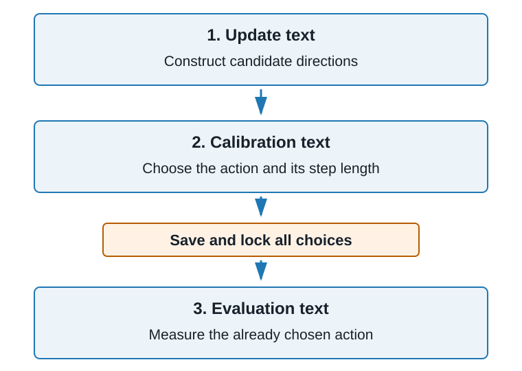
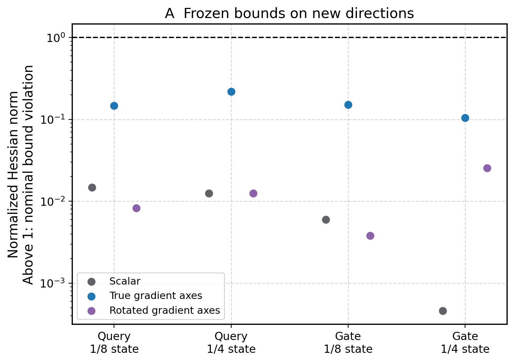
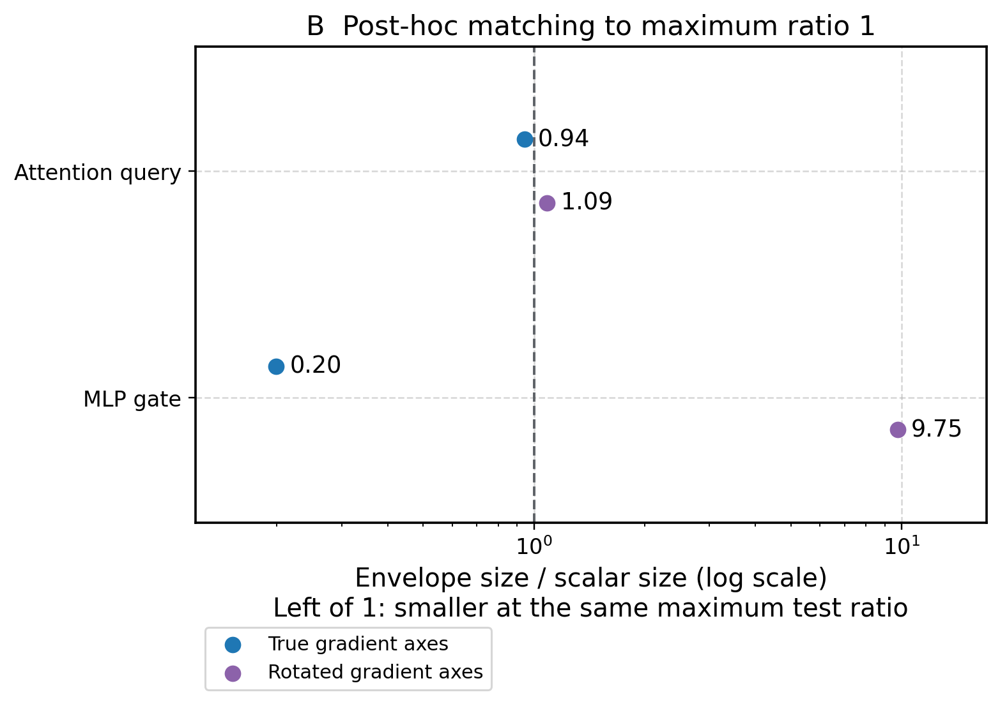
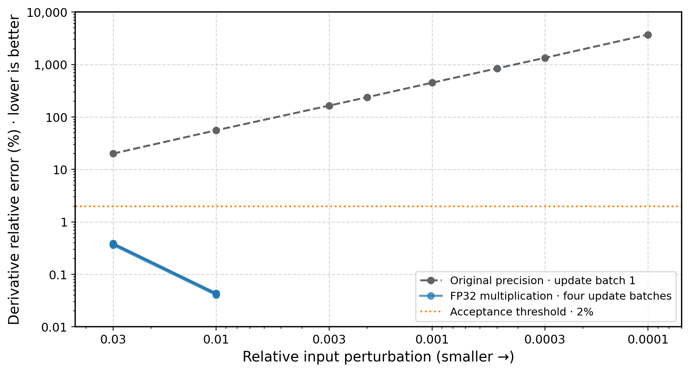
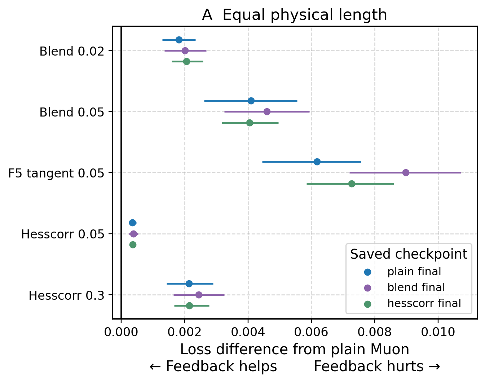
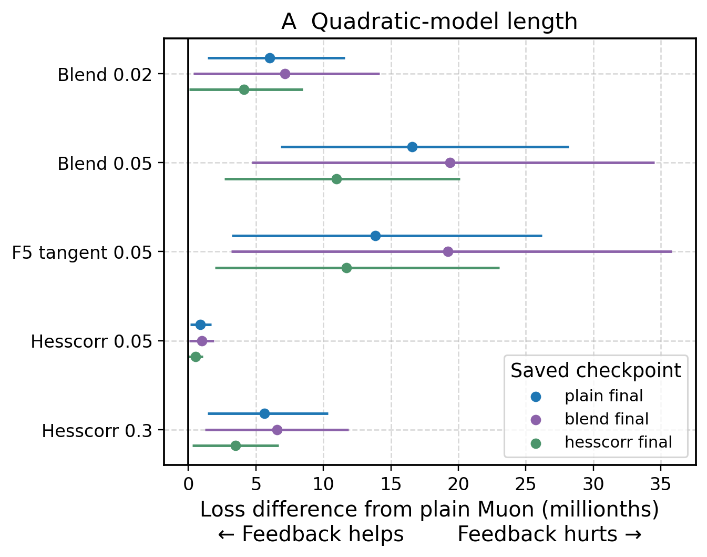
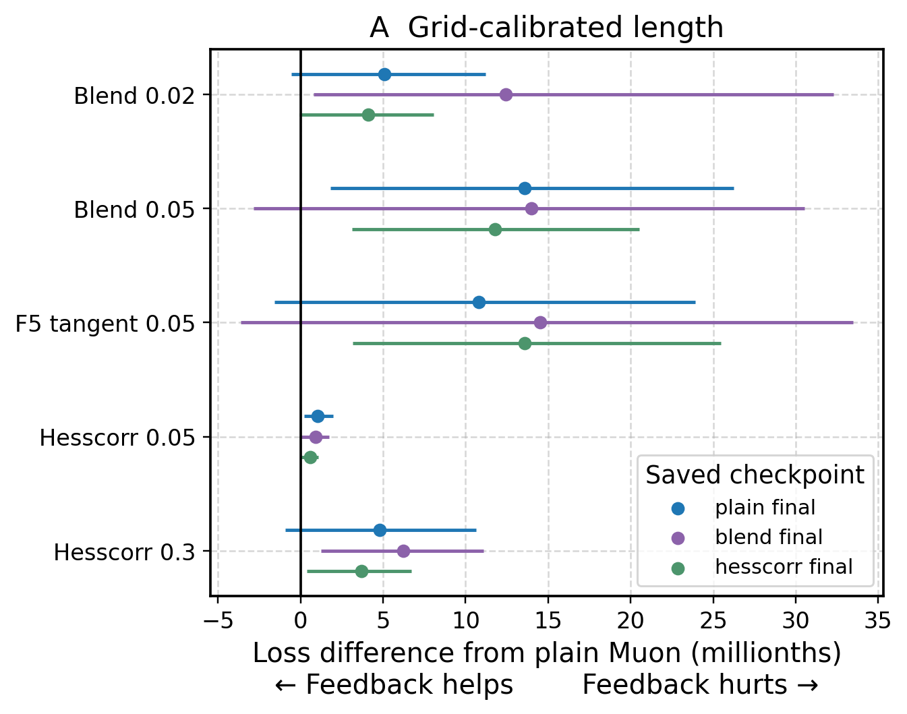

# Can curvature help choose an optimizer update?

**Research in progress — this is not a completed comparison.**

This report follows the experiment request dated 13 November 2026. It extends the earlier gradient-and-curvature study with new text panels and new tests. Results from the earlier study are not counted as results of these new tests.

## What can we conclude so far?

**All three original-grid Muon comparisons and the matrix-envelope test screens are complete. Power prediction and path testing remain unfinished.**

The first power pilot stopped because the TPU ran out of accelerator memory. A later implementation reduces the peak memory needed by Hessian-vector measurements. Its current attempt has passed the initial derivative and Hessian checks and is collecting calibration measurements. It has not yet evaluated selected actions on held-out text.

All three Muon comparisons passed their numerical checks and evaluated 72 candidates in total. Every original-grid calibration chose zero length. At separately calibrated quadratic-model steps, feedback variants had less favorable measured mean changes than plain Muon at each checkpoint. These local differences are small. The smaller-grid supplement was registered before inspecting held-out outcomes. It is now complete at all three checkpoints: all 72 choices were nonzero, but the feedback methods still had less favorable means than plain Muon.

Both matrix-envelope calibration screens and both separate test-direction screens completed with passing numerical checks. All three controls covered the tested subspaces. After a post-hoc comparison that equalizes the worst observed coverage ratio, the true gradient axes gave a modest attention improvement and a larger MLP improvement. Fixed-coefficient path checks are pending. Fresh-history comparisons have not started.

## 1. Why do these experiments matter?

**An optimizer can appear better for several different reasons. These tests try to separate those reasons.**

A language model has adjustable numbers called **parameters**. Its **loss** measures prediction error; lower is better. An optimizer proposes how to change the parameters.

A proposed change has both a **direction** and a **length**. Changing either can change the loss. The optimizer also remembers previous gradients, so its history can change its next proposal.

The earlier study found that step length can reverse the local ranking of powers 1/8 and 1/4. That motivates a harder question: can we predict a useful power before measuring its outcome on separate text?

The **gradient** describes the initial change in loss. **Curvature** describes how that change itself changes as we move. The Hessian is the mathematical operator that measures local curvature.

Good initial alignment means that a direction looks promising at the starting point. Curvature may tell us whether that promise persists for a finite step.

## 2. What is a checkpoint experiment?

**We propose changes from a saved model state and measure their immediate effects. We are not yet comparing complete new training runs.**

A **checkpoint** stores model parameters and optimizer state, including accumulated gradient statistics and counters. Each candidate starts from the same saved state and receives the same new update text.

For a fair comparison, candidate powers incorporate the new gradient once into their accumulated statistics. Those resulting statistics must match across the powers.

The model parameters used to construct the candidates remain fixed. Evaluating a proposed move does not start an ongoing training trajectory.

These experiments can identify a useful local mechanism. They cannot, by themselves, establish which optimizer wins after a full training run or across independent training seeds.

## 3. Why are there three separate text sets?

**The text that chooses an action must be separate from the text that judges it.**

1. **Update text** constructs the proposed optimizer direction.
2. **Calibration text** measures alignment and curvature and chooses a step length.
3. **Evaluation text** measures how the already chosen action performs.

The calibration panel contains 64 sequences. The evaluation panel contains 128 sequences. Each sequence contains 4,096 tokens. Candidate methods share the same panels so their differences are paired comparisons.

All choices are saved before any evaluation-panel loss is read. This prevents choosing a method because it happened to look good on the text used to report its outcome.

This is the loss-comparison workflow for Experiments 1 and 4. For Experiment 2, the locked objects are envelope coefficients, and new directions test them.

Whole-sequence hashes reject identical sequences across the panels and exclude the earlier study's recorded sequences. This does not prove that no documents or token spans overlap. It also does not establish that the text was absent from pretraining.

Cross entropy penalizes poor next-token predictions. Z-loss penalizes very large aggregate prediction scores. The reference loss adds z-loss with coefficient 0.0000001 to cross entropy. Weight decay is excluded from that measured loss. The production update still retains its original decay and nonmatrix parameter updates.

## 4. Experiment 1: can curvature improve the choice of power?

**The test compares choices made using alignment alone with choices made using alignment plus curvature.**

The planned experiment uses six 447M checkpoints: early, middle and late states from a trajectory trained with power 1/8 and a trajectory trained with power 1/4. Each checkpoint receives eight fresh update batches. Each batch produces three candidate powers: 1/8, 3/16 and 1/4. That gives 144 planned candidate directions.

These powers control inverse matrix powers applied to accumulated gradient statistics. They can alter both direction and size. The production five-step matrix transformation is retained.

Each complete candidate update is normalized by one scalar. This keeps its orientation while making its length one. A physical step length then specifies the Euclidean norm of the full parameter displacement.

We write a move as “new parameters = old parameters − s × d.” Thus positive alignment with d predicts an initial loss decrease. For a unit direction d and length s, the quadratic model predicts:

**predicted decrease = s × alignment − ½ × s² × directional curvature.**

Here, alignment is the inner product of the reference gradient and d. Directional curvature is the inner product of d and the Hessian-vector product Hd. This product describes how the gradient initially changes when parameters move along d. Curvature can be negative.

The model chooses its best action within a common bounded range, including the option to take no step. Every comparator receives the same opportunity to calibrate its length. The tested choices include fixed 1/8, fixed 1/4, the best initial alignment and the best quadratic prediction.

A useful result would be a lower paired evaluation loss for the curvature-based choice than for the alignment-based choice. Good agreement between predicted and measured loss changes is a separate question; a predictor can be accurate without changing the preferred action.

**Current limitation:** the power pilot is still collecting calibration measurements. Initial numerical checks passed, but the full set of locked choices and held-out outcomes is not yet available.

## 5. Experiment 2: does matrix orientation improve a curvature bound?

**The test asks whether the directions inside a gradient matrix contain useful information beyond its overall size.**

A proposed **envelope** limits the magnitude of curvature. A scalar envelope treats every direction equally. A matrix envelope can allow different amounts of curvature along different directions.

The experiment uses both middle checkpoints and two parameter blocks: the first attention-query matrix and the first MLP-gate matrix. Other model parameters remain fixed when measuring each block Hessian.

Each block has eight calibration directions and eight test directions. They include random directions and directions derived from the gradient's singular vectors. Optimizer directions are reserved for testing.

Three fitted controls are compared: a scalar envelope, an envelope using the gradient's actual matrix axes, and one using randomly rotated axes with the same singular values. Coefficients are shared across the two checkpoints for each block type.

Here G is the unclipped gradient of the reference loss with respect to the chosen matrix block. For a matrix direction E, the oriented envelope applies **L₀E + cᴸGGᵀE + cᴿEGᵀG**. The products GGᵀ and GᵀG describe the gradient's row and column axes. The fitted weights satisfy L₀ > 0 and cᴸ, cᴿ ≥ 0. The rotated control rotates G's axes while preserving G's singular values; it then fits its own nonnegative coefficients.

Calibration responses choose the coefficients. Those coefficients are then frozen. Test responses assess coverage and tightness.

The coverage score checks every linear combination of the eight test directions. It reports the largest magnitude of local curvature relative to the envelope allowed in that combination. A value above one, beyond numerical uncertainty, means at least one combination violates the fitted bound.

The calculation uses the full Hessian matrix restricted to those eight directions, including its off-diagonal entries. Looking only at eight separate directional curvatures would miss some violating combinations.

Coverage and tightness are different. A large envelope may cover everything but give little useful information. Tightness compares how much curvature the envelope allows, using average envelope size across the tested directions; smaller is tighter at comparable coverage.

A useful result would be a tighter envelope from the actual matrix axes at comparable coverage. Better calibration fit alone is insufficient. A promising fit also receives midpoint and endpoint checks along fixed block-update paths.

**Scope:** these are sampled block subspaces and local paths. Passing them would not prove a uniform bound on the full model Hessian.

## Matrix-envelope result: orientation helps, with different effect sizes

**All three frozen controls covered the tested subspaces. Matching their remaining slack shows a small attention advantage and a larger MLP advantage for the true gradient axes.**

The test has 12 combinations: two middle checkpoints × two matrix blocks × three controls. Each score checks the full span of eight reserved test directions. All scores were below one; no nominal violation was observed. The actual-gradient envelope's scores ranged from 0.104 to 0.218.

The dashed line marks one. Above it, a bound is violated in at least one linear combination of test directions. The vertical scale is logarithmic. Very small values can mean that a bound is overly large, so coverage alone does not identify the most useful bound.

Before any test-based rescaling, the true-gradient envelope's mean size was about 6.37% of the scalar control for attention and 0.783% for MLP. These are ratios of average trace per test direction, averaged equally over the two checkpoints.

Those large differences partly reflect different amounts of unused slack. To compare that slack explicitly, a **post-hoc diagnostic** multiplies each block/control's envelope by its largest observed test score across the two checkpoints. This makes its worst score exactly one. It can shrink a conservative bound as well as enlarge a violated one.

A ratio below one means a smaller envelope than the scalar control after this matching. The true-gradient ratios were 0.942 for attention and 0.199 for MLP: about 6% and 80% smaller. The rotated-axis ratios were 1.086 and 9.754.

**This rescaling uses test results.** It is a description of relative shape and slack, not another independently tested bound. The path experiments retain the original frozen coefficients. No claim of uniform full-network coverage follows from these sampled block tests.

[Complete test analysis](../geometry-envelope-test-analysis.json) · [Frozen coefficient plan](../geometry-envelope-plan.json)

## 6. Experiment 3: which part of optimizer history matters?

**The test separates remembered gradient directions from remembered Gram matrices.**

Momentum averages earlier gradients. Gram matrices average matrix products of those gradients. They are different forms of memory.

At each middle checkpoint, the planned experiment compares four combinations:

- Saved momentum + saved Gram matrices.
- Fresh momentum + saved Gram matrices.
- Saved momentum + fresh Gram matrices.
- Fresh momentum + fresh Gram matrices.

All other optimizer state stays fixed. The same new update batch is incorporated once in every condition.

Two independent histories, each containing 512 batches at fixed model weights, test how much the result depends on the sampled history. We also average the two histories before rescaling their statistics or adding the small diagonal stabilizer called a ridge. This checks sensitivity to the sampled history without changing the gradient batch size.

If replacing history reverses the power ranking, a later matched replay would compare histories built at moving versus fixed parameters using the same text and temporal weights. That replay has not run. A training continuation would require complete durable checkpoint restoration and online tracking.

## 7. Experiment 4: why might inexpensive Muon feedback help?

**The test separates a different direction from a larger update and from numerical approximation effects.**

Muon transforms its momentum matrix using a five-step map called F5. A blend control mixes momentum with the new gradient before applying that map. The Hesscorr control uses a numerical approximation to a curvature correction.

The planned candidates are plain Muon, blends 0.02 and 0.05, a five-step derivative control with weight 0.05, and production Hesscorr with weights 0.05 and 0.3. They start from identical post-gradient momentum and reuse each computed direction across all tested lengths.

The three available 300M checkpoints are at the end of their schedules. Their native next scheduled learning rate is zero. The approved comparison therefore uses a common **reference probe learning rate of 0.012**, with **Adam learning rate 0.0036**. These scales do not represent a resumed native training step.

FP32 means 32-bit floating-point numbers. On a TPU, matrix-multiplication precision also needs an explicit setting. The derivative control uses the same five-step polynomial with the highest FP32 multiplication precision.

First, momentum incorporates the new gradient. The derivative then asks how F5 changes when that post-gradient momentum moves toward the new gradient: the input direction is “new gradient minus post-gradient momentum.” We add 0.05 times this derivative to the native base direction, then apply the original shape and learning-rate scaling.

The other native candidates retain their pinned implementation. A separate measurement records how much the native and higher-precision base maps differ. Passing the derivative check does not assert that these two maps are numerically identical.

The table label **F5 tangent 0.05** names this five-step derivative control.

The derivative must agree with central finite differences to within 2% at two consecutive perturbation scales. Correction norms, clipping factors, zero fallbacks and equation residuals are also recorded.

At each checkpoint, six methods × four update draws give **24 candidate directions**. The shared reference norm r is the median of the four plain-Muon update norms, computed using the reference learning rates above. It is one number per checkpoint, shared by all candidates.

The original grid tests lengths **0, 0.1r, 0.3r, 0.6r, r, 2r and 4r**. It selects the lowest measured calibration loss and refines around an interior winner. A separate quadratic rule maximizes predicted improvement continuously over **0 ≤ s ≤ 4r**. Both rules may select zero.

The original FineWeb training subcache was missing. Measurement uses an explicitly identified replacement from a pinned public revision. All 79 files passed checksum verification, and the cloud worker reproduced the exact 704-sequence panel manifest checked locally: 64 calibration sequences, 128 evaluation sequences and four native update batches of 128 sequences each. These 512 update *sequences* are separate from Experiment 3’s proposed 512-*batch* histories. This does not prove byte identity with the missing subcache.

## Numerical check: higher precision restored derivative agreement

**The revised Muon derivative passed. This is a measurement-quality result, not evidence that Muon feedback improves loss.**

Read the orange line as the acceptance threshold: lower is better. The vertical axis is logarithmic; each labeled step is a tenfold change.

The gray curve shows the original calculation on the first update batch. The four nearly overlapping blue curves show the revised calculation on all four batches, at the same checkpoint and with the same data. Blue measurements stop after two consecutive scales pass; missing smaller-scale points are not zero errors.

At relative perturbations 0.03 and 0.01, the revised errors were approximately 0.36%–0.39% and 0.040%–0.044%, respectively. The original first-batch errors were 20.1% and 55.8% at those same scales. Both calculations differentiate the same five-step polynomial; their matrix-multiplication precision differs.

The separate full-model Hessian-vector check passed at two parameter-perturbation sizes, with errors 1.11% and 0.088%. Its symmetry discrepancy was approximately 0.00000000124, below the 0.0001 threshold.

[Original derivative record](../geometry-muon-results/muon/muon-plain-final/ema-gram-geometry-8f8a693ed3ab/muon-partial.json) · [Frozen revised calibration record](../geometry-muon-small-step-calibration-snapshot.json)

## A supplementary test checks smaller physical steps

**A grid that starts too far from zero can miss a useful small update.**

In the first 12 calibrated Muon candidates, the original grid selected zero. The quadratic model predicted lengths around 0.43–0.51, while the smallest positive grid length was about 1.32. These observations concern calibration text only.

A supplementary grid was registered before inspecting any held-out loss. It adds physical lengths 0.01, 0.03 and 0.06 times the same reference norm, equally for every candidate and checkpoint. The reference learning rates remain 0.012 and 0.0036.

The original-grid comparison remains the primary result. This supplement tests grid resolution; its results will be identified separately. The grid choices and the calibration evidence that motivated them are preserved in the [registered protocol](../geometry-muon-small-step-protocol.json).

## Completed original-grid comparisons

**All 72 original-grid choices selected no move. The quadratic rule selected smaller steps; feedback had less favorable mean changes than plain Muon at all three checkpoints.**

There are three saved checkpoints, produced by plain Muon, blend 0.05 and Hesscorr 0.3 training. Within each checkpoint, all six candidate methods start from the same model and optimizer state. This separates the candidate method from the checkpoint's training history.

The evaluation-panel baseline losses were 2.925999, 2.921209 and 2.924204, respectively. All 72 original-grid choices had exactly zero loss change because their selected length was zero. This completes the specified selection rule, but does not rank the candidate directions at useful small lengths.

For the separate quadratic rule, each candidate uses the best step predicted by its bounded quadratic model. Calibration text chooses those lengths before evaluation.

**Table units: millionths of loss.** A value of −65 means a loss decrease of 0.000065. Negative is better than taking no step. Each entry averages four update draws and 16 evaluation groups.

| Candidate | Plain checkpoint | Blend checkpoint | Hesscorr checkpoint |
| --- | ---: | ---: | ---: |
| Plain Muon | -64.98 | -57.25 | -29.76 |
| Blend 0.02 | -58.94 | -50.08 | -25.62 |
| Blend 0.05 | -48.41 | -37.88 | -18.78 |
| F5 tangent 0.05 | -51.13 | -38.02 | -18.04 |
| Hesscorr 0.05 | -64.08 | -56.26 | -29.21 |
| Hesscorr 0.3 | -59.34 | -50.68 | -26.27 |

The plain-Muon mean at the plain checkpoint was −65.0 millionths, with conditional 95% bootstrap interval [−95.6, −30.5]. At the Hesscorr checkpoint, its interval was [−68.2, +9.9]; that interval includes no improvement.

Read each dot as a paired mean difference from plain Muon at the same checkpoint. Horizontal lines are conditional 95% bootstrap intervals. Points right of zero favor plain Muon. The original grid selected zero for every candidate; those zero actions do not appear in this equal-length figure.

This figure uses **millionths of loss**. Its lengths come from the quadratic model, not the discrete grid. All feedback-minus-plain mean differences were positive, between 0.54 and 19.38 millionths. The Hesscorr 0.05 comparison at the Hesscorr checkpoint had an interval crossing zero. The other intervals were positive, conditional on these checkpoints and sampled panels.

The common reference lengths were 13.168, 13.002 and 13.210 at the three checkpoints. At the plain checkpoint's reference length, plain Muon increased evaluation loss by 0.04975. Thus the large reference scale and useful local steps occupy very different ranges at these terminal checkpoints.

These findings do not show that feedback is worse throughout training. The intervals exclude numerical error, training-seed variation and adjustment for multiple comparisons. Independent training-seed replication has not been performed.

[Validated analysis](../geometry-muon-primary-analysis.json) · [Verified completion and online run links](../geometry-completion-records.json)

## What the correction diagnostics show

**The production Hesscorr correction was heavily clipped and differed substantially from the five-step derivative control.**

Clipping multiplies an oversized correction by a factor below one. Every matrix/update record was clipped: 84 matrices × four update draws at each of three checkpoints. The median factor was about 0.00029–0.00033. No nonfinite or radial-zero fallback was recorded.

For an m-by-n matrix, the production Hesscorr correction is capped at Frobenius norm √min(m,n). The Frobenius norm is the square root of the sum of squared matrix entries. This cap is the norm of an ideal polar factor, whose rows or columns are orthonormal; the finite five-step base map can differ from it. Clipping occurs before multiplying the correction by 0.05 or 0.3 and before the common shape and learning-rate scaling. A small clipping factor therefore describes a large reduction from the raw correction, without by itself measuring the final correction-to-base ratio.

The median cosine similarity between the production correction and the five-step tangent was about 0.09. A cosine of one means the same direction; zero means perpendicular directions. These are **correction directions**. Both are added to a shared base, so this value does not establish a large difference between the complete updates.

Hesscorr approximates the derivative of a matrix polar factor, using a regularized linear matrix equation called a Sylvester equation. Its residual is the norm of the equation mismatch divided by the norm of its right-hand side. The median residual was about 3.4%–3.5%. That percentage is an equation-solve diagnostic; it is not the error relative to the five-step F5 derivative.

The native and higher-precision F5 base maps also differed: the median relative difference was about 0.9%, and the largest was 1.46%. The derivative validation establishes agreement for the explicitly higher-precision map. It does not make the native and higher-precision maps identical.

These diagnostics help interpret the controls. They do not identify clipping or approximation error as the cause of the observed loss differences; that would require a separate intervention.

[Measured correction diagnostics](../geometry-muon-mechanism-diagnostics.json)

## Smaller-grid results at all three checkpoints

**All 72 supplemental choices selected nonzero steps. Every feedback method still had a less favorable mean loss change than plain Muon at each checkpoint.**

All 72 candidate directions were byte-for-byte identical to the original-grid experiment. Their norms, alignment, signed curvature and quadratic-model lengths matched exactly. The supplement changed the available grid lengths while reusing the same directions.

Calibration loss selected the physical lengths, which were about 0.39–0.59. The reported outcomes use the separate held-out evaluation panel. Here r is the median native plain-Muon norm at that checkpoint, using the reference learning rates. The supplement retains the original interior refinement rule: for example, 0.593 at the plain checkpoint is a refined point between grid lengths 0.03r and 0.06r.

**Table units: millionths of loss.** These are plain Muon's mean changes from taking no step, with conditional 95% bootstrap intervals. Negative means a lower loss.

| Checkpoint's training method | Plain Muon mean | 95% interval |
| --- | ---: | ---: |
| Plain Muon | -62.51 | [-93.43, -27.68] |
| Blend 0.05 | -55.99 | [-96.93, -12.08] |
| Hesscorr 0.3 | -28.61 | [-67.18, +11.10] |

Every candidate method had a negative mean change at every checkpoint. This is an average over four update draws; individual moves can increase loss. The Hesscorr-checkpoint intervals include zero for all six methods.

Read each dot as a feedback method's mean loss minus plain Muon's mean loss at the same checkpoint. Positive values favor plain Muon. Means combine four update draws and 16 evaluation groups of eight sequences each. Horizontal lines are conditional 95% intervals from 10,000 bootstrap resamples of draws and text groups, preserving candidate pairing.

The 15 feedback-minus-plain means ranged from +0.58 to +14.50 millionths. Eight intervals were strictly positive; seven included or touched zero. None provided an interval wholly favoring feedback. These intervals omit numerical error, training-seed variation and multiple-comparison adjustment.

The finer grid resolved the original all-zero selection. It did not reveal an average local advantage for the tested feedback methods at these terminal checkpoints. This remains a supplement; the original-grid results are preserved separately.

[Supplement analysis](../geometry-muon-small-step-analysis.json) · [Exact direction reproduction checks](../geometry-muon-small-step-reproduction.json)

## 8. How should uncertainty be read?

**Repeated batches at one checkpoint are not independent training runs.**

Candidates share evaluation text. Their differences should therefore be analyzed as paired measurements. The reported bootstrap resamples update draws and evaluation text groups while preserving candidate pairing. Each evaluation group contains eight sequences; the 128-sequence panel therefore has 16 groups. The calculation uses 10,000 resamples and reports the central 95% interval.

The intervals are conditional on the chosen checkpoints, calibration panel and selection rules. They do not include uncertainty from a new training seed or a different calibration procedure.

A failed numerical check means that the corresponding measurement is not accepted for scientific comparison. It does not show that the optimizer is ineffective. A job that runs out of memory likewise says nothing about which optimizer has lower loss.

## 9. What remains before a mechanism can be selected?

**The first priority is valid checkpoint evidence for power prediction and matrix orientation.**

The new power pilot must pass its numerical checks and held-out evaluation. All three original-grid Muon checkpoints and their smaller-step supplements are complete. The frozen matrix envelopes have passed their separate test-direction screens. Path measurements will now assess them after parameter movement.

Only after these comparisons can the report support selecting a mechanism for matched training continuations. Full training claims and independent-seed replication are outside the completed evidence at this stage.
