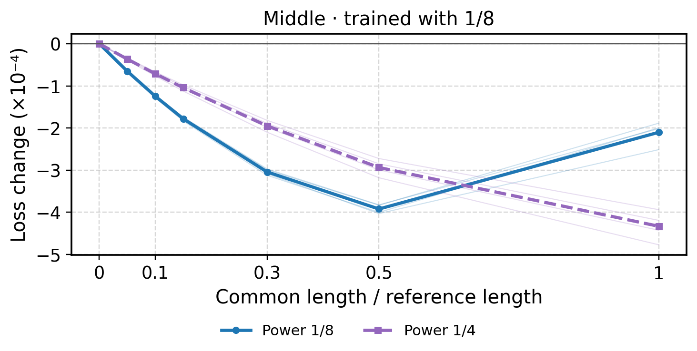
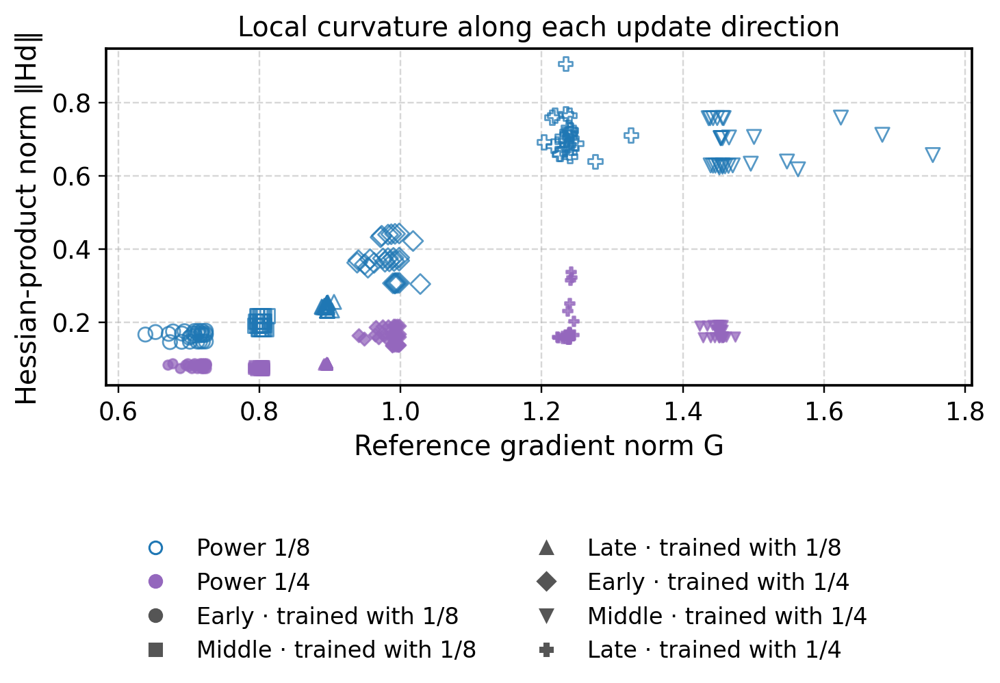
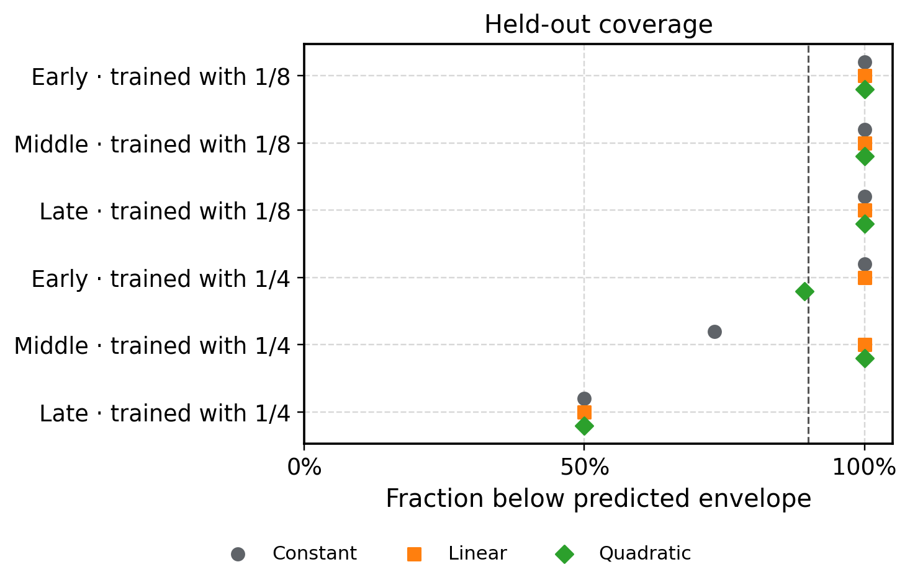

# Gradient size, curvature, and optimizer power

**Working results guide.** Six checkpoint probes are complete. Direct step-length calibration and held-out evaluation are still in progress. This version does not contain the final adaptive-step comparison.

Read the bold sentences first. Each section answers one question. The separate methods reference gives the formulas and implementation details.

## 1. What question are we trying to answer?

**Does a larger gradient mean stronger curvature? Can step length explain a difference between two optimizer settings?**

A language model's **loss** measures its prediction error. Lower loss is better.

The **gradient** describes how the loss changes when the model's parameters move. Its length is called the **gradient norm**. We write that length as G.

The **Hessian** describes how the gradient itself changes. This is one way to measure curvature. Curvature matters because a promising direction at the start can become less useful as a step gets longer.

The two optimizer settings are **power 1/8** and **power 1/4**. These numbers specify inverse matrix powers applied to accumulated gradient statistics. They can change both the direction and length of the proposed parameter update.

The earlier training comparison motivates this study. Here, we test saved model states directly. These local tests can explain how a proposed step behaves at a checkpoint. They do not reproduce an entire training trajectory.

## 2. What did we actually do?

**We compared both powers from exactly the same starting state.**

A **checkpoint** stores the model's parameters and the optimizer's accumulated state. We used six checkpoints: early, middle, and late from each of two training trajectories. One trajectory used power 1/8; the other used power 1/4.

For each checkpoint, the procedure was:

1. **Restore the same saved state.** Every candidate starts fresh from that state.
2. **Generate both update directions.** Both powers receive the same update batch. Each advances the optimizer's accumulated statistics once.
3. **Compare equal physical lengths.** Rescale the directions without rotating them. The main tested lengths are 0.1, 0.3, and 1 times the paired power-1/8 update norm.
4. **Measure the result.** Evaluate loss, gradient size, and directional curvature along each path.

We repeated this with four update batches. The same four batches are reused across checkpoints. No new training run was performed.

All measurements use a common **reference panel** of 64 sequences, each containing 4,096 tokens. Reference and update batches share no complete sequence. The reference text comes from the original training-data mixture; we have not established that it was absent from the original training run.

The main comparison includes the complete production update: matrix updates, AdamW updates, and decay. At the two middle checkpoints, an additional control moves only the matrix-transform parameters. Gradients and Hessian products still cover the full model in that control.

The middle checkpoint trained with 1/8 also repeats the measurements with 128 reference sequences.

## 3. Did the numerical measurements work?

**All six checkpoint jobs completed. All 28 representative derivative checks passed.**

The checks compare Hessian-vector products with central differences of gradients. Two adjacent perturbation sizes must each give relative error below 2%. The threshold was unchanged throughout the study.

Some checkpoints needed smaller perturbations before they passed. A large perturbation can measure curvature over too wide a region to agree with a local derivative.

We also predicted each paired loss difference from independently measured signed curvature along the path. All 96 comparisons met the declared numerical integration tolerance.

That prediction uses a different tolerance: the larger of 0.000002 and 20% of the observed paired difference. The largest absolute prediction residual was 0.0000167. Individual loss-change predictions can have a larger relative error when the actual change is close to zero. The direct loss measurements remain available separately from these curvature-based predictions.

These checks support the numerical calculations used here. They do not establish a bound on the full Hessian or prove that a step-size rule is safe everywhere.

## 4. What happens when the physical step gets longer?

**The preferred power can change with step length.**

The example below uses the middle checkpoint trained with 1/8. Blue is the candidate power 1/8; purple is the candidate power 1/4. Both candidates start from that same checkpoint.

At the two shorter main lengths, power 1/8 gives lower mean loss. At the longest length, power 1/4 gives lower mean loss. The paired uncertainty intervals exclude zero at all three lengths. The same signs appear with the doubled reference panel.

*Figure 1. Lower is better. A negative value means the step reduced the reference loss. One vertical-axis unit is 0.0001 loss. Thick lines show the mean of four update batches; faint lines show individual batches, not confidence intervals. Markers are actual measurements at seven fixed positions. Connecting lines are visual guides. The horizontal axis divides each length by the power-1/8 update norm from the same checkpoint and batch.*

[Open the full six-checkpoint comparison](figures/loss-versus-common-length-full.svg). Its vertical ranges differ between panels.

The middle checkpoint trained with 1/4 gives a less decisive comparison at short lengths: both short-length intervals include zero. At its longest length, power 1/4 gives lower loss.

The curves support a local role for step length. They do not identify one optimizer power as the best choice for all training.

## 5. Why can the ranking reverse?

**A better initial direction can lose its advantage at a longer step.**

We separate three contributions to the power-1/8-minus-power-1/4 loss difference:

- **Initial alignment:** how well each direction follows the reference gradient at the start.
- **Initial signed curvature:** how the loss already bends along each direction at the start.
- **Further curvature change:** the additional contribution from curvature changing along the path.

For the longest tested step at the middle checkpoint trained with 1/8, the mean contributions are:

| Contribution | Loss difference, in units of 0.0001 |
|---|---:|
| Initial alignment | −6.174 |
| Initial signed curvature | +8.420 |
| Further curvature change | −0.018 |
| Observed total | +2.229 |

Negative favors 1/8. Positive favors 1/4. Rounding and the small numerical prediction residual explain the tiny difference between the displayed sum and total.

Power 1/8 starts with an alignment advantage. Its larger initial curvature penalty overtakes that advantage at the longer step. In this example, a large curvature increase along the path is not needed to explain the reversal.

This table illustrates one checkpoint and length. The downloadable decomposition retains every checkpoint, batch, movement type, and main length.

## 6. Does curvature grow with gradient size?

**There is a useful association in these measurements, but it does not form a reliable bound at every checkpoint.**

For this question, we measure the **Hessian-product norm**, written ‖Hd‖. Here d is a unit update direction. This norm describes how quickly the full gradient changes locally along that direction. It is nonnegative.

It differs from **signed directional curvature**, which describes how the loss bends along the direction itself. Signed curvature, not the Hessian-product norm, enters the loss decomposition above.

*Figure 2. Colors identify the candidate optimizer powers; marker shapes identify the saved checkpoints. This figure measures local gradient change at a point. The reference gradient norm is recomputed at each displayed position. Points along one path are related measurements, not independent experiments.*

[Compare local curvature with gradient change over a whole step](figures/curvature-versus-gradient.svg).

We fit three alternatives: a constant, an intercept plus a multiple of G, and an intercept plus a multiple of G². Coefficients must be nonnegative. The fit targets the 90th conditional quantile: an empirical upper envelope for most measured values.

**Each prediction is tested on a whole checkpoint that was excluded from its fit.** Both powers, all four update batches, and all path positions from that checkpoint are held out together. The other five checkpoints have equal total fit weight.

*Figure 3. Colors now identify the three curvature models. Coverage is the fraction of measured values below the predicted envelope. The dashed line marks the 90% target. Each point summarizes one held-out checkpoint. High coverage alone can be obtained by predicting excessively large values, so we also assess prediction error.*

The quadratic model has the lowest average prediction error: 0.0345, compared with 0.0409 for linear and 0.0533 for constant.

This error is the 90th-quantile loss: underprediction is penalized nine times as heavily as equal-size overprediction. [See prediction error and coverage together](figures/heldout-envelope-validation.svg).

However, **all three models cover only 50% of the late checkpoint trained with 1/4**. The average score hides this failure. These observations do not establish a quadratic law, a full-Hessian bound, or a convergence guarantee.

## 7. Do curvature-based step lengths improve the comparison?

**The direct evaluations are still in progress.**

The proposed rule uses the starting gradient norm and the fitted curvature envelope. In symbols, its physical length is s = cG / ell(2G). The scalar c controls the overall size.

For each held-out checkpoint, direct loss evaluations on the other five checkpoints select c. A separate evaluation then tests that chosen value at the held-out checkpoint. The held-out loss cannot choose its own scalar.

The comparison includes a constant physical length, a linear-curvature rule, and a quadratic-curvature rule. Both optimizer powers share the scalar and length cap within each rule and holdout.

There is already an informative simplification: every fitted linear envelope has zero intercept. Then ell(2G) is proportional to G, so G cancels from the step rule. Its normalized candidate lengths coincide with the constant-length baseline, up to floating-point representation.

The remaining direct tests will determine the effects of the quadratic rule and the selected lengths. A better curvature prediction score alone does not answer that question.

## 8. How should the uncertainty be read?

**The intervals describe these checkpoints and this sampling procedure.**

Each loss-difference interval resamples the four paired update batches and the shared reference groups. Both powers use the same sampled indices. The reference-group indices are also shared across sampled update batches.

The intervals are pointwise 95% bootstrap intervals. They do not include variation across training seeds, uncertainty from choosing an adaptive scalar, or a correction for looking at many comparisons.

The six checkpoints come from two trajectories using one training seed. The two trajectories used different tuned learning rates. A between-trajectory difference therefore cannot be attributed to optimizer power alone.

The study measures selected update directions. The full Hessian operator norm would require considering every unit direction. A directional fit cannot certify that full norm.

## 9. Where are the methods and evidence?

**The detailed methods and raw measurements accompany this guide.**

The path-measurement phase used approximately 4.205 v4-32 slice-hours of task-active time, or about 67.3 JAX TPU-device-hours. Queue and provisioning time are excluded. This is a compute-usage description, not a dollar bill. Adaptive-phase usage will be added after completion.

- [Large-text methods reference](methods-reference.pdf)
- [Measured paths, including per-group losses](data/path-measurements.csv)
- [Paired loss differences and intervals](data/paired-common-length.csv)
- [Alignment and curvature decomposition](data/paired-loss-decomposition.csv)
- [Held-out model fits and source hashes](data/analysis.json)

The original Hessian reports remain separate. This follow-up tests the gradient-dependent-curvature proposal with new full-model directional measurements.
