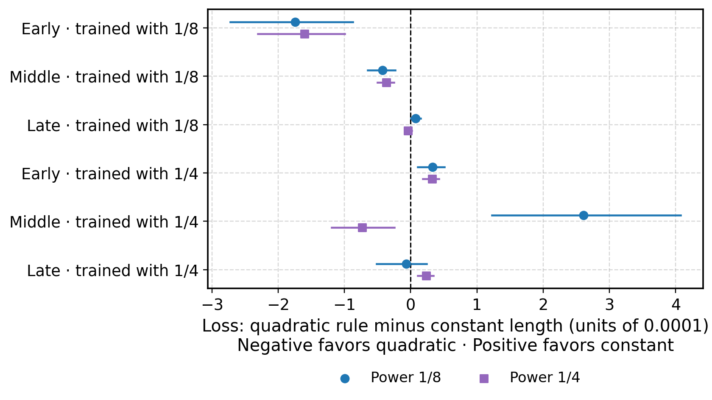
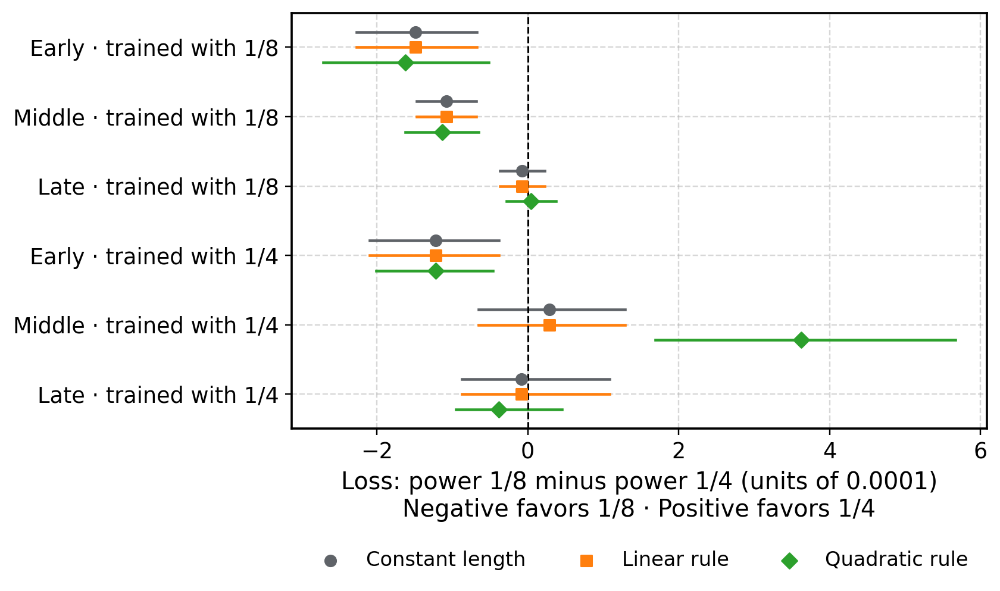

# Gradient size, curvature, and optimizer power

**The study is complete.** We measured six saved model states and completed the separate tests of selected step lengths.

The main findings are:

- **Step length can reverse the local ranking of the two powers.**
- **The quadratic curvature model predicts better on average, but fails its coverage target at some checkpoints.**
- **Its step rule helps some comparisons and hurts others. It does not explain the earlier training ranking by itself.**

Read the bold sentences first. Each section answers one question. The separate methods reference gives the formulas and implementation details.

## 1. What question are we trying to answer?

**Does a larger gradient mean stronger curvature? Can step length explain a difference between two optimizer settings?**

A language model's **loss** measures its prediction error. Lower loss is better.

The **gradient** describes how the loss changes when the model's parameters move. Its length is called the **gradient norm**. We write that length as G.

The **Hessian** describes how the gradient itself changes. This is one way to measure curvature. Curvature matters because a promising direction at the start can become less useful as a step gets longer.

The two optimizer settings are **power 1/8** and **power 1/4**. These numbers specify inverse matrix powers applied to accumulated gradient statistics. They can change both the direction and length of the proposed parameter update.

C4 is a separate text evaluation; lower loss is better. In the earlier comparison, power 1/8 recorded final C4 loss 3.784025. Power 1/4 had a recovered final evaluation of 3.844011 from a failed job. These runs used one training seed and separately tuned learning rates. This observation motivates the local tests, but does not isolate a causal effect of power.

A training comparison can mix direction, step length, and accumulated training history. Here, we test saved model states directly. These local tests can explain how a proposed step behaves at a checkpoint. They do not reproduce an entire training trajectory.

## 2. What did we actually do?

**We compared both powers from exactly the same starting state.**

A **checkpoint** stores the model's parameters and the optimizer's accumulated state. A training trajectory is the sequence of model states from one training run. We used six checkpoints: early, middle, and late from each of two trajectories. One trajectory used power 1/8; the other used power 1/4.

An **update batch** is the text used to calculate a proposed parameter change. An update’s **physical length** is the length of the complete change vector, measured with the Euclidean norm.

For each checkpoint, the procedure was:

1. **Restore the same saved state.** Every candidate starts fresh from that state.
2. **Generate both update directions.** Both powers receive the same update batch. Each advances the optimizer's accumulated statistics once.
3. **Compare equal physical lengths.** Rescale the directions without rotating them. The main tested lengths are 0.1, 0.3, and 1 times the paired power-1/8 update norm.
4. **Measure the result.** Evaluate loss, gradient size, and how the loss bends along each path.

We repeated this with four update batches. The same four batches are reused across checkpoints. No new training run was performed.

All measurements use a common **reference panel** of 64 sequences, each containing 4,096 tokens. They are organized into eight groups of eight sequences. Reference and update batches share no complete sequence. The reference text comes from the original training-data mixture; we have not established that it was absent from the original training run.

Gradient **clipping** limits a gradient’s size before it is used to compute an update. Reference gradients are measured without clipping. The production update retains its original gradient clipping and optimizer settings.

The main comparison includes the complete production update. Some parameters use the matrix transformation controlled by the power; others use the AdamW optimizer. It also includes weight decay, which shrinks parameters toward zero. At the two middle checkpoints, an additional control moves only parameters assigned to the matrix transformation. It removes decay and holds all other parameters fixed. Gradient and curvature measurements still cover the full model.

The middle checkpoint trained with 1/8 also repeats the measurements with 128 reference sequences.

## 3. Did the numerical measurements work?

**All six checkpoint jobs completed. All 28 representative derivative checks passed.**

We compare two ways to measure local gradient change along a path. A **Hessian-vector product** calculates that change directly from derivatives. A **central difference** estimates it from gradients measured after small parameter moves in opposite directions.

Relative error is the length of the difference between these two estimates, divided by the Hessian-vector product’s length. A tiny denominator floor of 10⁻³⁰ prevents division by zero.

The small move size is the **perturbation size**. Two adjacent sizes in the prescribed decreasing sequence must each give relative error below 2%. The threshold was unchanged throughout the study.

Some checkpoints needed smaller perturbations before they passed. A large perturbation can measure curvature over too wide a region to agree with a local derivative.

A second check combines measurements of loss bending along the path to predict the loss difference between the two powers. The curvature measurements are independent of the directly measured loss difference. All 96 paired comparisons on the 64-sequence reference panel met the declared tolerance for this numerical prediction.

That prediction uses a different tolerance: the larger of 0.000002 and 20% of the magnitude of the observed paired difference. The largest absolute difference between prediction and measurement was 0.0000167. Individual loss-change predictions can have a larger relative error when the actual change is close to zero. The direct loss measurements remain available separately from these curvature-based predictions.

These checks support the numerical calculations used here. They do not establish a bound on the full Hessian or prove that a step-size rule is safe everywhere.

## 4. What happens when the physical step gets longer?

**The preferred power can change with step length.**

The example below uses the middle checkpoint trained with 1/8. Blue is the candidate power 1/8; purple is the candidate power 1/4. Both candidates start from that same checkpoint.

At the two shorter main lengths, power 1/8 gives lower mean loss. At the longest length, power 1/4 gives lower mean loss.

Here, the **paired difference** is loss with power 1/8 minus loss with power 1/4. Negative favors 1/8; positive favors 1/4. A 95% uncertainty interval resamples the same update batches and reference groups for both powers. The intervals exclude zero at all three lengths, supporting the reported signs under this resampling procedure. Section 8 gives its limits. The same signs appear with the doubled reference panel.

*Figure 1. Lower is better. A negative value means the step reduced the reference loss. One vertical-axis unit is 0.0001 loss. Thick lines show the mean of four update batches; faint lines show individual batches, not confidence intervals. Markers are actual measurements at seven fixed positions. Connecting lines are visual guides. The horizontal axis divides each length by the power-1/8 update norm from the same checkpoint and batch.*

[Open the full six-checkpoint comparison](figures/loss-versus-common-length-full.svg). Its vertical ranges differ between panels.

The middle checkpoint trained with 1/4 gives a less decisive comparison at short lengths: both short-length intervals include zero. At its longest length, power 1/4 gives lower loss.

The curves support a local role for step length. They do not identify one optimizer power as the best choice for all training.

## 5. Why can the ranking reverse?

**A better initial direction can lose its advantage at a longer step.**

We separate three contributions to the power-1/8-minus-power-1/4 loss difference:

- **Initial alignment:** the initial loss decrease predicted for each candidate move from the starting reference gradient.
- **Initial signed curvature:** how the loss already bends along each direction at the start. Positive curvature bends upward and adds a loss penalty; negative curvature bends downward.
- **Further curvature change:** the additional contribution from curvature changing along the path.

For the longest tested step at the middle checkpoint trained with 1/8, the mean contributions are below. Negative favors 1/8. Positive favors 1/4.

| Contribution | Loss difference, in units of 0.0001 |
|---|---:|
| Initial alignment | −6.174 |
| Initial signed curvature | +8.420 |
| Further curvature change | −0.018 |
| Observed total | +2.229 |

Rounding and the small numerical prediction error explain the tiny difference between the displayed sum and total.

Power 1/8 starts with an alignment advantage. Its larger initial curvature penalty overtakes that advantage at the longer step. In this example, a large curvature increase along the path is not needed to explain the reversal.

This table illustrates one checkpoint and length. The downloadable decomposition retains every checkpoint, batch, movement type, and main length.

## 6. Does curvature grow with gradient size?

**Using gradient size improves average curvature prediction. At one checkpoint, all three models cover only half the measurements.**

Let H denote the Hessian, and let d be a unit vector along the candidate path. The **Hessian-product norm** measures how quickly the full gradient changes locally along that direction. It is written ‖Hd‖ and is nonnegative.

It differs from **signed directional curvature**, which describes how the loss bends along the direction itself. Signed curvature, not the Hessian-product norm, enters the loss decomposition above.

*Figure 2. Colors identify the candidate optimizer powers; marker shapes identify the saved checkpoints. This figure measures local gradient change at a point. The reference gradient norm is recomputed at each displayed position. Points along one path are related measurements, not independent experiments.*

[Compare local curvature with gradient change over a whole step](figures/curvature-versus-gradient.svg).

We fit three alternatives: a **constant**, a **linear** model with an intercept plus a multiple of G, and a **quadratic** model with an intercept plus a multiple of G². Coefficients must be nonnegative.

Each curve aims to place about 90% of curvature measurements below it at a given gradient size. This is called the **90th conditional quantile**. It is an empirical upper envelope; its measured coverage can fall short of that target.

**Each prediction is tested on a whole checkpoint that was excluded from its fit.** Both powers, all four update batches, and all path positions from that checkpoint are held out together. The other five checkpoints have equal total fit weight.

*Figure 3. Colors now identify the three curvature models. Coverage is the fraction of measured values below the predicted envelope. The dashed line marks the 90% target. Each point summarizes one held-out checkpoint. High coverage alone can be obtained by predicting excessively large values, so we also assess prediction error.*

We score prediction error using **90th-quantile loss**. For each measurement, the penalty is 0.9 times the underprediction magnitude or 0.1 times the overprediction magnitude. We average within each excluded checkpoint, then give the six checkpoint averages equal weight.

The quadratic model has the lowest average score: 0.0345, compared with 0.0409 for linear and 0.0533 for constant. [See prediction error and coverage together](figures/heldout-envelope-validation.svg).

However, **all three models cover only 50% of the late checkpoint trained with 1/4**. The average score hides this failure. These observations do not establish a quadratic law, a full-Hessian bound, or a convergence guarantee.

## 7. Do curvature-based step lengths improve the comparison?

**The quadratic rule helps in some cases and hurts in others. The linear rule gives the same results as constant length.**

### How were the lengths chosen?

The proposed rule uses the starting gradient norm G and the fitted curvature envelope, called ell. A scalar c controls the overall size. The expression ell(2G) evaluates the fitted curve at twice the starting gradient norm. The proposed physical length s is:

s = cG / ell(2G).

The held-out gradient norm is an input to the rule. The held-out loss is reserved for testing.

For each held-out checkpoint, direct loss evaluations on the other five checkpoints selected c. A separate job then evaluated the chosen value at the excluded checkpoint. Its own loss could not choose its scalar.

The comparison includes constant physical length, a linear-curvature rule, and a quadratic-curvature rule. Both optimizer powers share the scalar and permitted length range within each rule and holdout. The methods specify that range and the three scalar candidates.

Calibration produced 2,160 candidate records across six checkpoints. Identical physical lengths could reuse a direct evaluation within a process. The separate held-out phase produced 144 records. Every reported loss was measured directly; no adaptive loss was interpolated from the earlier path curves.

Every fitted linear envelope has zero intercept. Then ell(2G) is proportional to G, so G cancels from the rule. After scaling each rule to the same three target length scales, its candidate lengths coincide with the constant baseline. Their measured held-out losses are identical.

The constant and linear rules selected the middle candidate for every holdout. The quadratic rule selected the largest candidate for the middle checkpoint trained with 1/4, and the middle candidate elsewhere. None of the selected lengths reached a cap.

### Did the quadratic rule reduce loss?

**Improvement depends on both the checkpoint and the candidate power.**

The next plot compares the quadratic rule with constant length **within the same power**. Its difference is loss with the quadratic rule minus loss with constant length. Negative means the quadratic rule did better.

*Figure 4. Colors identify candidate powers. Points show paired mean differences; horizontal lines show pointwise 95% intervals conditional on the chosen scalars. One horizontal-axis unit is 0.0001 loss. Both methods use the same reference groups and update batches. A line crossing zero leaves the sign uncertain under this resampling procedure.*

The quadratic rule improves both powers at the early and middle checkpoints trained with 1/8. It worsens both at the early checkpoint trained with 1/4. These paired intervals exclude zero.

At the middle checkpoint trained with 1/4, it chooses length 0.771 instead of 0.376. This larger step improves power 1/4 but worsens power 1/8. The paired differences from constant length are −0.0000733 and +0.0002607, respectively; both intervals exclude zero.

These opposite effects are direct measurements. A better average curvature-fit score did not produce a uniformly better step rule.

### Did the preferred power change?

**The quadratic rule does not consistently remove the difference between the powers.**

The following plot returns to the power comparison: loss with power 1/8 minus loss with power 1/4. Negative favors 1/8. Its colors identify the three step rules.

*Figure 5. Points show mean power differences and lines show pointwise 95% intervals. One horizontal-axis unit is 0.0001 loss. Constant and linear have identical measured results; their vertical offsets separate the markers. Each rule's scalar was selected on the other five checkpoints. These intervals do not include uncertainty from that selection.*

Power 1/8 gives lower loss under all three rules at both early checkpoints and at the middle checkpoint trained with 1/8. Those intervals exclude zero. Both late checkpoints have power-difference intervals that include zero under every rule.

At the middle checkpoint trained with 1/4, the constant-length interval includes zero. The quadratic rule instead favors power 1/4: its mean power difference is +0.0003626, with interval [+0.0001688, +0.0005665].

Thus, selecting a curvature-based length changes some local comparisons. It does not make one power uniformly preferable. These single-step tests also do not establish why the earlier full training runs ended differently.

## 8. How should the uncertainty be read?

**The intervals describe these checkpoints and this sampling procedure.**

Each loss-difference interval resamples the four paired update batches and the shared reference groups. Both powers use the same sampled indices. The reference-group indices are also shared across sampled update batches.

The intervals use 10,000 resamples with replacement. They are 95% bootstrap intervals, calculated separately for each checkpoint and length. They do not include variation across training seeds, uncertainty from choosing an adaptive scalar, or a correction for looking at many comparisons.

The six checkpoints come from two trajectories using one training seed, which controls random choices during training. The trajectories used different tuned learning rates, the multipliers controlling update size. A between-trajectory difference therefore cannot be attributed to optimizer power alone.

Checkpoint holdout tests prediction at an excluded model state. The reference text and four update batches are shared across states. This is not a test on new text.

The study measures selected update directions. The full Hessian operator norm is the largest Hessian-product norm over every unit direction. A directional fit cannot certify that full norm.

## 9. Where are the methods and evidence?

**The detailed methods and raw measurements accompany this guide.**

All 18 experiment jobs completed successfully. Their total task-active usage was about 84.85 accelerator-device hours, or 5.305 v4-32 slice-hours. Each slice contained 16 JAX-visible TPU devices. Queue and provisioning time are excluded. This is measured compute usage, not a dollar bill.

- [Large-text methods reference](methods-reference.pdf)
- [Measured paths, including per-group losses](data/path-measurements.csv)
- [Paired loss differences and intervals](data/paired-common-length.csv)
- [Alignment and curvature decomposition](data/paired-loss-decomposition.csv)
- [Held-out model fits and source hashes](data/analysis.json)
- [Direct step-rule comparisons and intervals](data/adaptive-analysis.json)
- [Quadratic and linear rules versus constant length](data/adaptive-versus_constant.csv)
- [Experiment completion records, compute usage, and W&B links](data/experiment-index.json)

The original Hessian reports remain separate. This follow-up tests the proposal that curvature depends on gradient size, using new directional measurements across the full model.
