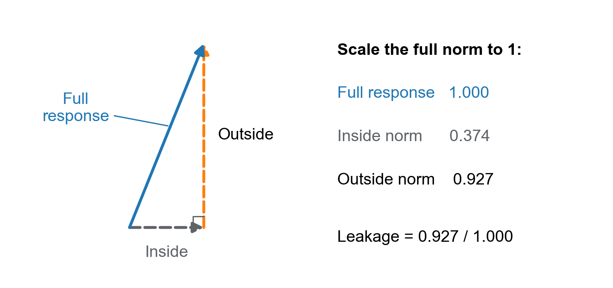

# Why did one-eighth power work well?

A guide to the Marin Hessian and gradient-Gram experiments

Prepared for Kaiyue • 11 November 2026

## Start here

**These measurements do not yet establish why one-eighth power gave lower final evaluation loss.**

An earlier comparison found a small loss advantage for power 1/8 in one training seed. The package proposed two explanations based on curvature, the local shape of the loss. We tested them using real saved model states.

The original measurements used the 1/4 training run. The added experiments examine the 1/8 trajectory, numerical accuracy, more directions, fresh gradient statistics, and actual optimizer updates.

Keep three questions separate:

1. **Shape:** Do the gradient statistics match the proposed curvature relationship?
2. **Trust:** Are the measurements accurate and broad enough?
3. **Behavior:** Does an optimizer step improve loss?

**Reading route.** Sections 1–3 explain the question and method. Sections 4–6 explain the original results, rejected fits, and leakage. Sections 7–8 cover the added experiments. Section 9 interprets the evidence. Appendix A gives optional formulas.

## 1. The motivation

### What the optimizer is trying to do

A language model has many adjustable numbers, called **weights**. A **loss** is a score for prediction error. Lower loss is better on the same data and under the same scoring rule.

Training repeatedly changes the weights to reduce loss. An **optimizer** is the rule that chooses those changes.

The **gradient** describes how loss changes under a very small change in the weights. For a sufficiently small step, moving against a nonzero gradient reduces this loss. The **Hessian** describes how that gradient changes as the weights move. It measures local curvature: some directions can bend sharply while others bend gently.

Unequal curvature can make optimization difficult. A step that is reasonable in a gentle direction may be too large in a sharp direction. **Preconditioning** means rescaling directions to account for these differences.

The optimizer in this experiment builds its rescaling from past gradients. It stores two **Gram matrices** for each matrix of weights. A Gram matrix summarizes products of gradient entries. The left Gram matrix is formed by multiplying a gradient matrix by its transpose. The right Gram matrix reverses that multiplication. A transpose swaps rows and columns. These two products describe relationships along the two dimensions of the gradient matrix.

These statistics are **exponential moving averages**, abbreviated EMA. Each new gradient receives a small weight. Older gradients receive progressively smaller weights. Here each update retains 99% of the previous Gram average and adds 1% of the new gradient product.

The parameter **alpha**, written α, controls the strength of the inverse power used in rescaling. Inverse powers reduce directions with larger Gram values relative to directions with smaller values. They can amplify directions with small values. A larger alpha strengthens this relative rescaling; it does not necessarily make the whole update smaller.

**Training alpha** is the setting used to produce a saved model. **Fit-derived alpha** is a value calculated afterward from a curvature measurement. They answer different questions and need not agree.

### Why 1/8 was interesting

The earlier single-seed comparison found final loss 3.784025 for α = 1/8 and 3.792297 for α = 0 on its held-out C4 text evaluation. Held-out text is text reserved for evaluation rather than used in the training sample. Lower is better. The observed difference was 0.008272.

The first recorded evaluation at or below C4 loss 4.0 occurred after 33,000 updates for α = 1/8 and 34,000 for α = 0. These correspond to 1.081 billion and 1.114 billion training tokens. A token is a unit of text processed by the model. This is an observed token advantage at that target, without interpolating between evaluations.

The 1/8 run nevertheless took longer to reach that target in its actual deployment. The runs used different hardware layouts, so this does not isolate the optimizer's intrinsic computational cost. The motivating benefit concerns loss and observed training tokens, not faster execution.

A **seed** controls random choices such as initialization and data order. One seed is one realization, not a test of how consistently the result repeats.

The comparison also used different tuned learning rates and different amounts of Gram stabilization. That stabilization is called a ridge and is explained in Section 3. A **learning rate** controls the overall size of an update. The completed and verified configurations included α = 0 and α = 1/8. The α = 1/4 and α = 1/2 runs had shutdown failures. Their recorded final evaluation losses were recovered from local logs. Those values provide supplementary evidence despite the job failures.

The earlier comparison was:

| Training α | Matrix learning rate | Ridge | Final C4 loss | Evidence status |
|---|---:|---:|---:|---|
| 0 | 0.003535534 | 0.0001 | 3.792297 | Verified completion |
| 1/8 | 0.0025 | 0.01 | 3.784025 | Verified completion |
| 1/4 | 0.002 | 0.01 | 3.844011 | Failed job; final evaluation recovered |
| 1/2 | 0.001 | 0.01 | 3.958380 | Failed job; final evaluation recovered |

The learning-rate column concerns the weight matrices using this optimizer. At α = 0, Gram rescaling is bypassed, so its ridge value does not affect that matrix direction. The separately tuned learning rates remain an important difference between the runs.

Thus, “1/8 worked best” is a motivating observation about that comparison. It is not an established universal optimum.

### Two explanations make different predictions

A **proxy** is a substitute statistic used to represent something else. Let **H** mean the Hessian in the directions we measure. Let **K** mean the gradient-Gram proxy in those same directions.

The raw proxy acts on a proposed weight change by multiplying it on the left by the left Gram matrix and on the right by the right Gram matrix. We then measure the components of that response along the chosen directions. This defines K. It puts the proxy and the Hessian into the same coordinates.

The proposed power relationship is K approximately equal to a positive constant times H raised to a power **r**. The fitted number r describes how rapidly Gram values change relative to curvature values.

An **eigenvalue** is the scaling factor associated with a special direction of a matrix, called an **eigenvector**. A **symmetric matrix** has the same entries when its row and column indices are exchanged. For a symmetric Hessian, eigenvalues are curvatures. For a Gram matrix, they are gradient-statistic scales.

A **matrix logarithm** applies the ordinary logarithm to positive eigenvalues while retaining their eigenvectors.

The fit also produces **rho**, written ρ. It measures how much of the variation in the matrix logarithm of K is explained by the fitted matrix logarithm of H, after removing overall scale.

The geometric goal is to make curvature more uniform after rescaling by an inverse power of K on both sides. **Centering** removes the mean of the log eigenvalues. The simplified calculation compares two centered matrix logarithms: the log Hessian and twice alpha times the log proxy. It minimizes the squared size of their difference.

This is an approximation to making rescaled curvature uniform; the exact grid check described in Section 3 evaluates the rescaled matrix directly.

For a positive fitted power, the approximation suggests α = ρ/(2r). The table applies this relation; Appendix A states the full formulas. This positive-matrix analysis requires every measured Hessian eigenvalue to be positive.

| Explanation | Expected r | Expected ρ | Fit-derived α |
|---|---:|---:|---:|
| An accurate fourth-power proxy | 4 | 1 | 1/8 |
| An imperfect squared-curvature proxy | 2 | 1/2 | 1/8 |
| An accurate squared-curvature proxy | 2 | 1 | 1/4 |

These are proposed diagnostic patterns. Finding α near 1/8 alone would not distinguish the first two explanations. We also need r and ρ.

**Rho is not a direct measurement of noise.** A poor fit could arise from sampling variation, changing weights during the stored history, different matrix directions, or an incorrect power-law model. Fresh measurements are needed to investigate those possibilities.

## 2. What was actually measured

### Saved models, not new training

A **checkpoint** is a saved model together with its training state. The original experiment restored three complete checkpoints from the α = 1/4, seed-0 trajectory. A **trajectory** is the sequence of states produced by one training run.

The supplied ZIP contained code for fitting exported matrices, but no real checkpoint measurements. A Marin measurement runner was added to produce those matrices from saved checkpoints. The supplied analysis program then fitted the exported results.

The recorded update counters were 3,733, 18,665, and 33,597. We call these early, middle, and late. The weights stayed fixed while curvature was measured.

The model has about 447 million parameters, another name for adjustable weights. It is an 11-layer Qwen-style transformer, a language-model architecture that repeatedly combines information across tokens and transforms features. A **layer** is one repeated processing stage. Each sequence contained 4,096 tokens, where a token is a unit of text used by the model.

### Two weight matrices and twelve directions

Measuring the full Hessian of a 447-million-parameter model is impractical here. Instead, the experiment measured two individual weight matrices. **Attention** combines information across token positions. The **MLP**, or multilayer perceptron, transforms features at each position. The query projection helps form the comparisons used by attention. The gate projection helps control which transformed MLP features pass through.

| Block | Weight matrix | Shape |
|---|---|---:|
| Attention | The first query projection matrix | 1,024 × 1,024 |
| MLP | The first gate projection in the feed-forward part | 4,096 × 1,024 |

Only the named matrix was allowed to change when its Hessian was differentiated. All other weights were held fixed.

For each matrix, the experiment selected twelve weight-change directions from the saved Gram matrices. The directions were selected before computing the Hessian. Each direction combines one left Gram eigenvector with one right Gram eigenvector. Multiplying every entry of the left vector by every entry of the right vector produces a matrix-shaped weight-change direction.

The selection excluded eigenvalues of either Gram matrix at or below one hundred-thousandth of that matrix's largest eigenvalue. For each candidate direction, it multiplied the associated left and right eigenvalues. It spread the twelve choices over the logarithms of those products. This targets a broad range of scales. It does not sample all weight directions uniformly.

The selected directions span a **subspace**: all changes that can be made by combining those twelve directions. The subspace is tiny compared with either full weight matrix.

### How the curvature was calculated

For each selected direction, the code calculated a **Hessian-vector product**, abbreviated HVP. An HVP tells us how the gradient responds to movement in that direction, without constructing the enormous full Hessian.

The code measured the component of that response along every selected direction. This operation is called **projection**. Thus, the measurement retained the full 12 × 12 matrix of interactions. It did not keep only twelve diagonal values.

The loss was next-token cross entropy plus the configured small z-loss term. Cross entropy penalizes assigning low probability to the correct next token. The z-loss term keeps the normalization of the model's prediction scores under control. Normalization converts those scores into probabilities that sum to one. The z-loss coefficient was 0.0000001.

Curvature used 32-bit floating-point weights and derivatives. Floating-point arithmetic stores approximate real numbers with a fixed number of bits. The calculation requested the highest available matrix-multiplication precision. Its attention and loss implementations supported the derivatives needed for the Hessian. Weight decay, which is a separate optimizer shrinkage term, was not included in the Hessian.

The stored Gram history came from globally combined, clipped training gradients. A **norm** measures size; here the gradient norm is the square root of the sum of squared gradient entries. Clipping shrinks a gradient when needed to keep that total norm at or below 0.1. Training used **mixed precision**, meaning that different parts of the computation used different numerical storage precisions. Therefore, the stored history and the smooth Hessian share the loss formula but do not use an identical numerical or clipping procedure.

### Which data were used

Each checkpoint used eight disjoint groups. Each group contained eight sequences of 4,096 tokens. This totals 262,144 token positions, with 262,080 valid next-token prediction positions after excluding positions without a scored next token.

The experiment used the same sequences at all three checkpoints. It verified this with hashes, compact identifiers computed from each sequence to detect matching content. This makes checkpoint comparisons less sensitive to changes in the sampled text.

The sequences came from a fresh permutation of the existing training caches, which are stored text prepared for the training data loader. They were fresh for this measurement. They were not certified as unseen during the original training run.

The group Hessians were averaged before taking a matrix logarithm. Each group received equal weight. Within each group, losses were weighted by the dataset's valid prediction weights and divided by their sum.

There were 192 main HVP evaluations per checkpoint, or 576 across the three successful measurements. Additional derivative checks were separate from this count. The four cooperating TPU hosts were parts of one distributed calculation, not four statistical repetitions.

## 3. How the analysis turns measurements into a fit

### The raw and ridged proxies answer different questions

Here H is curvature projected onto the chosen directions. K is the gradient-Gram proxy in those same coordinates. The Gram factors are the stored left and right Gram matrices.

The **raw proxy** multiplies a weight change on the left and right by the respective stored Gram factors, then projects the result onto the selected directions.

The **ridged proxy** first divides each factor by its own mean eigenvalue. It then adds 0.01 to each diagonal entry before combining the factors. A ridge keeps extremely small factor directions from producing unbounded inverse powers.

The ridged proxy is closer to the geometry used in the actual optimizer. It is not obtained by adding 0.01 to the diagonal of the already combined raw proxy.

Both proxies are expressed in the same selected directions as H. We analyze them separately.

### Three numbers have different meanings

**The fitted power r** describes the relationship between the two matrix logarithms.

**Centering** removes the mean of the log eigenvalues, so the comparison concerns differences among directions rather than an overall scale. **The fit quality ρ** is the fraction of squared variation in this centered log proxy explained by the fitted relationship. It is not the fraction of model behavior, loss, or full curvature explained.

**The log-based exponent α** is the rescaling strength suggested by a simplified geometric objective. For a positive fitted power, the package computes α = ρ/(2r).

If K were exactly a positive constant times H raised to r, and the matrices shared eigenvectors, the ideal geometric exponent would be 1/(2r). In that exact case, ρ equals 1. The two expressions then agree.

For example, consider two curvature values, 1 and 4. An exact fourth-power proxy has values 1 and 256. Applying its inverse one-eighth power on both sides of the Hessian makes both resulting curvatures equal to 1. This explains why a fourth-power relationship would suggest 1/8 in the idealized geometry.

The code also directly checks a grid of exponents from 0 to 0.5. It evaluates how uneven the rescaled log curvatures remain. The grid spacing is 0.005, with additional theoretical values included. A grid minimum is the best tested value for this geometric criterion. It is not a training-performance optimum.

## 4. The original quarter-power results

**The original MLP measurements did not show either proposed 1/8 pattern in their selected directions.**

The raw proxy gave powers near 1.1–1.2 and fit qualities near 0.92–0.94. Those values differ from both the proposed fourth-power pattern and the proposed imperfect squared-curvature pattern.

The following numbers are **descriptive fit values for these twelve directions**. The original experiment had not yet established the stronger empirical precision check described later. The later wider measurement adds that check for middle MLP; Section 8 reports it. Early and late values remain descriptive.

| Checkpoint | Raw r | Raw ρ | Raw fit-derived α | Ridged fit-derived α |
|---|---:|---:|---:|---:|
| Early | 1.245 | 0.938 | 0.377 | 0.405 |
| Middle | 1.194 | 0.916 | 0.384 | 0.412 |
| Late | 1.134 | 0.930 | 0.410 | 0.437 |

The direct geometric grid minima were 0.375, 0.385, and 0.410 for the raw proxy. For the ridged proxy, they were 0.405, 0.410, and 0.435.

**These values do not recommend changing the training exponent to about 0.4.** The measurement covers a small subspace, uses the quarter-power trajectory, and optimizes a geometric approximation. The full optimizer includes a nonlinear operation that the approximation does not model.

### What the uncertainty intervals do and do not say

A fit is retained only when its input passes the symmetry-error check defined in Section 5 and all measured Hessian and proxy eigenvalues are positive enough for the numerical logarithm. The smallest eigenvalue must exceed $10^{-12}$ times the largest eigenvalue. The stronger empirical precision screen was not part of the original analysis.

The package used a **bootstrap**: it repeatedly resampled the eight curvature groups with replacement and recalculated the fit. This estimates variation associated with those sampled groups while holding the checkpoint, Gram history, and selected directions fixed.

| Checkpoint | Raw fit-derived α interval | Ridged fit-derived α interval | Valid bootstrap repetitions |
|---|---:|---:|---:|
| Early | 0.371–0.384 | 0.399–0.413 | 1,000 / 1,000 |
| Middle | 0.381–0.386 | 0.410–0.415 | 1,000 / 1,000 |
| Late | 0.408–0.419 | 0.434–0.447 | 772 / 1,000 |

The intervals contain the middle 95% of the **valid** bootstrap results. At the late checkpoint, 228 repetitions failed the positivity requirement. The late interval therefore describes only the surviving repetitions. It is not an unconditional 95% interval.

These intervals do not include uncertainty from other training seeds, changing the selected directions, noise in the stored Gram history, or systematic numerical error.

## 5. What “no accepted fits” means

**“No accepted fits” means that no fit passed the requirements for the stated analysis. It does not mean that no measurements were made.**

The matrix-log analysis requires positive curvature in every measured direction. A symmetric matrix with all positive eigenvalues is called **positive definite**. Its real matrix logarithm is available for this analysis.

A Hessian can contain both positive and negative eigenvalues. Such a Hessian is **indefinite**. Negative curvature is possible for a neural network's loss. It is not automatically a programming error.

A true Hessian is **symmetric**: exchanging two directions leaves their interaction unchanged. The input check measures the difference between a calculated matrix and its transpose. It divides the square root of the sum of squared differences by the square root of the sum of squared matrix entries. Each group must have a ratio at most 0.00001.

The original attention results were:

| Checkpoint | Why the original analysis rejected the fit |
|---|---|
| Early | The mean projected Hessian had a negative eigenvalue, about −0.00107. |
| Middle | The mean projected Hessian had a negative eigenvalue, about −0.0767. |
| Late | One group's measured matrix exceeded the symmetry-error tolerance. |

A diagnostic also replaced the late mean matrix by the average of itself and its transpose. The set of eigenvalues is called the **spectrum**. This diagnostic spectrum included negative values. That calculation was diagnostic only; it did not repair the failed input check.

The code did not replace negative eigenvalues by their absolute values. It did not add a shift to make the Hessian positive. Those changes would answer a different question.

This result limits the proposed positive-power explanation in the measured attention subspace. It does not prove that the optimizer is ineffective. It also does not prove that the full model has no useful curvature structure.

The phrase can refer to different filters in different outputs. A rejection due to negative curvature, failed symmetry, unresolved precision, or an invalid bootstrap sample should always be accompanied by its specific reason.

## 6. What “leakage” means

**Leakage is the part of a curvature response that leaves the selected directions. It is not a data leak.**

Imagine that we chose twelve directions in which to move a weight matrix. We move in one of them and ask how the gradient changes. The gradient's response may point partly along those twelve directions and partly elsewhere.

The response that points elsewhere is the leaked component. It still lies within the same weight matrix in this experiment. Responses in other layers were not measured.

The size of a response is measured by the square root of the sum of its squared entries. The reported leakage is a ratio of these norms: the size of the response outside the subspace divided by the size of the full response, combining all tested directions. The group responses are averaged first.

| Checkpoint | Attention leakage | MLP leakage |
|---|---:|---:|
| Early | 0.419 | 0.490 |
| Middle | 0.927 | 0.297 |
| Late | 0.693 | 0.382 |

For example, middle attention has leakage about 0.927. The outside component has about 92.7% of the full response's norm. This does not mean that 92.7% of examples, parameters, or loss escaped the analysis.

{width=100%}

The two components are perpendicular. Their squared norms add to the full squared norm. Their ordinary norms do not add to one.

The ratio is also not the fraction of squared norm. Squaring 0.927 gives about 0.860 for that different quantity.

**High leakage limits how broadly we can interpret a good fit inside the subspace.** The selected directions may fit each other well while substantial curvature response points into unmeasured directions.

The selected Gram directions changed across checkpoints. Therefore, changes in leakage are not a clean time trend in one fixed subspace.

## 7. Why the follow-up experiments were necessary

The original work produced real measurements, but several measurements were narrower than the motivating question. Seven additional experiments addressed these gaps: three checkpoints from the one-eighth trajectory, two measurements with 48 directions, and two controls combining fresh histories with actual optimizer steps. Section 8 gives their results.

| Gap in the original experiment | Added experiment | What it can establish |
|---|---|---|
| The motivating result concerned the 1/8 run; measurements used the 1/4 run. | Measure saved states from the 1/8 trajectory. | Whether the proposed patterns appear in the motivating trajectory. |
| The smallest curvature values lacked a direct precision calibration. | Compare every projected HVP column with nearby-weight derivative estimates at two step sizes. | Empirical agreement at the scale needed by the projected fit. |
| Twelve directions could miss substantial response. | Expand to 48 directions, retaining the original twelve. | Sensitivity to a wider measured set and changes in leakage. |
| One stored history could not identify sampling variability. | Build two disjoint fresh Gram histories with weights held fixed. | Whether fresh statistics agree with each other and with the saved history. |
| A geometric optimum was not an optimizer-performance result. | Compare full optimizer updates on paired evaluation batches. | Local loss effects of changing alpha under controlled state and data. |

The wider set adds 36 directions from the same saved left and right Gram matrices. As in the original selection, the added directions cover a range of products of Gram eigenvalues on a logarithmic scale. Leakage is compared using the same original twelve input directions and the same full-response denominator. Only the output projection expands from twelve to 48 directions. Forty-eight directions still cover a very small part of either weight matrix.

The 1/8 checkpoint labels are offset from the 1/4 labels. Their expected restored counters differ by one update. These are nearly matched training times, not exactly identical counters.

### Numerical accuracy is checked at the relevant scale

**Automatic differentiation** applies derivative rules to the operations in the model code. A **finite difference** instead estimates a derivative by evaluating nearby weights. A central difference uses changes in both the positive and negative direction.

The original check compared automatic differentiation with central finite differences in three selected directions on the first data group. For each direction, it divided the norm of their HVP difference by the norm of the automatic-differentiation HVP. It required this relative error to be below 2% at two adjacent perturbation sizes.

Large perturbations can leave the local regime. Tiny perturbations can lose accuracy because finite-precision arithmetic subtracts nearly equal values.

The follow-up retains the 2% requirement. It checks every measured direction on every group. It projects the finite-difference responses onto the full chosen basis.

The original MLP Hessians had smallest-to-largest eigenvalue ratios of roughly $2\times10^{-8}$ to $7\times10^{-8}$. A small error relative to the largest response can still be large relative to a weak direction. This is why a global 2% check alone does not settle the precision question.

The screen first checks the symmetry of each automatic-differentiation matrix. It averages the eight groups. Each averaged matrix is replaced by the average of itself and its transpose before comparing the estimates. This makes the averaged estimates symmetric; it does not make negative eigenvalues positive.

For a positive mean Hessian, the precision screen then has four stages:

1. Rescale the coordinates so the mean Hessian's diagonal entries are comparable.
2. Form three differences: automatic differentiation versus each finite-difference estimate, and the two finite-difference estimates versus each other.
3. Apply the same coordinate rescaling to every difference. Measure its **spectral norm**, the largest possible output norm for a unit input. Keep the largest of the three discrepancies.
4. Require the smallest rescaled Hessian eigenvalue to exceed ten times that discrepancy.

This is an **empirical agreement screen**. It is not a rigorous bound on errors shared by both differentiation methods. A failed screen means the power fit remains unresolved at this precision. A passed screen does not remove the limitations from data sampling or subspace selection.

### Fresh histories separate one source of uncertainty

Each fresh history used 512 batches at unchanged weights. It collects statistics for the same two weight matrices. Gradient clipping is calculated across the full model. It uses the original Gram averaging factor of 0.99 and global gradient clipping. The finite-history average is corrected for starting from zero.

This weighting gives about 197 effective equally weighted samples. “Effective” describes the concentration of the EMA weights; it does not assert that text batches are statistically independent.

The two histories use separately randomized, disjoint text windows. Sequence hashes are checked against each other and against the curvature data. Here, disjoint means that no complete token sequence repeats under this check. Shared documents or shorter text fragments are not ruled out. A candidate batch containing any repeated sequence is skipped. The accepted source positions and the rejection counts are recorded. Both fresh histories are expressed in the basis chosen from the saved history. We retain interactions between different basis directions, called off-diagonal entries. Fresh statistics can therefore disagree with the saved history in direction as well as scale.

If the fresh histories agree with each other but differ from the saved history, that would be evidence against fresh sampling variability as the sole explanation. Historical drift and numerical differences would still need consideration. Two histories do not identify a complete noise model.

### Actual optimizer updates test a different claim

The optimizer uses **momentum**, a running average of gradients.

Any matrix can be described by paired input and output directions and their nonnegative scaling strengths, called **singular values**. When all singular values are positive, the exact **polar operation** keeps those paired directions and replaces their scaling values by ones. The implementation approximates this operation.

The optimizer rescales momentum, applies the polar operation, and rescales again. Thus, alpha affects both the input to the polar operation and its output. Appendix A gives the formula.

**Candidate alpha** is the value tried for one hypothetical optimizer step. The earlier training history stays fixed. The follow-up compares candidate α = 0, 1/8, 1/4, 3/8, and 1/2. Each full update changes all parameters that the production optimizer normally changes. It is not restricted to the two matrices whose curvature was measured.

Each candidate starts from the same complete saved state and the same fresh gradient. The learning-rate schedule and weight decay are held fixed across candidates within a checkpoint.

These update comparisons use the saved optimizer history, updated with that one gradient. They do not replace it with either of the two fresh histories measured for the separate sampling diagnostic.

The comparison uses two versions of each update. The **native version** keeps the optimizer's original update magnitude. The second version rescales its total norm to match the α = 0 update. Both versions are tested at one-tenth, three-tenths, and their full size. Norm matching rescales the entire update, including parameters handled outside the Gram transform, such as embedding weights and biases; it is an explicit diagnostic modification.

Sixteen separate evaluation batches are reused across all candidates. This makes loss differences paired: each candidate is assessed on exactly the same text. The evaluation text is disjoint from the new gradient and history measurements, but is still drawn from training caches.

The sixteen batches measure evaluation variation conditional on one update-gradient batch and one saved state. They do not measure variation across update-gradient draws or training seeds.

These are hypothetical local steps from a checkpoint. They do not continue the training trajectory. A better immediate loss change does not establish better performance after thousands of further steps.

## 8. Follow-up results

**All three checkpoints of the motivating one-eighth trajectory have been measured successfully.**

These are twelve-direction measurements at restored update counters 3,734, 18,666, and 33,598. Their execution, saved results, and online tracking were verified complete. The wider measurements and both optimizer controls are reported below.

The **precision margin** divides the smallest rescaled eigenvalue by the largest measured discrepancy. The required margin is ten. Early attention passes only narrowly.

| Checkpoint and block | Mean passes the empirical screen? | Precision margin |
|---|---|---:|
| Early attention | Yes | 10.9 |
| Early MLP | No: a negative measured eigenvalue | Not evaluated |
| Middle attention | Yes | 29.2 |
| Middle MLP | Yes | 36.4 |
| Late attention | No: a negative measured eigenvalue | Not evaluated |
| Late MLP | No: insufficient precision margin | 4.8 |

The early MLP's smallest measured eigenvalue is approximately $-4.79\times10^{-8}$, while its largest is about 1.94. This fails the positive-matrix requirement. The screen stops there, so it does not separately establish that the sign of this very small negative value is numerically resolved. The correct conclusion is rejection of this fit, not a certified claim about negative curvature at that scale.

At the late checkpoint, attention also fails positivity. Its smallest measured eigenvalue is approximately $-4.79\times10^{-7}$, against a largest value of about 2.66. The same qualification about an uncalibrated negative sign applies.

Late MLP is positive and passes the original numerical gate. Its empirical precision margin is only 4.8, below the required ten. Its descriptive raw fit would give r = 1.141, ρ = 0.968, and alpha = 0.424. **That estimate is unresolved under the stronger screen and is excluded from the accepted-fit table.**

The accepted mean fits are:

| Checkpoint and block | Raw r | Raw ρ | Raw fit-derived α | Ridged fit-derived α |
|---|---:|---:|---:|---:|
| Early attention | 1.318 | 0.976 | 0.370 | 0.377 |
| Middle attention | 1.242 | 0.974 | 0.392 | 0.410 |
| Middle MLP | 1.189 | 0.966 | 0.406 | 0.428 |

**The accepted mean fits do not show either proposed one-eighth pattern.** Their raw powers are near 1.2–1.3, rather than 2 or 4. This statement applies to these selected directions and saved states.

### Fixed powers two and four fit worse in these accepted means

A **residual** is the difference left after fitting a relationship. Here the residual score is squared error in the centered log proxy, divided by the squared size of that proxy. Smaller is better. A score above one means the error exceeds this reference size.

| Checkpoint and block | Residual: fitted r | Residual: r = 2 | Residual: r = 4 |
|---|---:|---:|---:|
| Early attention | 0.024 | 0.285 | 4.063 |
| Middle attention | 0.026 | 0.388 | 4.827 |
| Middle MLP | 0.034 | 0.483 | 5.429 |

These are residual scores for the raw proxy, not fitted power values. The fourth-power relation fits particularly poorly in these measured subspaces.

The direct geometric grid also agrees closely with the log-based calculation here. Its raw optima are 0.370, 0.390, and 0.405 in the table's row order. The ridged optima are 0.375, 0.410, and 0.425. Agreement between these two geometric calculations still does not establish the best training alpha.

### Acceptance of a mean does not make sampling uncertainty disappear

For the follow-up, the empirical precision screen is reapplied to every bootstrap resample. A resample must pass both that screen and the original numerical requirements before contributing to an interval.

| Checkpoint and block | Accepted | Rejected: indefinite | Rejected: precision |
|---|---:|---:|---:|
| Early attention | 511 / 1,000 | 47 | 442 |
| Middle attention | 619 / 1,000 | 178 | 203 |
| Middle MLP | 585 / 1,000 | 281 | 134 |

The raw-proxy intervals are:

| Checkpoint and block | Fitted r interval | Fit-derived α interval |
|---|---:|---:|
| Early attention | 1.295–1.422 | 0.337–0.377 |
| Middle attention | 1.192–1.294 | 0.372–0.414 |
| Middle MLP | 1.161–1.213 | 0.395–0.416 |

These are the middle 95% intervals **conditional on passing both screens**. The many rejected resamples are part of the result. They limit certainty about the mean Hessian in the selected directions.

A separate diagnostic also fits the four even-indexed groups on their own. That half of the middle MLP data fails positivity even though the eight-group mean passes. The fit is therefore sensitive to the sampled text.

### The trajectory comparison needs a narrow interpretation

Attention at the middle one-eighth checkpoint is positive in its selected subspace. The original quarter-power attention measurement was indefinite. This difference shows that conclusions from the quarter-power measurement cannot simply be transferred to the motivating trajectory.

It does not establish that changing alpha caused the sign difference. These are separately trained states with different tuned learning rates and different Gram-selected directions. Their counters also differ by one update.

The one-eighth trajectory has the following leakage values:

| Checkpoint | Attention leakage | MLP leakage |
|---|---:|---:|
| Early | 0.517 | 0.513 |
| Middle | 0.388 | 0.514 |
| Late | 0.354 | 0.514 |

These values concern different Gram-selected subspaces at each checkpoint. The wider measurements below test how much additional response is captured when the original twelve input directions are retained.

### Full optimizer steps at the quarter-power checkpoint

**Every full native step increased mean evaluation loss at this checkpoint.** Some candidate powers caused a smaller increase than others. That is different from improving on the unchanged model.

This control restored the middle quarter-power state at counter 18,665. It completed two 512-batch fresh histories and all 30 update comparisons. All 8,392 complete sequences recorded across curvature exclusions, histories, the update batch, and evaluation were unique under the hash check. Twenty-five candidate batches containing duplicate sequences were rejected.

The unchanged checkpoint's mean evaluation loss was 3.673041. This uses the local training-cache evaluation defined in Section 7, rather than the earlier C4 evaluation.

**Loss change means loss after the hypothetical step minus loss at the unchanged checkpoint.** Negative is improvement. Positive is deterioration.

The table multiplies loss changes by 1,000 for readability. Thus, a value of +1.000 means an increase of 0.001 loss units. It uses the full native update size.

| Candidate α | Mean change × 1,000 | Conditional interval × 1,000 |
|---|---:|---:|
| 0 | +9.873 | [8.948, 10.790] |
| 1/8 | +1.004 | [0.498, 1.505] |
| 1/4 | +0.484 | [0.048, 0.890] |
| 3/8 | +0.548 | [−0.115, 1.173] |
| 1/2 | +3.987 | [2.975, 4.950] |

These are middle 95% intervals from 10,000 resamples of the sixteen paired evaluation batches. The checkpoint and the one update-gradient batch stay fixed. The intervals are descriptive and are not adjusted for comparing many candidates.

At smaller step fractions, some mean changes were negative. Their loss-change intervals included zero. These data do not establish a reliable immediate improvement at this checkpoint.

### Update size changes the comparison

The full native update norm ranged from 0.862 at α = 0 to 24.691 at α = 1/2. The second arm rescaled every candidate to norm 0.862 before applying the chosen step fraction.

At full native size, α = 1/4 caused a smaller loss increase than α = 1/8. Their paired difference was −0.000520, with interval [−0.000820, −0.000231]. After matching update norms, the difference was −0.000241, with interval [−0.000524, +0.000033].

This shows that the update-size convention matters when interpreting the comparison. Norm matching rescales the whole update, including parameters handled by AdamW. It does not isolate only the direction of the two measured matrices.

### Full optimizer steps at the one-eighth checkpoint

**The one-eighth checkpoint did not select one-eighth as a unique best next-step power.** At native update size, candidate α = 1/4 gave a larger mean loss reduction. Matching norms made the α = 1/8 and α = 1/4 mean changes nearly equal.

This control restored counter 18,666 and completed all 30 comparisons. Its fresh histories, update batch, and evaluation batches used exactly the same complete sequences as the quarter-power control. Its unchanged-model mean evaluation loss was 3.620126.

The full native-step results below use the same loss-change definition and ×1,000 scale as the previous table.

| Candidate α | Mean change × 1,000 | Conditional interval × 1,000 |
|---|---:|---:|
| 0 | +1.766 | [1.051, 2.473] |
| 1/8 | −0.349 | [−0.853, 0.093] |
| 1/4 | −0.625 | [−1.112, −0.208] |
| 3/8 | −0.477 | [−1.029, −0.013] |
| 1/2 | +0.451 | [−0.286, 1.085] |

At one-tenth and three-tenths of native size, all five candidates reduced mean loss, and their individual conditional intervals were below zero. For example, candidate α = 0 changed from +0.001766 at full size to −0.000392 at three-tenths size. Its full-step deterioration therefore does not mean that its direction is always harmful.

The paired native loss difference between candidate α = 1/4 and candidate α = 1/8 was −0.000276. Its conditional interval was [−0.000361, −0.000183]. This comparison holds the starting model, history, gradient, and evaluation text fixed.

After matching full update norms to 0.994, the mean changes were −0.00050436 for α = 1/8 and −0.00050458 for α = 1/4. Their paired difference interval was [−0.000165, +0.000169]. These data do not distinguish their loss changes under this normalization; they do not prove the methods equivalent.

The native α = 1/2 update had norm 11.093. Matching its norm to 0.994 changed the sign of its measured mean loss change: from +0.000451 to −0.000211. This is a concrete example of how update magnitude affects a local comparison.

**These are conditional local effects, not a new training ranking.** One gradient and one saved state were used per checkpoint. Different training seeds, gradients, learning-rate treatments, and longer trajectories could change the outcome. The sixteen-batch intervals also do not measure systematic error from the native mixed-precision computation.

The accompanying [optimizer-step table](optimizer-step-results.csv) lists all sixty tested branches, including the smaller step fractions and both norm conventions.

### A wider measurement passes for quarter-power MLP, but not for every block

**A good fit in twelve directions does not guarantee a valid fit in 48 directions.** Both wider experiments used the middle checkpoint. They retained the original twelve directions and the same eight curvature groups. Their twelve-by-twelve curvature matrices exactly reproduce the earlier middle measurements.

| Training trajectory and block | Twelve-direction result | 48-direction result |
|---|---|---|
| 1/4 attention | Rejected; derivative check incomplete | Rejected; derivative check incomplete |
| 1/4 MLP | Accepted; margin 193.1 | Accepted; margin 42.0 |
| 1/8 attention | Accepted; margin 29.2 | Rejected: measured negative eigenvalue |
| 1/8 MLP | Accepted; margin 36.4 | Unresolved; margin 7.1 |

The required precision margin is ten. Quarter-power attention has a negative mean eigenvalue in both dimensions. One direction/group pair also lacks two adjacent finite-difference steps passing the unchanged 2% test. Its derivative reference is therefore incomplete. The empirical screen does not certify this block. The negative measured values remain a separate reason the positive-matrix fit fails.

For one-eighth attention, the 48-direction minimum is approximately $-5.16\times10^{-7}$, against a maximum of 1.199. The screen rejects positivity before calibrating the negative sign. All per-direction derivative checks passed, but that alone does not certify the sign of this small eigenvalue.

For one-eighth MLP, all per-direction checks also passed. Its mean is positive, but its margin of 7.1 falls short of ten. Its descriptive raw fit-derived alpha is 0.376. **That wider fit is unresolved and is not an accepted estimate.**

The quarter-power MLP measurement provides a useful positive result. It adds the missing empirical precision check to the original middle-checkpoint fit. Early and late quarter-power MLP still lack that added check.

| Directions | Raw r | Raw ρ | Raw fit-derived α | Ridged fit-derived α |
|---|---:|---:|---:|---:|
| Twelve directions | 1.194 | 0.916 | 0.384 | 0.412 |
| 48 directions | 1.147 | 0.883 | 0.385 | 0.413 |

The fit-derived alpha is stable in this expansion, although the explained fraction decreases. The direct grid chooses raw alpha 0.385 and ridged alpha 0.410 in both dimensions. This supports stability of this particular geometric answer, not a whole-model optimum.

At 48 directions, 663 of 1,000 bootstrap resamples pass both screens. Another 247 are indefinite and 90 are unresolved. The accepted raw alpha interval is 0.383–0.387. At twelve directions, all 1,000 pass. Expanding the measured space therefore exposes sampling sensitivity even when the full-data mean passes.

### Adding Gram directions barely reduces leakage

**The extra 36 directions capture very little of the response that escaped the original twelve.** This comparison keeps the original twelve HVP inputs fixed. It changes only how many output directions are used to represent their response.

| Middle checkpoint and block | Leakage into unmeasured directions: 12 outputs | Leakage: 48 outputs |
|---|---:|---:|
| 1/4 attention | 0.927401 | 0.926993 |
| 1/4 MLP | 0.296787 | 0.296575 |
| 1/8 attention | 0.387614 | 0.387059 |
| 1/8 MLP | 0.513949 | 0.513878 |

These are response-norm ratios, not percentages of data or squared response energy. The decreases are less than 0.001 in every row. The selected additions therefore do not solve the leakage problem.

This does not show that every possible 48-direction basis would perform poorly. The added directions come from the same Gram construction. Different directions, including directions chosen from the escaping responses, could capture more. Quarter-power attention also retains the derivative-validation limitation described above; its leakage values are measured diagnostics rather than a calibrated full-curvature claim.

### Fresh histories differ more from the saved history than from each other

**At both checkpoints, the two fresh Gram histories agree more closely with each other than with the stored history.** This comparison concerns the proxies themselves. It remains calculable even when the Hessian fails the positive-matrix analysis.

We compare the centered matrix logarithms of the projected proxies. Centering removes overall scale, so the comparison measures differences in relative scales and directions. The distance is the square root of the sum of squared entry differences, divided by the square root of the number of directions. Smaller means closer under this particular definition.

The following table uses the raw proxy in 48 directions. “Fresh 1” and “Fresh 2” are the two separately sampled histories at the same frozen weights.

| Checkpoint and block | Fresh 1 versus fresh 2 | Saved versus fresh 1 | Saved versus fresh 2 |
|---|---:|---:|---:|
| 1/4 attention | 0.178 | 0.838 | 0.869 |
| 1/4 MLP | 0.264 | 1.741 | 1.754 |
| 1/8 attention | 0.151 | 0.627 | 0.665 |
| 1/8 MLP | 0.156 | 1.144 | 1.155 |

The same ordering holds for the ridged proxy and for the twelve-direction restrictions. It suggests that fresh-sample variability alone is an incomplete account of the saved-versus-fresh discrepancy in these measurements.

The saved EMA includes gradients from weights that changed during training. The fresh histories hold weights fixed. Historical change is therefore a plausible contributor. Finite sampling, data distribution, clipping, and differences in numerical computation also need consideration. Two fresh histories do not assign a variance to each cause or prove that drift is the sole cause.

### Fresh statistics change the geometric answer

**Replacing the saved proxy with a fresh proxy moves the accepted geometric estimates toward larger alpha.** The Hessian, coordinates, and acceptance screen stay fixed in this comparison.

The table includes only cases with accepted mean fits. It reports the raw proxy. The two fresh entries correspond to separately randomized, disjoint sets of complete sequences. They are not independent training runs.

| Checkpoint, block, directions | Saved fit-derived α | Fresh 1 α | Fresh 2 α |
|---|---:|---:|---:|
| 1/4 MLP, 12 | 0.384 | 0.473 | 0.477 |
| 1/4 MLP, 48 | 0.385 | 0.469 | 0.474 |
| 1/8 attention, 12 | 0.392 | 0.431 | 0.432 |
| 1/8 MLP, 12 | 0.406 | 0.461 | 0.466 |

Across these fresh fits, raw r ranges from 1.042 to 1.142 and raw ρ from 0.983 to 0.997. They still do not match either proposed one-eighth pattern. The ridged fit-derived alphas range from 0.442 to 0.490. Detailed fits and direct-grid checks are included in the evidence.

Changing the proxy does not repair an invalid Hessian. Quarter-power attention and one-eighth attention at 48 directions remain rejected. One-eighth MLP at 48 directions remains unresolved. Their fresh proxies are not promoted into accepted power fits.

Bootstrap intervals for each fresh-proxy fit hold that proxy fixed. They capture resampling of curvature groups, not joint uncertainty in both the Hessian and fresh Gram history. The two-history comparison is a separate diagnostic.

These fresh proxies were not substituted into the full optimizer-step experiments. The local loss results above use the saved optimizer state. A fresh geometric alpha near one-half therefore does not predict the observed loss effect of candidate one-half in those controls.

## 9. How to interpret the evidence

**The added experiments address the measured mismatches, but they do not establish why one-eighth power won the earlier training comparison.**

The results give five specific answers.

1. **The motivating trajectory was measured.** The accepted early and middle one-eighth fits have raw powers near 1.2–1.3. They do not match either proposed one-eighth pattern. Several other blocks fail positivity or the precision screen.
2. **Some geometric estimates survive stronger checks.** Quarter-power middle MLP passes the empirical screen at both twelve and 48 directions. Its fit-derived alpha stays near 0.38–0.41, depending on the proxy. That is a geometric result in selected directions.
3. **The wider measurement does not resolve leakage.** Adding 36 Gram directions barely captures the escaping response. One-eighth attention also loses positivity in the wider space, and one-eighth MLP becomes unresolved.
4. **The saved history matters.** Fresh histories agree more with each other than with the saved EMA. Accepted fresh fits move toward larger geometric alpha. These observations motivate studying history dependence, without identifying a complete noise or drift model.
5. **Actual next-step behavior depends on update size.** At the one-eighth state, quarter power improves the local mean more than one-eighth at native size. Matching whole-update norms makes their mean changes nearly equal. At the quarter-power state, every full native candidate increases mean loss.

“No accepted fits” and high leakage are limits on specific measurements. They do not mean that no experiment ran, that data were exposed, or that the optimizer cannot work.

The completed work contains three original checkpoint measurements and seven added experiments. The follow-ups calculate 2,112 main HVPs across the two blocks, in addition to derivative checks. They also measure four fresh histories of 512 batches each and sixty hypothetical full-optimizer branches. None is a new training trajectory.

The remaining gap is a **causal explanation of final training performance**. That requires controlled training comparisons, repeated seeds, and a clearly chosen learning-rate treatment. Repeating only the local geometric fit cannot answer that question.

A direct next test would compare the candidate powers from common starting states under both a fixed learning-rate schedule and a clearly specified tuning budget. Repeated gradient draws would strengthen the local controls. Longer training would then test whether local advantages persist to the intended evaluation outcome. These are future experiments, not results claimed here.

## Appendix A. Exact mathematical definitions

### Projected curvature and the proxy

Let $W$ be one weight matrix. Let $\ell(W)$ be the group-averaged loss with all other weights fixed. Let $e_1,\ldots,e_d$ be the selected unit weight-change directions. Here $d=12$ in the original experiment. The directions are mutually orthogonal under the sum of entrywise products.

The notation $\langle\cdot,\cdot\rangle$ means the sum of entrywise products. The operator $\nabla^2\ell$ is the full Hessian for this weight block. The projected Hessian entry is

$$H_{ij}=\langle e_i,\nabla^2\ell(W)e_j\rangle.$$

Let $L$ and $R$ be the saved left and right Gram matrices. Let $E$ be a matrix-shaped weight change. The raw proxy maps $E$ to $LER$. Its projected entry is

$$K_{ij}=\langle e_i,Le_jR\rangle.$$

This definition avoids constructing the much larger matrix that would act on a list of every weight entry.

The **trace**, written $\operatorname{tr}$, is the sum of diagonal entries. The **identity matrix**, written $I$, leaves a vector unchanged when multiplying it. Let $m$ and $n$ denote the numbers of rows and columns of $W$. Define the normalized, ridged factors

$$A=\frac{L}{\operatorname{tr}(L)/m}+0.01I,$$

$$B=\frac{R}{\operatorname{tr}(R)/n}+0.01I.$$

For the ridged proxy, replace $L$ and $R$ by $A$ and $B$ in the proxy action.

### The matrix-log fit

For positive definite $H$ and $K$, define their centered logarithms as

$$X=\log H-\frac{\operatorname{tr}(\log H)}{d}I,$$

$$Z=\log K-\frac{\operatorname{tr}(\log K)}{d}I.$$

Centering removes the overall logarithmic scale. The Frobenius inner product sums products of corresponding entries. Its squared norm is $\|X\|_F^2=\langle X,X\rangle$.

The fitted power is

$$r=\frac{\langle X,Z\rangle}{\|X\|_F^2}.$$

The explained fraction is

$$\rho=\frac{\langle X,Z\rangle^2}{\|X\|_F^2\|Z\|_F^2}.$$

The unconstrained log-based exponent minimizes $\|X-2\alpha Z\|_F^2$. Its value is

$$\alpha_{\log}=\frac{\langle X,Z\rangle}{2\|Z\|_F^2}.$$

When $r>0$, this equals $\rho/(2r)$. The reported nonnegative version replaces a negative exponent by zero. These formulas require nonzero centered variation. Symmetry and positive definiteness are checked before fitting.

The direct grid instead evaluates

$$K^{-\alpha}HK^{-\alpha}.$$

It minimizes the mean squared centered logarithm of this matrix's eigenvalues. Multiplying a matrix on both sides this way is a **congruence transformation**.

Matrix logarithms do not generally turn multiplication into addition when the matrices have different eigenvectors. The direct grid therefore checks the transformed matrix itself. It does not assume its centered logarithm equals $X-2\alpha Z$.

### Leakage

Place each matrix-shaped direction into a column by listing its entries in a fixed order. Let $Q$ collect these columns. A superscript $T$ denotes a transpose. Let $P=QQ^T$ be the orthogonal projection onto the selected span.

Let $H_{\mathrm{full}}$ denote the averaged Hessian operator within the chosen weight block. The subscript $F$ denotes the Frobenius norm, the square root of the sum of squared entries. The measured leakage is

$$\frac{\|(I-P)H_{\mathrm{full}}Q\|_F}{\|H_{\mathrm{full}}Q\|_F}.$$

For the wider-output comparison, $Q$ still contains the original twelve input directions, while $P$ projects onto all 48 output directions. In that comparison, $P$ is built from the expanded basis rather than from $Q$ alone.

This quantity concerns responses to the selected input directions. It does not average over every possible direction in the weight block.

### The optimizer's matrix direction

Let $M$ be the saved or freshly updated momentum matrix. With the normalized, ridged factors $A$ and $B$ above, the matrix direction before applying the negative learning-rate factor is

$$A^{-\alpha}\operatorname{polar}\!\left(A^{-\alpha}MB^{-\alpha}\right)B^{-\alpha}.$$

Let $C$ be the matrix entering the polar operation. Its singular value decomposition represents it using mutually perpendicular unit output directions in $U$, mutually perpendicular unit input directions in $V$, and nonnegative scaling values on the diagonal of $\Sigma$.

This gives $C=U\Sigma V^T$. When all singular values are positive, the exact polar factor is $UV^T$. The production optimizer uses five Newton–Schulz iterations, repeated matrix calculations that approximate that factor.

The optimizer also applies learning-rate scaling and weight decay. Parameters handled outside this matrix transform use **AdamW**. AdamW rescales individual coordinates using running averages of gradients and their squares, with a separate weight-decay term.

These additional operations are why the Hessian congruence criterion is not the full training update. Momentum-based directions need not improve loss on every individual step.

## Appendix B. Evidence and reproducibility

The scientific specification is the supplied Hessian Power Analysis Package: its brief, README, and analysis script. The package's synthetic examples were validation cases, not real checkpoint results.

The original measurement records contain per-group matrices, Gram projections, basis selections, sequence hashes, derivative checks, bootstrap results, and rejection reasons. All three original successful jobs were verified complete, including online experiment tracking.

The report's values are drawn from those saved records. The original unmodified analysis requires the smallest eigenvalue to exceed $10^{-12}$ times the largest. Its input symmetry tolerance is $10^{-5}$ under the difference-to-matrix norm ratio defined in Section 5. A numerical gate alone is not a measurement-error estimate.

The accompanying [evidence index](evidence-index.md) identifies source commits, checkpoint paths, artifact locations, and exact experiment configurations. It also distinguishes the original measurements from the follow-ups. Execution logs and failed attempts remain in the evidence archive rather than being treated as additional successful experiments.
