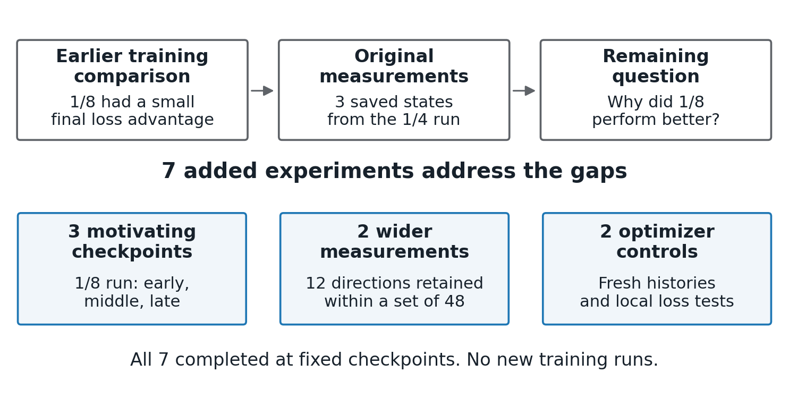
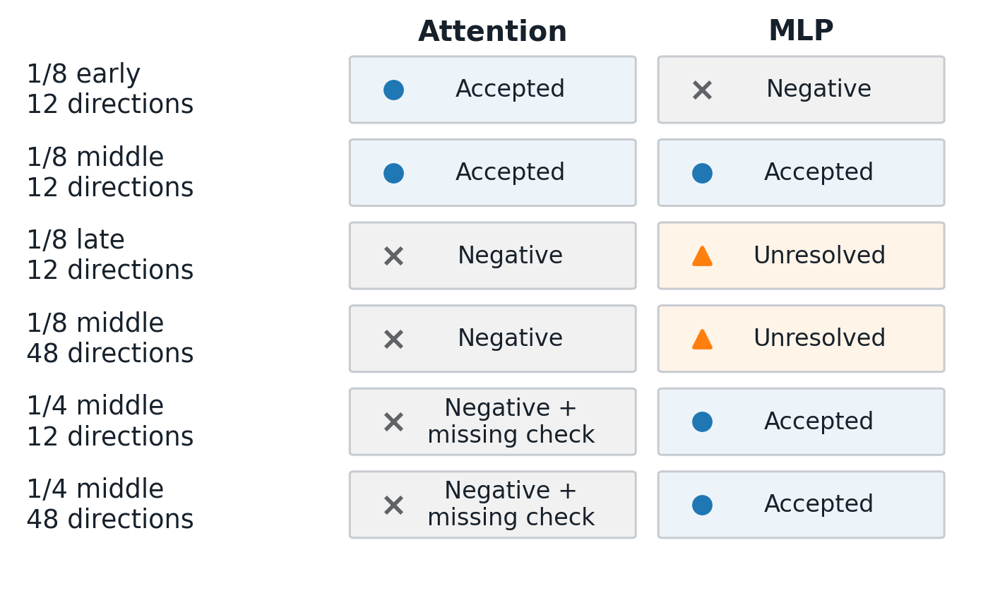
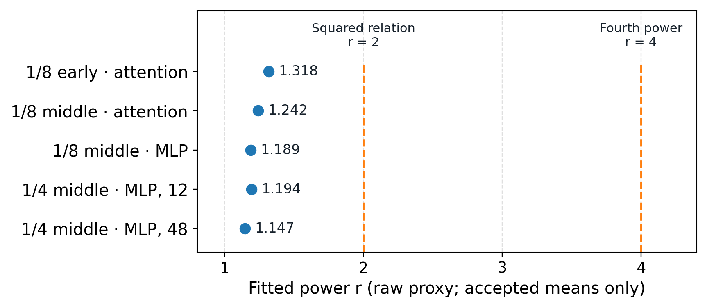
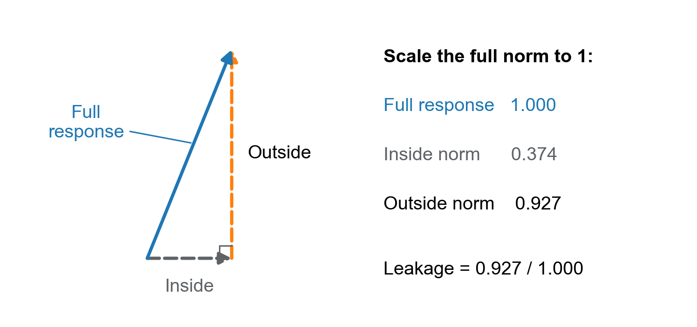
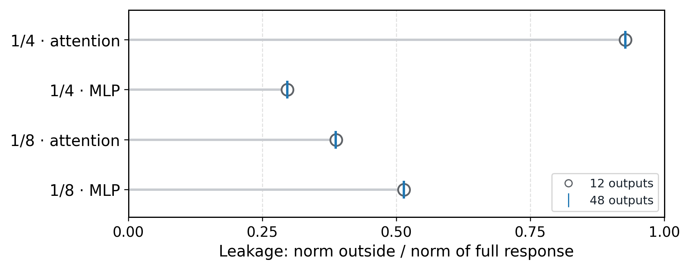
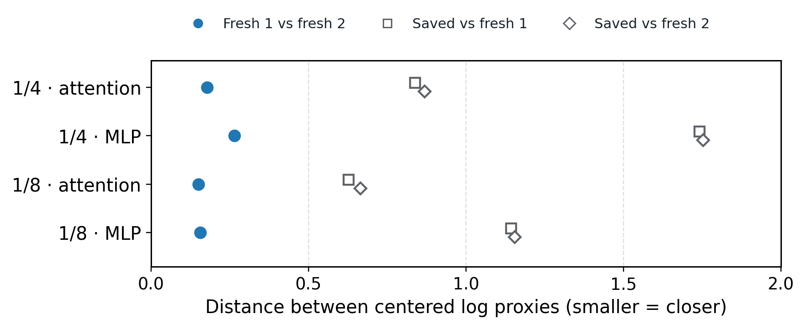
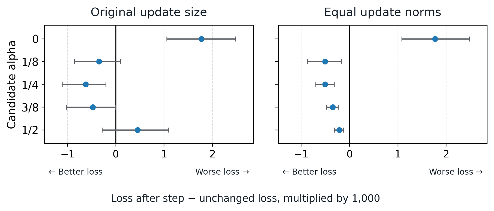
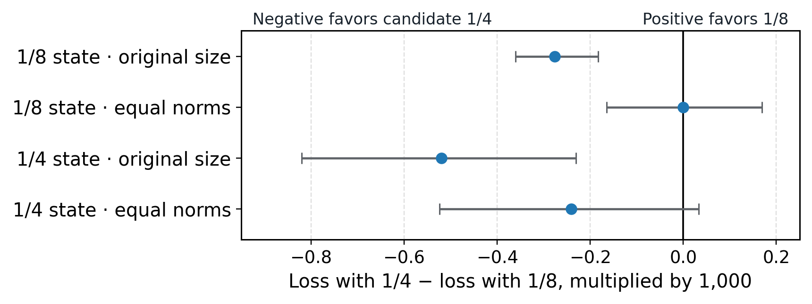
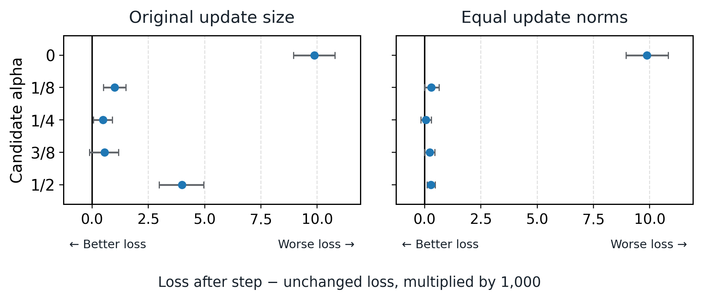

# Understanding the Hessian experiments

A visual reading guide to the Marin results

Prepared for Kaiyue • 11 November 2026

## Start with the answer

**We completed the experiments. We have not explained why optimizer setting 1/8 gave better final training results.**

The new measurements teach us three useful things:

- **A fit can work in a small set of directions and fail in a larger set.**
- **Fresh gradient statistics differ from the history saved during training.**
- **Changing the size of an optimizer step can change its apparent advantage.**

These are findings about particular saved models and local measurements. They are not a rule that one optimizer setting is always best.

### Choose a reading path

**For the main story:** read the bold opening sentence in each section, then its figure and takeaway.

**For the confusing terms:** Section 2 explains the basic objects. Section 4 explains “no accepted fits.” Section 6 explains “leakage.”

**For the exact methods:** the accompanying *Detailed technical reference* preserves the complete report, formulas, tables, and qualifications. The browser version includes that reference in expandable sections.

You do not need to remember every number. Keep asking: **What was measured? What does it show? What remains unknown?**

## 1. Why run these experiments?

**The starting observation was a small advantage for optimizer setting 1/8 in one earlier training comparison.**

A model has adjustable numbers called **weights**. Training changes those weights to improve predictions. **Loss** scores prediction error; lower is better on the same evaluation. An **optimizer** chooses the weight changes.

The optimizer has a setting called **alpha**, written α. It controls how strongly the optimizer rescales directions using its stored gradient statistics. A larger alpha strengthens relative rescaling. It does not necessarily make the whole update smaller.

C4 is the text evaluation used in the earlier comparison. Its text was reserved for evaluation. The final losses were:

| Training alpha | Final loss | Evidence |
|---|---:|---|
| 0 | 3.792297 | Completed run |
| 1/8 | 3.784025 | Completed run |
| 1/4 | 3.844011 | Failed job; final evaluation recovered |
| 1/2 | 3.958380 | Failed job; final evaluation recovered |

The observed advantage of 1/8 over 0 was **0.008272 loss units**.

The 1/8 run first reached C4 loss at or below 4.0 after 33,000 updates. The alpha 0 run reached it after 34,000. This is an observed advantage in training tokens at that target. A token is a unit of text processed by the model.

**Limit:** these were separately tuned configurations with one training seed. A seed controls random choices; one seed cannot show how consistently an outcome repeats. Learning rates—the multipliers controlling the size of updates—differed. The 1/8 run also took longer in its actual hardware deployment.

**Takeaway:** the observation motivates a question. It does not establish a universal best alpha.

## 2. Four ideas to keep separate

**Curvature, gradient history, a fitted relationship, and an actual optimizer step are different objects.**

### The gradient tells us about a small move

The **gradient** describes how loss changes when the weights move a very small amount. Moving against a nonzero gradient reduces that loss for a sufficiently small step.

### The Hessian describes local bending

The **Hessian**, written H, describes how the gradient changes as the weights move. This is **curvature**. Some directions bend sharply; others bend gently.

### Gram statistics summarize gradients

A **Gram matrix** summarizes products of gradient entries. This optimizer stores a left Gram matrix and a right Gram matrix for each matrix of weights.

The combined **Gram proxy**, written K, is a statistic used to represent curvature. It acts on a proposed weight change by multiplying on the left and right by those Gram matrices.

The saved statistics are an **exponential moving average**, or EMA. Each new update keeps 99% of the previous average and adds 1% of the new gradient product. The saved history therefore includes gradients from earlier weights.

### A fit connects two measured objects

A **fit** approximates the Gram proxy using a power of the Hessian, within the selected directions. We estimate the power and how well the relationship holds. Section 5 gives the formula.

A **raw proxy** uses its Gram factors without the additional stabilizing modification described in Section 5.

### Three uses of alpha answer different questions

| Name | Meaning |
|---|---|
| Training alpha | The setting used to produce a saved model. |
| Alpha derived from the fit | A value calculated from a curvature fit. |
| Candidate alpha | A setting tried for one hypothetical next step. |

**Takeaway:** a geometric alpha derived from the fit is not automatically the best alpha for training.

## 3. What did we actually do?

**We measured real saved checkpoints. We did not run new training trajectories.**

A **checkpoint** contains a saved model and its training state. The original experiment measured three checkpoints from the 1/4 run. That left a mismatch: the motivating advantage came from the 1/8 run.

*Figure 1. The added experiments address the motivating trajectory, measurement coverage, gradient history, and actual next step loss. Numerical checks accompany the curvature measurements.*

### How much of the model was measured?

The model has about **447 million weights**. We measured curvature for two individual matrices: one in attention and one in the multilayer perceptron, or **MLP**. Attention combines information across text positions. The MLP is a feedforward component that transforms features at each position. Each selected matrix is called a **block** here; the technical reference identifies the exact matrices.

We chose **12 directions** in each matrix from its saved Gram statistics. A **subspace** is the set of changes obtained by combining those directions. At the middle checkpoints, two further experiments expanded the set to **48 directions**, retaining the original twelve.

For each direction, a **Hessian-vector product**, or HVP, measures how the gradient responds. The experiment kept the interactions between directions, not just their individual curvature values.

### Which data and controls were used?

Each curvature measurement used eight groups of eight sequences, with 4,096 tokens per sequence. The same complete sequences were used across all eight curvature measurements. The other model weights stayed fixed while each block Hessian was calculated.

A **batch** is a group of text sequences processed together. Each of the two optimizer controls built **two fresh Gram histories of 512 batches each** at fixed weights. It then tried 30 hypothetical full model updates. Each candidate began from the same saved state and one shared batch used to calculate the update gradient within that checkpoint.

Sixteen evaluation batches were reused across candidates. These batches came from training caches. They were not certified as unseen during the original training run.

**Takeaway:** these are carefully controlled local measurements of a small part of curvature, plus full model next step loss tests. They are not a test of every layer or of performance over the full training run.

## 4. What does “no accepted fits” mean?

**It means that the fit did not pass the requirements for this analysis. It does not mean that no experiment ran.**

An **eigenvalue** describes the scaling along a special direction of a matrix. For a symmetric Hessian, it is a curvature value. This analysis needs positive eigenvalues because it takes a **matrix logarithm**: the ordinary logarithm of each eigenvalue, retaining the directions.

A fit can be excluded for several reasons:

- **Negative:** at least one measured curvature value is negative, so the analysis of positive matrices cannot be used.
- **Unresolved:** the measured matrix is positive, but the numerical discrepancy is too large relative to its weakest direction.
- **Missing or failed check:** a required derivative or symmetry check is unavailable or fails.

### How did we check numerical accuracy?

Automatic differentiation applies derivative rules to the model code. A **finite difference** estimates the derivative using nearby weights. The checks required agreement below 2% at two adjacent perturbation sizes.

That check alone is not enough for a very weak curvature direction. We first average the Hessians from eight data groups and fit that **mean Hessian**. We do not average eight separately fitted powers.

For a positive mean Hessian, an added screen puts its diagonal entries on a common scale. The same coordinate scaling is applied to both finite-difference estimates. We compare all three estimates in pairs. The size of a discrepancy is its largest possible response to an input of size one.

The **precision margin** divides the weakest curvature on this scale by the largest of those three discrepancies. It must exceed **10**: the weakest curvature must be more than ten times the measured disagreement. The technical reference gives the exact matrix formula.

This is an empirical agreement check, not a rigorous guarantee against errors shared by both methods.

*Figure 2. Each cell describes the mean fit in the stated block and dimension. “Accepted” requires both numerical validity and the added precision screen. “Negative” describes the measured matrix; the screen stops before certifying the sign of a tiny negative eigenvalue. 1/4 attention also lacks one required derivative reference.*

### Passing the mean does not remove sampling uncertainty

A **bootstrap** repeatedly resamples the eight data groups and recomputes the fit. Many resamples fail even when the mean over eight groups passes.

For the 1/8 run, accepted counts were 511 of 1,000 for early attention, 619 for middle attention, and 585 for middle MLP. The reported intervals use only accepted resamples. They are **conditional intervals**, not uncertainty guarantees for all resamples or other training seeds.

The original 1/4 attention fits were rejected at all three stages. Original early and late MLP fits remain descriptive because they lack the added precision check. The later middle MLP measurement passes that check at both 12 and 48 directions.

**Takeaway:** report the reason for rejection. Do not turn a rejected or unresolved fit into an accepted scientific estimate.

## 5. Did the accepted fits explain optimizer setting 1/8?

**No. The accepted measurements did not show either proposed 1/8 pattern.**

The proposed relation is **K approximately proportional to H raised to a power r**. The fitted number **r** describes how Gram values change relative to curvature values.

A second number, **rho**, written ρ, describes how much variation in the log proxy is explained by the fit after removing overall scale. Rho is not a direct measurement of noise.

The simplified geometric calculation gives **alpha derived from the fit = ρ / (2r)** when r is positive. Two proposed patterns would therefore suggest 1/8:

| Proposed explanation | Power r | Fit quality ρ |
|---|---:|---:|
| Accurate relation with power four | 4 | 1 |
| Imperfect relation with squared curvature | 2 | 1/2 |

*Figure 3. Dots are accepted mean fits using the raw saved Gram proxy. Dashed lines mark the two proposed powers. These dots are not confidence intervals. All rows use 12 directions except the row marked 48.*

For the accepted early and middle 1/8 fits, rho is about **0.966–0.976**. Their alphas derived from the fit are about **0.370–0.406** with the raw proxy.

The **ridged proxy** first rescales each Gram factor by its mean eigenvalue and adds 0.01 to each diagonal entry. This stabilizes small directions. Its corresponding alphas derived from the fit are about **0.377–0.428**.

The technical reference also describes a separate geometric check and the optimizer’s additional transformations of the proposed update. The fitted relationship alone does not include all of those transformations.

**Takeaway:** these selected directions do not support the proposed 1/8 explanation. They also do not justify changing the training alpha to 0.4.

## 6. What does “leakage” mean?

**Leakage is curvature response outside the directions we selected. It is not a data leak.**

Imagine moving the weights in one of the twelve selected directions. The gradient's response can point partly inside that selected space and partly outside it.

The **norm** measures the size of a response: the square root of the sum of its squared entries. For every selected input direction, we first average its response across the data groups. We then collect all those responses together and sum squared entries across both responses and entries. Taking the square root gives their combined norm.

Leakage divides the combined norm of the outside responses by the combined norm of the full responses. It is not the average of twelve separate leakage ratios.

*Figure 4. This example uses original middle 1/4 attention. The triangle represents combined response norms, not a model with only two dimensions. The squared component norms add to the squared full norm. The ordinary norms do not add to one.*

A leakage value of 0.927 means the outside component has about 92.7% of the full response's norm. It does **not** mean 92.7% of examples, parameters, or loss escaped.

### Did measuring more directions solve this?

**No. Adding 36 Gram directions captured very little of the escaping response.**

The comparison below holds the original twelve input directions fixed. Only the number of output directions expands. This keeps the denominator the same.

*Figure 5. Circles use 12 output directions; blue marks use 48. Every decrease is below 0.001. These are norm ratios, not fractions of squared norms. 1/4 attention retains its limitation in derivative checks.*

For example, middle 1/8 MLP changes from **0.513949 to 0.513878**. That is a decrease of only about **0.000070**.

**Takeaway:** a good fit inside the selected space can coexist with substantial response outside it. These particular extra directions do not fix the coverage problem. Other choices of directions could behave differently.

## 7. Does the saved gradient history matter?

**Yes: the two fresh histories are closer to each other than either is to the saved history, under the measured distance.**

The fresh histories hold weights fixed. The saved EMA includes gradients from weights that changed during training. Both use the averaging factor 0.99 and global gradient clipping at norm 0.1. Clipping shrinks a gradient when its total norm exceeds that threshold.

Each fresh history uses 512 batches. The batches are separately randomized. Hash checks on complete sequences exclude duplicate complete sequences across histories and the other measurement data. Shared documents or shorter fragments are not ruled out.

We compare **centered matrix logarithms** of the proxies. Centering removes the mean log eigenvalue, so the comparison removes overall scale. The distance is the square root of the sum of squared entry differences, divided by the square root of the number of directions.

*Figure 6. Raw proxies in 48 directions. Each mark is one observed distance, not an uncertainty interval. The same ordering holds for the ridged proxies and restrictions to twelve directions.*

Replacing the saved proxy with a fresh proxy also shifts accepted alphas derived from the fit upward. For example, 1/4 MLP in 48 directions changes from **0.385** to **0.469 and 0.474** in the two fresh histories.

Changing the proxy does not repair an invalid Hessian. Rejected or unresolved curvature fits stay excluded.

**Takeaway:** fresh sampling variability alone looks insufficient to explain the difference between saved and fresh histories here. Historical change is a plausible contributor. Two histories do not identify how much comes from drift, sampling, clipping, or numerical differences.

## 8. What happened when we tried actual optimizer steps?

**At the 1/8 checkpoint, candidate 1/4 improved local mean loss more at the original update size. Matching update norms made their mean changes nearly equal.**

Each candidate started from the same middle checkpoint and the same fresh gradient within that control. We changed candidate alpha while keeping the saved history, learning rate schedule, and weight decay fixed. **Weight decay** is a separate shrinkage of weights.

These updates changed the full model, not just the two measured matrices. The new fresh histories from Section 7 were **not** substituted into these optimizer steps.

We compared two sizes:

- **Original update size:** use the magnitude produced by the optimizer.
- **Equal norms of complete updates:** rescale every candidate's complete update to the norm of the alpha 0 update.

Each version was also tested at 0.1, 0.3, and 1.0 times its full size. Norm matching includes all updated parameters and the contribution of weight decay.

### How to read the loss plots

**Loss change = loss after the step − loss at the unchanged checkpoint.**

- Left of zero: lower loss, an improvement.
- Right of zero: higher loss, a deterioration.
- Dot: mean change on sixteen paired evaluation batches.
- Line: conditional 95% bootstrap interval from 10,000 resamples of those batches.

The plotted changes are multiplied by **1,000**. A plotted change of −0.5 means a loss reduction of 0.0005.

*Figure 7. Middle 1/8 checkpoint, full step fraction. The two panels share the same scale. Intervals hold one state and one gradient batch fixed. They do not include variation across training seeds or gradient draws, and are not adjusted for multiple comparisons.*

The unchanged checkpoint loss was **3.620126** on these local evaluation batches. This is a different evaluation from the earlier C4 comparison.

At original size, candidate 1/4 changed mean loss by **−0.000625**. Candidate 1/8 changed it by **−0.000349**. After norm matching, both changes were approximately **−0.000504**.

### Compare the candidates directly

The next figure uses their paired loss difference on the same evaluation batches. It does not infer the difference from overlap of the separate intervals above.

*Figure 8. Full step fraction. Dots show paired mean differences; lines show conditional 95% bootstrap intervals from the sixteen shared evaluation batches. A negative value favors candidate 1/4 over candidate 1/8. The interval includes zero after norm matching at both starting checkpoints. That does not prove equivalence.*

At 0.1 and 0.3 times the original size, all five candidates improved mean loss at the 1/8 state, and their individual conditional intervals were below zero.

**Takeaway:** the size of the step matters. A local next step advantage is not a ranking of final training performance.

## 9. Was the 1/4 checkpoint different?

**Yes. Every full step at the original update size increased mean evaluation loss at the 1/4 checkpoint.**

The unchanged local mean loss was **3.673041**. A smaller positive change is still a loss increase, not an improvement over the unchanged model.

*Figure 9. Middle 1/4 checkpoint, full step fraction. Both panels share a scale. The wider horizontal range than Figure 7 is stated by the axis values; compare numbers rather than physical distances between figures. The same limitations of conditional intervals apply.*

Some mean changes from smaller steps were negative, but their intervals included zero. These measurements do not establish a reliable immediate improvement at this checkpoint.

The two checkpoint controls used the same complete sequences. Nevertheless, they began from different trained models and optimizer histories. The different outcomes do not isolate a causal effect of training alpha.

**Takeaway:** neither the local curvature fit nor the candidate alpha alone determines the observed loss change.

## 10. What can we conclude?

**The experiments narrow the explanation. They do not settle it.**

### What the evidence supports

- The motivating 1/8 trajectory has now been measured.
- Accepted fits using the saved proxy do not match the two proposed 1/8 patterns.
- A wider subspace can reveal failed positivity or unresolved precision.
- The extra Gram directions barely reduce leakage.
- Fresh history changes the geometric estimate.
- The magnitude of the complete update changes the local optimizer comparison.

### What the evidence does not establish

- A universal best training alpha.
- A complete explanation separating noise from drift.
- A characterization of the full model's Hessian.
- Why 1/8 won the earlier comparison of final losses.

A causal training comparison would need repeated seeds and a clearly specified learning rate treatment. Repeated draws of the gradient used for the update would also strengthen the local controls. Those are future experiments, not completed results in this report.

### Where to find the details

The [**Detailed technical reference**](technical-reference.pdf) preserves all original methods, formulas, result tables, and numerical caveats. The [**evidence index**](evidence-index.md) links the source configurations, saved artifacts, and online experiment tracking. The [**optimizer step table**](optimizer-step-results.csv) contains all sixty hypothetical branches.
