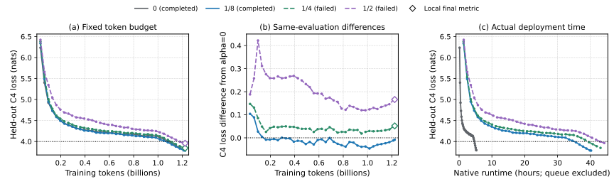

# Fixed-subset EMA-Gram: seed0 findings

Among the two configurations that passed every original completion gate,
alpha=1/8 finished with C4 loss 3.784025, versus 3.792297 for alpha=0. Its first
observed crossing of the preregistered C4<=4.0 target used 1,000 fewer updates
(2.94%). Its actual deployment took 7.47 times as long and 29.88 times the
estimated device-hours to reach that target. The deployments use different
hardware sizes and meshes. This single-seed result supports a small observed
loss/token advantage for the tuned alpha=1/8 configuration, with no observed
time-to-target advantage. It does not establish a reproducible best exponent.

Alpha=1/4 and alpha=1/2 failed during shutdown. Their recovered final C4 values
are retained as supplementary measurements; neither run is promoted to a
validated completion. Their failures do not establish optimizer instability.
The three prescribed checkpoint probes show stage-dependent local loss
changes and do not select a universal preferred training exponent.

## Setup and comparison scope

The model has 447M parameters, context 4096 and global batch 8. Each confirmation
starts from scratch with seed0 and requests 37,335 updates, or 1,223,393,280
training tokens. Full FP32 Gram matrices and momentum, every-update Gram
refresh, trace normalization, default spectral solver, five-step production
polar approximation and fixed nonmatrix AdamW follow the
[protocol](../../experiments/ema_gram/README.md). The data recipe uses the fixed
2,000,188,501-token HQ/code/math subset described in the
[execution plan](single-seed-execution-plan.md); it replaces unavailable original
web data and is not byte-identical to the original Delphi recipe.

Alpha controls the spectral Gram powers in the matrix update direction
`A^(-alpha) polar(A^(-alpha) M B^(-alpha)) B^(-alpha)`, where M is momentum
and A/B are trace-normalized left/right Gram matrices with ridge regularization.
Alpha=0 reduces the direction to the production polar of M; passive Gram
updates remain enabled.

Learning rates and ridges were selected from 37 completed pilot cells,
including recursive boundary expansions. Confirmation outcomes did not alter
that selection. The comparison is between tuned configurations; learning rate
and ridge vary with exponent. Model, resolved data recipe, sequence length,
data seed and evaluation controls match in the cached native configurations.
The complete configuration differences, source hashes and data references are
retained in [single-seed-comparison.json](single-seed-comparison.json).
Agreement of configured seeds and controls does not prove bitwise-identical
initial weights or historical cache bytes across hardware layouts.

| Alpha | Matrix LR | Ridge | Execution and evidence | Final C4 (nats) | Difference from alpha=0 |
|---:|---:|---:|---|---:|---:|
| 0 | 0.003535534 | 0.0001 | Validated completion; native W&B | 3.792297 | 0 |
| 1/8 | 0.0025 | 0.01 | Validated completion; native W&B | 3.784025 | -0.008272 |
| 1/4 | 0.002 | 0.01 | Failed execution; local final JSON | 3.844011 | +0.051714 |
| 1/2 | 0.001 | 0.01 | Failed execution; local final JSON | 3.958380 | +0.166083 |

Each marker represents one observed held-out C4 evaluation from one training
trajectory; there is no smoothing or seed aggregation. Panel(b) subtracts the
alpha=0 loss at the same update label. Lines connect observed native W&B
points as visual guides. Open diamonds show recovered local final metrics
for failed executions and are not connected across the provenance change.
Panel(c) omits these two local endpoints because they have no W&B runtime.
The dotted loss line is the fixed target 4.0. All 38 evaluation values are
available for each run; alpha=1/4's missing training metrics remain explicit.

## What the failed executions support

Alpha=0 and alpha=1/8 satisfy canonical scheduler success, original task
lineage, exact accepted source/configuration/data bindings, finished ONLINE
tracking, 37,335 finite five-metric rows, final evaluation, permanent checkpoint
metadata and stored counter 37335. Alpha=1/8's earlier W&B crashed observation
is preserved. Successful original tasks and synchronization-completion logs
justified one terminal recovery check, which returned finished on the same
run identity. No tracking state or history was rewritten.

For alpha=1/4, the native history has 37,088 complete five-metric rows. Cached
local JSON events raise coverage to 37,223 rows; labels 37140..37251 remain
missing for all five metrics. The unchanged full-history validator rejects
this record. For alpha=1/2, native history plus the cached final local row
passes the 37,335-row finite-history audit. Both failed jobs retain canonical
FAILED and cached crashed tracking states, so their original success and
finished-ONLINE gates remain unmet. Both have validated permanent 57-array
checkpoint metadata and stored counter 37335.

This report admits the exact recovered final C4 values and the earlier native
target crossings as supplementary observations tied to their original
attempts. It excludes both runs from the completed-run comparison and makes
no numerical-instability inference from their exits. Alpha=1/4 cannot support
a full-schedule finite-training-history claim. Neither failed run has an
observed native final-evaluation runtime. Missing rows and times are not
imputed. Checkpoint checks cover metadata and the scalar counter; none of
these final checkpoint audits establishes all-array byte finiteness, full-state
restoration or training resume.

The failure logs establish a shutdown synchronization failure: a JAX barrier
received three of four participants, while process0 was in tracker teardown.
For alpha=1/4, W&B background finish was abandoned after 120 seconds; the fatal
main-thread stack was in Finelog.close. The scheduler reports task2 exit139
(SIGSEGV), while stderr also reports signal 6. Their relationship and the
initiating cause remain unresolved. Service task numbering is not assumed to
match JAX process numbering. These failures occurred after logged final
training, checkpoint saving and evaluation, but that ordering does not prove
all preceding numerical work was valid beyond the audited measurements.

## Observed time and device cost

| Alpha | First target-crossing updates | Training tokens | Native hours to target | Device-hours to target |
|---:|---:|---:|---:|---:|
| 0 | 34,000 | 1,114,112,000 | 4.770 | 19.081 |
| 1/8 | 33,000 | 1,081,344,000 | 35.630 | 570.088 |
| 1/4, failed | 34,000 | 1,114,112,000 | 39.567 | 633.076 |
| 1/2, failed | 36,000 | 1,179,648,000 | 42.988 | 687.808 |

Crossings are the first observed evaluations satisfying the fixed target,
without interpolation. Native runtime includes compilation and evaluation and
excludes queue time. Device-hours here multiply that runtime by the validated
JAX device count; they are not billing records or complete allocation lifetime.
Alpha=0 uses four v4 devices on one host with data=4/model=1. Nonzero-alpha runs
use 16 v4 devices on four hosts with data=4/model=4. These are actual deployment
comparisons, not matched-hardware optimizer-overhead measurements.

For the two completed runs, median measured update duration is 0.347592 seconds
at alpha=0 and 3.660263 seconds at alpha=1/8. Their elapsed native runtimes at the final evaluation
are 5.268 and 40.214 hours respectively. Isolating spectral decomposition,
communication and other optimizer overhead requires source- and
configuration-matched profile attribution, which is not established here.
Old synthetic and earlier-data profile results are not substituted for that
measurement. Peak-memory comparisons are also not established by this report.

## Checkpoint probes

The three probes restore full trainer state from the prescribed alpha=1/4
checkpoints at counters 3,733, 18,665 and 33,597. Each evaluates 27 exponent/ridge/step-size combinations on the same eight
held-out Wikipedia batches. Each matrix direction is rescaled to that matrix's
alpha=0 Frobenius norm; nonmatrix parameters stay fixed and decay is omitted. Delta means are
perturbed loss minus the unchanged-checkpoint loss; negative means improvement
in this local test. The four hosts repeat the same calculations and are
replicas, not 32 independent samples. The same eight batches are reused across
checkpoints, so checkpoint results are not independent sample sets either.

| Checkpoint counter | Negative mean deltas | Positive mean deltas | Range of mean loss deltas |
|---:|---:|---:|---:|
| 3,733 | 5 | 22 | -0.000028014 to +0.000068069 |
| 18,665 | 18 | 9 | -0.000227153 to +0.000423223 |
| 33,597 | 0 | 27 | +0.000084877 to +0.000725538 |

Production-polar versus SVD direction comparisons cover one attention and one
MLP matrix across nine exponent/ridge settings per checkpoint. Across the 18 comparisons per checkpoint (54 total), cosine ranges are 0.94891–0.99948, 0.89484–0.99959 and
0.86383–0.99975 at the three checkpoints; relative-error ranges are
0.03355–0.31979,0.02955–0.47070 and0.02271–0.52135. Approximation discrepancies
are measurable and stage-dependent. These isolated direction comparisons do
not show what replacing the production polar would do to full training.
The finite local probes and successful checkpoint restorations do not certify
the failed parent run's missing history or turn it into a successful execution.

## Conclusions and remaining engineering work

The completed seed0 comparison shows a small loss and observed-token benefit
for the tuned alpha=1/8 configuration with substantially higher deployment
time and device use. Recovered alpha=1/4 and alpha=1/2 endpoints are higher
than the baseline but remain supplementary failed-execution evidence. Probe
responses vary by checkpoint and do not establish a universal training winner.
One seed supplies no cross-seed uncertainty or reproducibility test. These
results do not meet the protocol's reproducible-result condition for automatic
horizon or 998M follow-ups; no further run is launched.

The scientific interpretation above is bounded by the recorded evidence.
Research remains active for shutdown-cause investigation and qualification of
a future repair before new execution. Sequential primary-process telemetry
finalization with a 120-second W&B finish budget overlaps a 120-second distributed
shutdown budget in the accepted source; this is a timing hypothesis, not a
proven initiating cause or a qualified fix. No accepted runtime was changed.
All existing jobs, followers and the original observer are terminal. Continue
from caches; do not restart them or repeat completed remote reads.

## Reproduction and evidence

The scalar comparison and provenance are in
[single-seed-comparison.json](single-seed-comparison.json). Run
`python logbooks/20-ema-gram-polar/plot_single_seed_comparison.py` to recreate the
PDF, SVG and PNG from those scalars. The analysis was performed entirely from
local cached artifacts; no completed job or artifact was queried again.

- [Baseline validated completion](alpha0-long-run-completed.json)
- [Alpha1/8 validated completion and tracking recovery](parallel-long-runs-r01-alpha0125-completed.json)
- [Alpha1/4 terminal failure](parallel-long-runs-r01-alpha025-failed.json) and [partial recovery](parallel-long-runs-r01-alpha025-partial-recovery.json)
- [Alpha1/2 terminal failure](parallel-long-runs-r01-alpha05-failed.json) and [mixed-source recovery](parallel-long-runs-r01-alpha05-recovered.json)
- [Early probe](reference-probe-r01-completed.json), [middle probe](reference-probe-r02-completed.json), [late probe](reference-probe-r03-completed.json)
