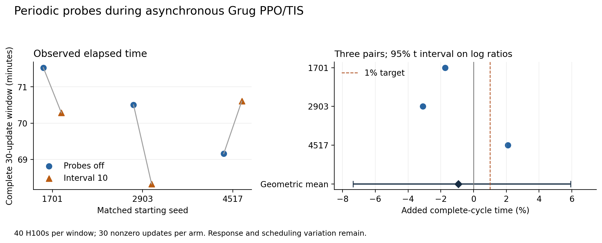

# Periodic probe cost during asynchronous Grug training

Probes every ten published policy steps had **−0.94% added complete-cycle time**, with a paired 95% interval of **−7.37% to +5.94%**, across three starting seeds. Keep interval ten as a practical cadence for this workload. The result establishes neither a speedup nor a 1% upper bound. The declared interval-twenty trigger was a primary point estimate above 1%; it was not met, so no longer-cadence runs were submitted. Score centering (SC) remains off, K remains 128, and product defaults stay unchanged for review.

A probe estimates a score-centering correction without applying it to training. Here the score is the gradient of the current policy's log probability. SC subtracts an estimate of the sampler's expected clipped, importance-weighted score. Capture records the 128 most probable token IDs and their full-vocabulary probabilities; K counts these candidates. The learner rescores the same IDs and models omitted probability mass.

All six windows completed thirty nonzero optimizer updates and publications 0–30. The three probe windows consumed nine observations covering 1,036 positions, including 608 positions from responses at least 2,048 tokens long. These observations show that the measured windows exercised the diagnostic path. They are a small, selected sample of the training data.



## What was compared

Each window used the normal asynchronous Snowball PPO loop with tokenwise truncated importance sampling (TIS), the Grug 67B-A2B model, and the frozen 89,557-row dataset from [study #17](https://github.com/marin-community/marin-logbooks/issues/17). Snowball is the five-family training workload: 7,115 calendar tasks, 20,432 competitive coding tasks, 20,588 generated reasoning puzzles, 20,721 STEM tasks and 20,701 structural/structured-output tasks. Tasks retain their serialized graders; the recipe provides local execution and remote judging, forms leave-one-out reward advantages over the four answers, and filters all-zero-reward groups. [Input identities](input-selection-summary.json) and the recipe retain the details. The batch had 128 prompts with four answers each, maximum context 24,576 and maximum response 8,192 tokens. AdamW learning rates and gradient norms were nonzero. SC was disabled in both arms; only the probe interval changed between zero and ten.

Each run used 32 learner H100s and eight sampler H100s across five batch nodes in `cw-us-east-02a`. Megatron used tensor/sequence parallel size one, pipeline size two, context size one and expert size eight. [Provider observations](final-cohort-hardware.json) verify the same H100_NVLINK_80GB model and `gd-8xh100ib-i128` instance class on all twelve allocated GPU-node names, and the same main task image digest on all 35 GPU attempts, including the interrupted attempt. The paired runs did not occupy identical physical nodes.

The fixed order was off1701, on1701, on2903, off2903, off4517, on4517. Each arm started from the same original model and data with its declared seed. Asynchronous scheduling and generation did not produce identical trajectories within a seed pair. [The finite plan](final-runtime-cohort-plan.json), [placement amendment](final-cohort-placement-amendment.json), [actual run manifest](final-cohort-run-manifest.json) and [continuation plan](continuation-plan.json) retain decisions made before the corresponding allocations. No runs were added to obtain a desired significance level.

The primary clock starts immediately before the first rollout publication and ends after the thirtieth training step's awaited weight synchronization. It includes generation, candidate-head capture, transport, grading, scoring, optimization and publication, with normal sampler/trainer overlap. Stage timers were not summed. Common observer writes between cycles remain in elapsed time. Model/engine startup before this clock is separate.

## Complete windows and uncertainty

| Seed | Probes off, seconds | Interval ten, seconds | Paired change | Off/on loss tokens, millions |
| --- | ---: | ---: | ---: | ---: |
| 1701 | 4,291.85 | 4,217.03 | −1.74% | 39.03 / 44.35 |
| 2903 | 4,230.15 | 4,099.40 | −3.09% | 39.67 / 34.11 |
| 4517 | 4,149.45 | 4,236.40 | +2.10% | 38.39 / 38.80 |

The primary estimate is the geometric mean of the three on/off elapsed-time ratios. Its interval uses a Student t interval on the three log ratios with two degrees of freedom, then transforms back to percentages. Cycles are not independent replicates. [Analysis JSON](final-analysis/analysis.json), [per-cycle data](final-analysis/per-cycle.csv) and [window overview](final-analysis/window-overview.csv) retain full precision.

Excluding the first three cycles gives −0.95% with a 95% interval of −7.19% to +5.71%. Normalizing by trained loss tokens gives −0.51% with an interval of −28.53% to +38.49%; normalizing by response tokens gives −0.51% with an interval of −28.52% to +38.48%. These secondary ratios expose workload variation and do not remove its causal effects. For example, the seed1701 probe arm trained 13.6% more loss tokens than its control, while seed2903 trained 14.0% fewer.

Entry point to the primary clock took 799.02–1,002.58 seconds per arm. The first three cycles took 390.22–408.03 seconds. Primary elapsed time includes those cycles; the warmed estimate removes them. Allocation includes startup and termination overhead in addition to the timed windows.

## Consumed evidence and cadence

| Seed | Consumed learner steps | Probe positions | Positions from long responses |
| --- | --- | ---: | ---: |
| 1701 | 3, 12, 21 | 268 | 192 |
| 2903 | 3, 11, 23 | 384 | 160 |
| 4517 | 2, 12, 23 | 384 | 256 |

Interval ten marks the next dispatched prompt group at startup and after each ten published policy steps; zero disables probes. Marking, generating and admitting that group take time, so the learner can consume it at a later step such as 3, 12 or 21. Each observation covered the four answers to one prompt. Export and learner scoring stayed bounded at 32 selected loss-eligible positions per response. Across the nine observations, 178 positions were fresh and 858 were stale relative to the consuming learner step; none had an unknown source stamp. [Coverage records](final-analysis/probe-coverage.json) retain source-step sets and consumed spacing. A long response can span policy publications, so one observation can contain several source versions. Consumed observations were 8–12 learner steps and about 18.5–27.1 minutes apart after the first observation. A marked dispatch does not guarantee consumption: filtering or batch admission can remove it.

All six windows had response-length p95 and p99 of 8,192, with 4,765–6,340 responses at least 2,048 tokens long per window. Median lengths ranged from 891.5 to 1,360. Policy-stamp coverage was 100%; average token age was 1.258–1.278 steps and the maximum was two. Long-response coverage and fresh/stale populations are therefore visible, but nine selected prompt groups cannot represent the whole population or establish learning benefit.

Interval ten supplies roughly three consumed observations in these thirty-update windows without a positive primary point estimate. A longer interval would reduce requested capture frequency and observation density, but its cost was not measured. Keep the existing adjustable knob and check consumed spacing and coverage on other workloads. vLLM still computes heads at every generated position in a selected group, and neighboring requests can compute extra candidates. The 32-position export cap does not bound all sampler work. No adaptive controller was added.

## Applicability and operational history

Initial cohort source was `9094978f4e0134c635cb95ca2cfb856213c16151`; continuation source was `a5f8b0ae7ff50fdc0da6b14c4b3c5d49b253650a`. Their twelve measured module hashes match. Actual imported driver sources, full resolved configurations and eight sampler runtime records passed admission for every arm. After removing only the declared seed, interval and five output identities, each configuration has common SHA `c644d4cf38e4247d43ed61d0a86c3bf858014e0272bf227eb78ee1c884d25478`. The sampler reports the pinned vLLM `39e62869693c` V2 path without logits processors. Driver hashes do not independently hash every worker module.

The contribution stack separates ordinary training–inference mismatch (TIM) diagnostics, the optional SC objective (core), and periodic hypothetical corrections (probes). The final product candidates are TIM `7c505df93c5a4ad818f6cd478915ad67e4eb30b2`, core `9ded206c12b040bcdcd4b2c59d8e7de0ca048874` and probes `f819db9f37e6333c127cd3e856fa6239bd2a0b92`. [Runtime alignment](final-product-runtime-alignment.json) proves that the last product correction changes only two docstrings in one of the six pinned product files; all executable AST nodes match the measured snapshot. Five other files are byte-identical. [The final reference-link update](final-product-documentation-link.json) changes no runtime or test file from the previous probe snapshot `8b7d2d490587a2f3542957a850ce84937dd4fca9`. This comparison does not claim the entire newer Marin runtime matches the earlier study snapshot.

Before the cohort, [a real disaggregated Grug qualification](grug-qualification-results.json) completed four nonzero updates, consumed 128 probe positions from four long responses and published weights through step four. During weight synchronization, the sampler receives a generation-pause request. Four logged enter/return pairs on the same sampler actor had 62–83 requests outstanding; the largest delay from entering that pause call to its return was 0.480073 seconds. This qualifies the path and does not isolate the cause of earlier failures. The older short, fixed-weight, interval-one [study #13](https://github.com/marin-community/marin-logbooks/issues/13) answered a different cost question and is not pooled with these windows.

The first cohort's zero-GPU CPU coordinator was provider-preempted during the second arm's startup. Its successful off1701 control was retained, and its incomplete probe attempt was excluded from timing while retained in cost. One manual infrastructure replacement, from an allowance of two, resumed only the five uncompleted arms. The CPU coordinator became interactive with zero GPUs; every GPU gang remained batch with zero automatic retry budgets. [The interruption record](cohort-first-preemption-results.json) and chronological [notebook](notebook.md) retain failed runs, intrusive diagnostic attempts, the earlier pre-repair control and the reasons they are not paired here.

## Allocation, storage and shutdown

[Reconstructed allocation](final-allocation-accounting.json) totals 493.729824 H100-hours: 349.364271 for the six admitted windows, 5.112033 for the cohort interruption, and 139.253520 for all earlier qualification, failed and diagnostic work. Per-pod spans run from PodScheduled to controller termination, excluding queued time before allocation. Controller cancellation can precede physical teardown grace. These are allocation estimates, not a provider billing export.

[Shutdown checks](final-owned-job-shutdown.json) cover all 31 owned Iris jobs and 92 physical attempts in both pools. Every controller job and attempt is terminal. All GPU pod names return NotFound; the one remaining zero-GPU CPU coordinator pod had every container terminated. No owned pod has running containers, and no further GPU work is planned.

All eighteen stopped temporary attempt trees were removed after publishing their verified recovery records. [Preservation](preservation.json) retains 116,712 payload files and 8,361,785,330 bytes, with exact readiness-manifest references. Verified-copy computed file SHA256 values; independent checks compared every source and destination path, size and ETag. A final readback confirmed all eighteen readiness-manifest hashes unchanged.

[Fresh output metadata](final-storage-footprint.json), completed at 15:20 UTC on November 6, lists 8,483,133,410 retained bytes across 234,136 objects: 18,092,910 bytes of canonical outputs and 8,465,040,500 bytes under the durable research prefix, including verification bookkeeping and curated evidence. The task's entire temporary attempt prefix is empty. Existing model/data inputs, prior studies, local development environments/input caches and provider-internal storage are outside these output prefixes and remain intact.

[Native output metadata](final-native-output-audit.json) reports 57 empty archives, one uploaded 207-byte payload with verified durable readback, one explicit unavailable archive and 33 attempts without an archive metadata record. Missing metadata does not prove an empty payload. The separate 207-byte native source remains under managed seven-day retention. [Provider telemetry](storage-after-final-cohort.json), observed at 14:52:13 UTC, showed 38.915 TB headroom in RNO, 124.857 TB in East02A and 231.248 TB in archive08A; this was a read-only dry run.

## Reproduce the analysis

Check out `codex/29-async-probe-cost` in `marin-community/marin-logbooks`, which retains the Marin source tree. Use its pinned environment and existing object-storage access. The manifest points to retained raw completion, configuration and source receipts outside the temporary attempt trees.

```sh
uv run --frozen python logbooks/29-async-probe-cost/analyze.py \
  logbooks/29-async-probe-cost/final-cohort-run-manifest.json \
  logbooks/29-async-probe-cost/final-analysis
MPLBACKEND=Agg uv run --frozen python logbooks/29-async-probe-cost/plot_results.py \
  logbooks/29-async-probe-cost/final-analysis/analysis.json \
  logbooks/29-async-probe-cost/final-analysis
```

Exact launch commands, source revisions, input identities and regional output locations are in the linked submission and manifest records. Benchmark drivers, controls, observers and analysis stay on this research branch; product PRs contain maintained runtime code, behavioral tests and user documentation.
