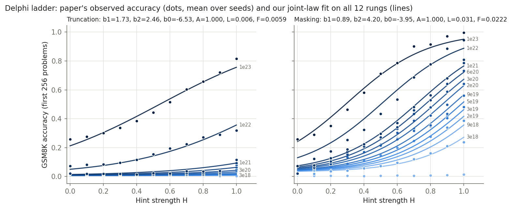
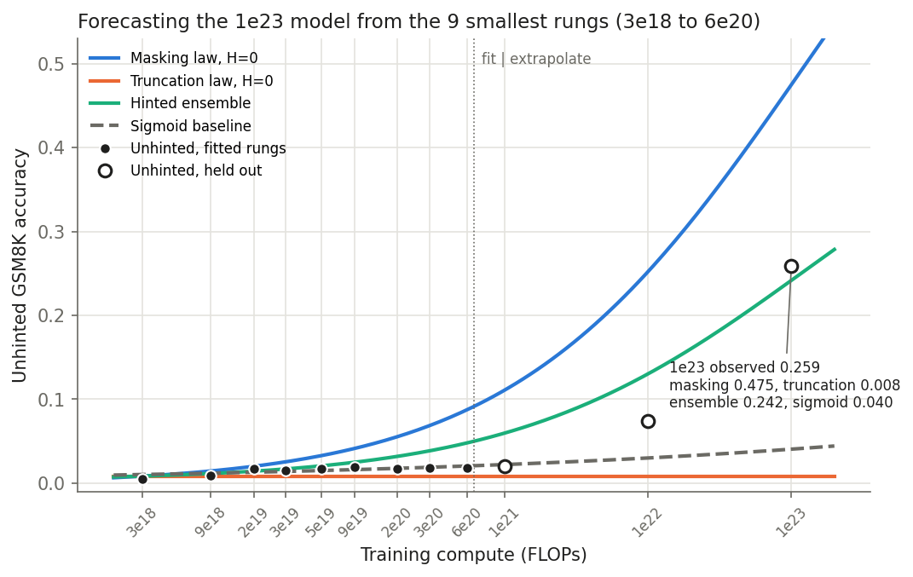
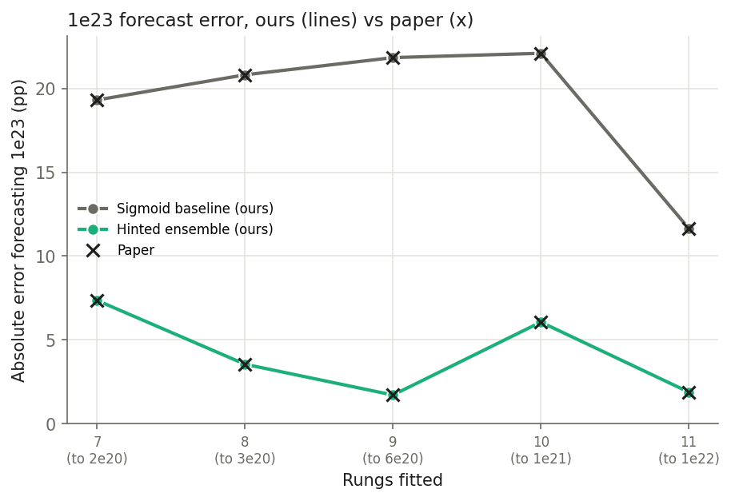
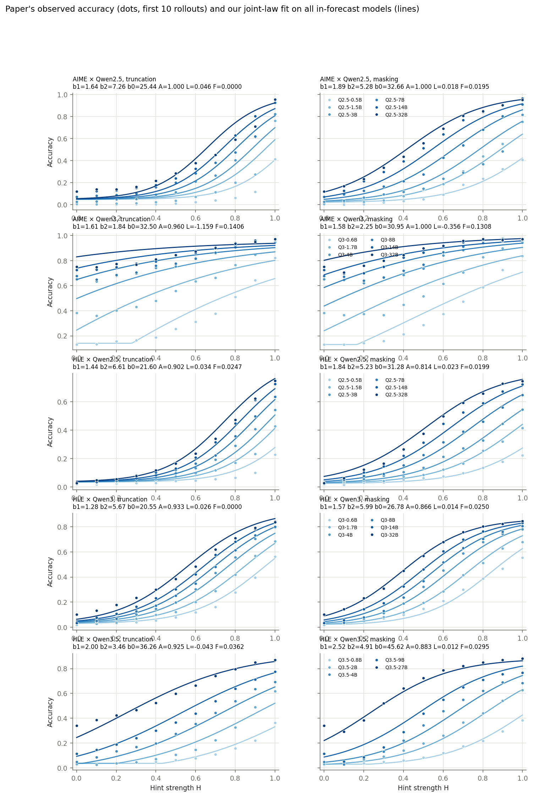
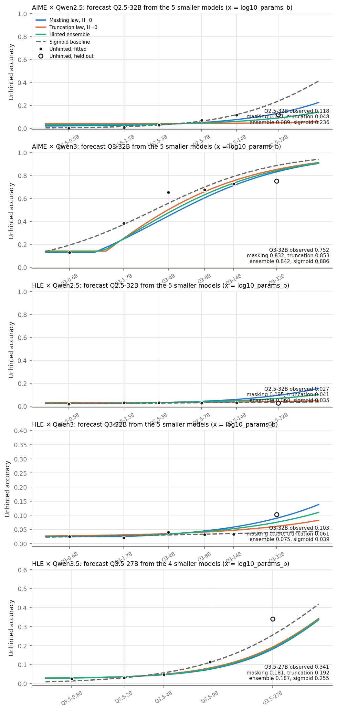
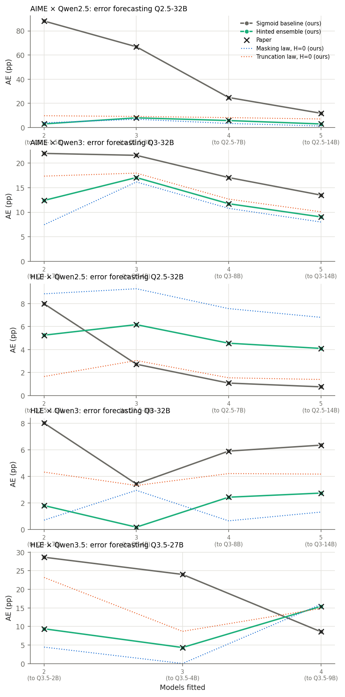
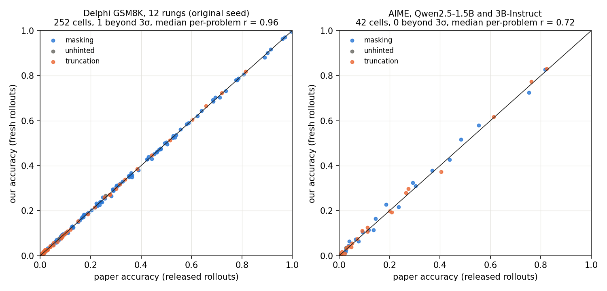
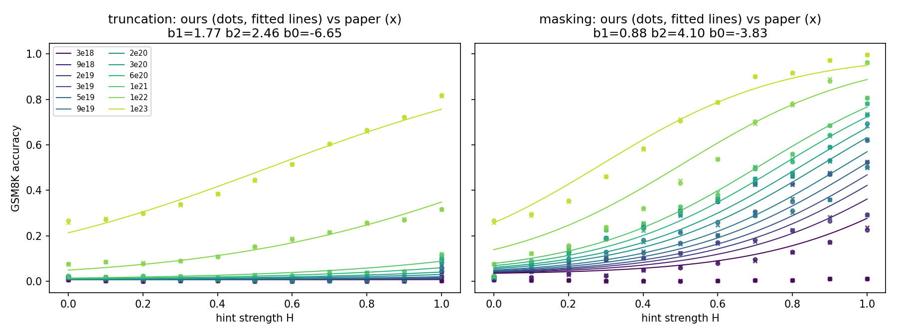

# Hinted scaling laws on the hero ladder

## Question and decision criteria

- Goal and why it matters: decide whether hinted scores on small hero-exact ladder checkpoints forecast Mochi's unhinted base accuracy well enough to use the ladder for SFT-recipe comparisons (marin-community/marin#9541).
- Baseline and alternatives: a two-parameter sigmoid on unhinted ladder scores, and a two-stage compute → bits per byte → accuracy fit.
- Evidence needed to choose: first, the eval and the fit code reproduce the paper's Delphi GSM8K results (marin-community/marin#11868). Then, on the hero ladder, the hinted Mochi forecast beats both baselines by more than the bootstrap interval (marin-community/marin#11870).
- Constraints and unresolved questions: Delphi is used only to validate code; conclusions about Hero come from hero checkpoints.

## Baseline

- Date: 2026-11-20
- Published source revision: the paper's code and data, [tatsu-lab/hinted-scaling-laws@c0490e53](https://github.com/tatsu-lab/hinted-scaling-laws/tree/c0490e53ba8eae58bf5375f6b56956f0d57dad30).
- Configuration, command, and external inputs: the paper's released per-problem rollouts in `data/results/rollouts/gsm8k__{no_hint,mask,truncate}.csv`.
- Result and evidence: the paper's Table 1 and the forecast errors that `experiments/forecasting/plot.py` and `two_stage.py` print.
- Limitations: the paper repository has no license file, so its data is not copied here.

## Entries

### 2026-11-20 22:30 UTC - Fit module reproduces the paper's Delphi fits on the paper's rollouts

- Question or hypothesis and reason for trying it: does `marin.scaling_laws.hinted_fit` (marin-community/marin#11891, for #11867) reproduce the paper's fits when given the paper's own rollouts? This isolates the fitting code from our eval, which is not built yet.
- Published source revision: this branch's base, `3fe82d09927215cc320276cce31aaa535d5daa73` (the head of marin-community/marin#11891).
- Command or material configuration, from the repository root with the paper checkout at `$HSL`:

  ```bash
  uv run --with pandas python -I logbooks/67-hinted-scaling-laws/scripts/reproduce_paper.py "$HSL"
  uv run --with pandas --with matplotlib python -I logbooks/67-hinted-scaling-laws/scripts/plot_delphi.py "$HSL" logbooks/67-hinted-scaling-laws/figures
  ```

- External inputs and artifact references: tatsu-lab/hinted-scaling-laws at c0490e53, `data/results/` (`rollouts/`, `models.csv`, `bpb_delphi.csv`). GSM8K uses the first 256 test problems; a rung's score is the mean over its training seeds (`original`, 42, 62746); 1e23 has only the original seed.
- Environment and hardware when relevant: laptop CPU. No rollouts were generated.
- Result, including failure or restart:
  - All ten Table 1 joint-law parameter sets (five model families × two methods) match to printed precision; the largest absolute difference is 0.0048. GSM8K × Delphi: truncation b1=1.73, b2=2.46, b0=−6.53; masking b1=0.89, b2=4.20, b0=−3.95.
  - Table 1's in-sample joint-fit MAE, averaged over the five families: 3.1 pp for masking and 3.3 pp for truncation, as in the paper. These are in-sample errors. They are not a Delphi forecast error.
  - Forecasting the 1e23 rung from the smallest 7 to 11 rungs, the sigmoid-baseline and ensemble absolute errors equal `plot.py`'s to four decimals.
  - The two-stage baseline errors equal `two_stage.py`'s: 0.1628, 0.2300, 0.2304, 0.2347 and 0.2364 for 9 down to 5 fitted rungs.
- Evidence:
  - [`figures/delphi_hint_curves.png`](figures/delphi_hint_curves.png): observed accuracy against hint strength for all 12 rungs (seed means), with the joint law fitted on all rungs.
  - [`figures/delphi_forecast_t9.png`](figures/delphi_forecast_t9.png): the 1e23 forecast at H=0 from the 9 smallest rungs (3e18 to 6e20).
  - [`figures/delphi_forecast_error.png`](figures/delphi_forecast_error.png): absolute 1e23 forecast error against the number of fitted rungs, ours and the paper's.

  
  
  

- Interpretation and limitations:
  - Truncation gives a signal only from 1e22 up. Below that, every rung stays under about 0.1 accuracy even with the full reference as the hint.
  - Masking separates the rungs from 9e18 up. The 3e18 rung barely responds (0.005 at H=0.1, 0.014 at H=1), but the law predicts about 0.27 at H=1, the largest misfit in the figure.
  - With 9 fitted rungs, the ensemble forecasts 0.242 for 1e23 against an observed 0.259, and the sigmoid baseline forecasts 0.040. The ensemble is close only because two large errors cancel: masking alone forecasts 0.475, and truncation sits at its floor of 0.008. The hero ladder tops out near 1e21–1e22, where truncation is still flat, so the hero analysis should report each method's forecast as well as the ensemble.
  - This checks the fit code only. Our own eval has not produced any rollouts yet.
- Decision and next action: the fit code is accepted for the gate. Next, generate fresh Delphi GSM8K rollouts with the hinted eval (marin-community/marin#11866) on each rung's original seed, compare per-cell accuracies with the paper's rollouts, and rerun these fits and figures on our rollouts (marin-community/marin#11868).

### 2026-11-20 23:10 UTC - Fit module reproduces the paper's Qwen forecasts

- Question or hypothesis and reason for trying it: do the fits also reproduce the paper's chat-model pairs, where capability is the paper's model-size scale and the fits use the first 10 rollouts per problem?
- Published source revision: marin-community/marin#11891 at `344ecd5056` (fit module plus paper-regression tests for these pairs).
- Command or material configuration, from a checkout with the fit module and the paper checkout at `$HSL`:

  ```bash
  uv run --with pandas --with matplotlib python -I logbooks/67-hinted-scaling-laws/scripts/plot_pairs.py "$HSL" logbooks/67-hinted-scaling-laws/figures
  ```

- External inputs and artifact references: tatsu-lab/hinted-scaling-laws at c0490e53, `data/results/` for AIME × Qwen2.5-Instruct and Qwen3, and HLE × Qwen2.5-Instruct, Qwen3 and Qwen3.5. The paper's own `experiments/forecasting/plot.py forecasts` output, run in a scratch environment, is the reference.
- Environment and hardware when relevant: laptop CPU. No rollouts were generated.
- Result, including failure or restart: all 19 sigmoid-baseline and ensemble forecast errors (every pair, every fitted size from 2 to n−1) equal the paper's to four decimals. Forecasting each pair's largest model from all smaller ones:

  | Pair | Fitted | Observed | Masking | Truncation | Ensemble | Sigmoid |
  |---|---|---|---|---|---|---|
  | AIME × Qwen2.5 | 5 | 0.118 | 0.131 | 0.048 | 0.089 | 0.236 |
  | AIME × Qwen3 | 5 | 0.752 | 0.832 | 0.853 | 0.842 | 0.886 |
  | HLE × Qwen2.5 | 5 | 0.027 | 0.095 | 0.041 | 0.068 | 0.035 |
  | HLE × Qwen3 | 5 | 0.103 | 0.090 | 0.061 | 0.075 | 0.039 |
  | HLE × Qwen3.5 | 4 | 0.341 | 0.181 | 0.192 | 0.187 | 0.255 |

- Evidence:

  
  
  

- Interpretation and limitations:
  - The ensemble beats the sigmoid baseline in 15 of 19 panels, as the paper reports.
  - AIME × Qwen2.5 shows the same cancellation as Delphi: with 2 fitted models, masking forecasts 0.157 and truncation 0.021 against an observed 0.118.
  - On HLE × Qwen2.5 the ensemble loses to the baseline from 3 fitted models up; the family barely improves with scale and masking overshoots.
  - On HLE × Qwen3.5 both methods forecast about 0.19 against 0.341; the 9B → 27B step is steeper than the smaller models predict.
  - On AIME × Qwen3 every forecast overshoots (0.83–0.89 against 0.752).
- Decision and next action: the paper-regression tests in marin-community/marin#11891 now cover these pairs. Fresh Delphi rollouts remain the next step (marin-community/marin#11868).

### 2026-11-21 02:15 UTC - Fresh Delphi GSM8K and Qwen AIME rollouts reproduce the paper

- Question or hypothesis and reason for trying it: do our hinted prompts, sampling and grading reproduce the paper's per-cell accuracies, and do fits on our own rollouts reproduce the paper's forecasts? This is the Delphi gate in marin-community/marin#11868, plus a Qwen check on a chat-model pair.
- Published source revision:
  - prompts and the GSM8K scorer: marin-community/marin#11905 at `4ababc03db`;
  - fits: marin-community/marin#11891 at `45b5ceb1e7`;
  - `marin-serve iris --priority`: local commit `fed5c39cdd` (not on main).
- Command or material configuration:
  - Each model was served with `marin-serve iris` on cw-rno2a at production priority, bf16, with a 4,096-token context for Delphi ([`replication/serve_delphi.sh`](replication/serve_delphi.sh)).
  - A laptop client sampled them directly, bypassing the curated eval driver: [`replication/sample_hinted_gsm8k.py`](replication/sample_hinted_gsm8k.py) for Delphi and [`replication/sample_qwen.py`](replication/sample_qwen.py) for Qwen.
  - Each request asks for all of a prompt's rollouts with vLLM `n` and is graded in-process.
  - Delphi uses the paper's sampling: temperature 0.4, top_p 1.0, max_tokens 512, top_k 1000 hinted and off unhinted, with 64 rollouts at H=0 and 32 at H>0 over the first 256 GSM8K test problems.
  - Qwen uses the paper's released AIME prompts verbatim (`suzeva/hinted-benchmarks@3d3d42c4`), its per-model sampling, its own AIME grader, and 10 rollouts per cell.
- External inputs and artifact references:
  - Delphi models: original-seed checkpoints (seed 0 for 5e19 and 6e20, the released `rohithck` repos), pinned in the serve script.
  - Qwen models: Qwen2.5-1.5B-Instruct and Qwen2.5-3B-Instruct.
  - Raw per-problem pass strings and completions: `s3://marin-us-east-02a/marin/experiments/hinted-scaling-laws/replication-2026-11-21/` ([Filer](https://filer.marina.oa.dev/#s3%3A%2F%2Fmarin-us-east-02a%2Fmarin%2Fexperiments%2Fhinted-scaling-laws%2Freplication-2026-11-21%2F)).
- Environment and hardware when relevant:
  - One H100 per Delphi rung through 1e22, and two (TP2) for 1e23.
  - 1e22 used 2 replicas and 1e23 used 6, to finish the slow rungs sooner.
  - The 11 rungs through 1e22 took 38–46 minutes each, and both Qwen models took under 30 minutes.
- Result, including failure or restart:
  - The curated eval driver first ran at about 0.3 attempts/s, because it makes two blocking FineStore commits per attempt (marin-community/marin#11391; fix in marin-community/marin#11918). Those runs were cancelled.
  - The first 1e23 server was OOM-killed at 64 GB host memory and was relaunched with 256 GB.
  - Per cell, from [`replication/compare_with_paper.py`](replication/compare_with_paper.py) and [`replication/compare_qwen.py`](replication/compare_qwen.py): paired z over problems against the paper's released rollouts for the same checkpoint.

    | Replication | Cells | Beyond 3σ | Median per-problem r |
    |---|---|---|---|
    | Delphi GSM8K, 12 rungs × 21 cells | 252 | 1 (2e19 masking H=0.9, z = −3.2) | 0.96 |
    | AIME, Qwen2.5-1.5B and 3B | 42 | 0 (largest 2.0) | 0.72 |

  - Selected Delphi cells:

    | Cell | Ours | Paper |
    |---|---|---|
    | 1e23 unhinted | 0.267 | 0.259 |
    | 1e23 truncation H=1 | 0.818 | 0.816 |
    | 1e22 unhinted | 0.076 | 0.075 |

  - Fits on our rollouts and on the paper's rollouts for the same checkpoints ([`replication/fit_ours.py`](replication/fit_ours.py), [`replication/forecasts_ours_vs_paper.csv`](replication/forecasts_ours_vs_paper.csv)):

    | Fitted rungs | Ensemble AE, ours | Ensemble AE, paper | Sigmoid AE, ours | Sigmoid AE, paper |
    |---|---|---|---|---|
    | 7 | 0.100 | 0.097 | 0.197 | 0.200 |
    | 8 | 0.069 | 0.073 | 0.206 | 0.197 |
    | 9 | 0.013 | 0.019 | 0.216 | 0.208 |
    | 10 | 0.034 | 0.028 | 0.216 | 0.214 |
    | 11 | 0.017 | 0.010 | 0.111 | 0.111 |

  - Joint-law parameters, ours against paper: truncation b1 1.770/1.759, b2 2.463/2.453, b0 −6.646/−6.614; masking b1 0.881/0.882, b2 4.096/4.119, b0 −3.829/−3.846.
- Evidence:

  
  

- Interpretation and limitations:
  - The hinted GSM8K dataset, sampling and grading reproduce the paper within sampling noise: one cell beyond 3σ among 252 is about what chance gives. Fits on our rollouts reproduce the paper's parameters and forecast errors. This passes the #11868 gate.
  - The gate's original "3.1/3.3 pp" target is Table 1's in-sample MAE, which the fit tests in #11891 already check.
  - These runs cover one seed per rung; the paper's headline numbers average three seeds.
  - The client used served endpoints, not the curated eval driver. #11905's eval catalog entries have not yet completed a full run through the driver; that waits on #11918.
  - The Qwen per-problem correlations are lower because each cell has only 10 rollouts over 60 problems.
- Decision and next action: the Delphi gate passes. Phase C (hero ladder, marin-community/marin#11869) can proceed, with the curated driver once #11918 lands, or with this direct-sampling client in the meantime.

## Final decision

- Selected approach and evidence:
- Rejected alternatives and why:
- Marin contribution PRs: marin-community/marin#11891 (fit module, open)
- Reproduction instructions:
- Remaining uncertainty:
